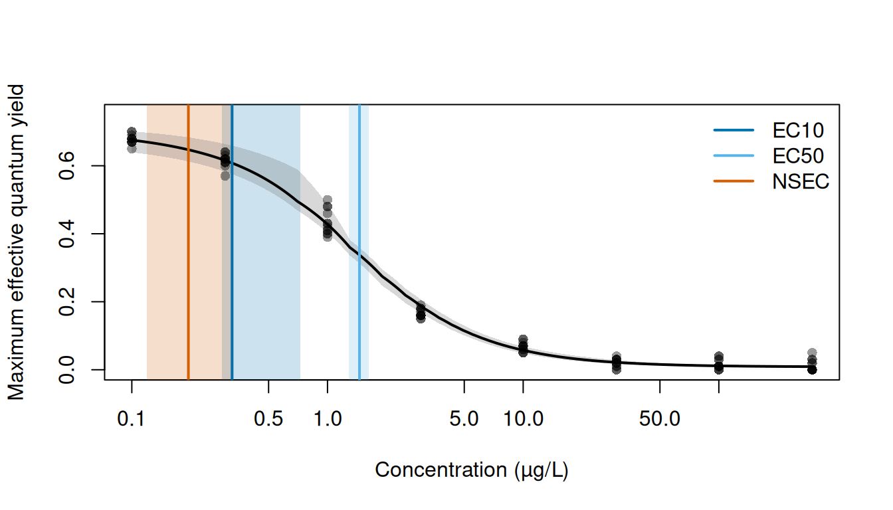
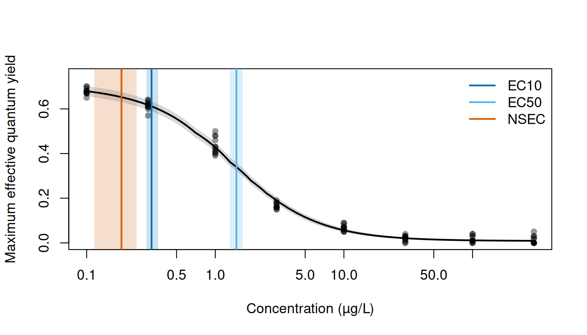
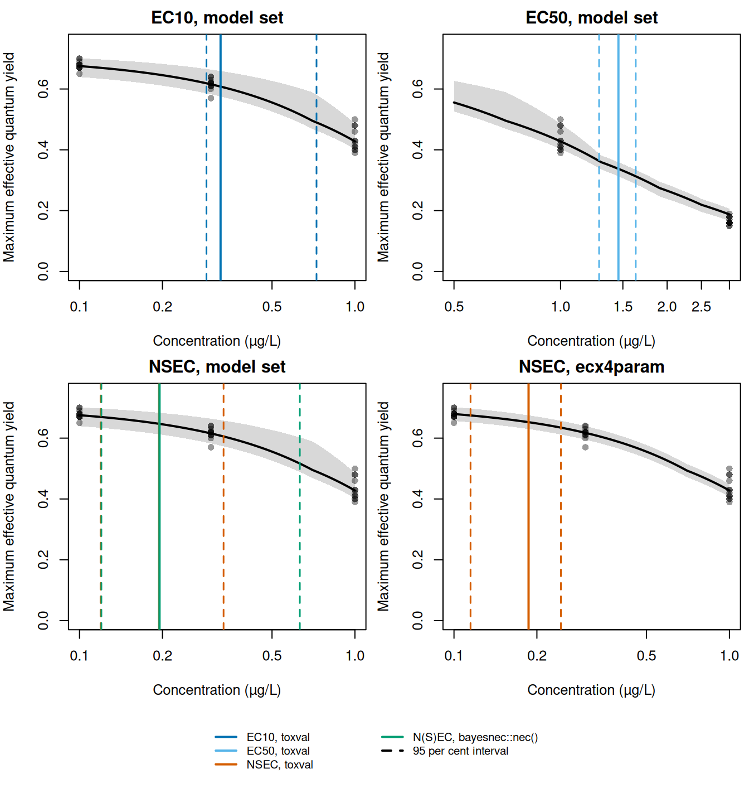

# The bayesnec case study

Here we apply toxval’s
[`ecx()`](https://open-aims.github.io/toxval/reference/ecx.md) and
[`nsec()`](https://open-aims.github.io/toxval/reference/nsec.md) to the
two kinds of object returned by
[`bnec()`](https://open-aims.github.io/bayesnec/reference/bnec.html) in
the `bayesnec` package: a fit of a single equation (class
`bayesnecfit`), and a model set that weights several equations and
averages them (class `bayesmanecfit`). The example is the ametryn series
of
[`bayesnec::herbicide`](https://open-aims.github.io/bayesnec/reference/herbicide.html),
to which we fitted the `decline` set of `bayesnec` equations. The single
fit is one equation taken from this set (`ecx4param`). Because
`bayesnec` computes the ECx and the NSEC itself, we also compare the
estimates with those returned by its own
[`ecx()`](https://open-aims.github.io/toxval/reference/ecx.md),
[`nsec()`](https://open-aims.github.io/toxval/reference/nsec.md) and
[`nec()`](https://open-aims.github.io/bayesnec/reference/nec.html), and
identify the settings under which the two packages give the same values.
The definitions of the ECx and the NSEC used by toxval are given in the
vignettes on the
[ECx](https://open-aims.github.io/toxval/articles/ecx-definition.html)
and the
[NSEC](https://open-aims.github.io/toxval/articles/nsec-definition.html).

Because `bayesnec` also exports functions named
[`ecx()`](https://open-aims.github.io/toxval/reference/ecx.md) and
[`nsec()`](https://open-aims.github.io/toxval/reference/nsec.md),
whichever package is attached later masks the functions of the other
when both are attached. We therefore do not attach `bayesnec`, and call
its functions as
[`bayesnec::ecx()`](https://open-aims.github.io/bayesnec/reference/ecx.html)
and
[`bayesnec::nsec()`](https://open-aims.github.io/bayesnec/reference/nsec.html).

## The data and the fitted models

The response is the maximum effective quantum yield of the symbiotic
dinoflagellates of the coral *Seriatopora hystrix*, measured after 10
hours’ exposure to the herbicide ametryn in the experiment of Jones and
Kerswell (2003), which Fisher et al. (2024) describe as it applies to
these data. The columns are documented in
[`?bayesnec::herbicide`](https://open-aims.github.io/bayesnec/reference/herbicide.html).

``` r

ametryn <- bayesnec::herbicide[bayesnec::herbicide$herbicide == "ametryn", ]
concentrations <- sort(unique(ametryn$concentration))
concentrations
#> [1]   0.1   0.3   1.0   3.0  10.0  30.0 100.0 300.0
```

The series contains 96 observations at 8 concentrations, from 0.1 to 300
µg/L, with each concentration about three times the one below it, and
the model is fitted on `log(concentration)`. The control is recorded as
0 in the source data. However, the script that builds the dataset in the
`bayesnec` source repository (`data-raw/herbicide_data.R`) sets it to
0.1, so the control is the lowest concentration in the series.

We fitted the model set once (in the script
`data-raw/vignette_fits_bayesnec.R`) with the call below:

``` r

fit <- bayesnec::bnec(
  fvfm ~ crf(log(concentration), model = "decline"),
  data = ametryn,
  family = brms::Beta(link = "identity"),
  seed = 17,
  thin = 4,
  control = list(adapt_delta = 0.99, max_treedepth = 12)
)
```

``` r

stored <- readRDS(file.path("fits", "bayesnec_ametryn_decline.rds"))
settings <- stored$provenance$settings
ametryn_set <- stored$fit
ametryn_single <- suppressMessages(
  bayesnec::pull_out(ametryn_set, model = "ecx4param")
)
class(ametryn_set)
#> [1] "bayesmanecfit" "bnecfit"
class(ametryn_single)
#> [1] "bayesnecfit" "bnecfit"
```

Each equation was sampled with 4 chains of 10000 iterations (8000 of
them warmup) using `rstan`, the default backend of `brms`. With
`thin = 4` only one in four post-warmup draws is kept, so the stored
file contains a quarter of them.

``` r

weights <- ametryn_set$mod_stats[, c("model", "wi")]
weights <- weights[order(weights$wi, decreasing = TRUE), ]
knitr::kable(
  weights,
  digits = 3,
  row.names = FALSE,
  col.names = c("equation", "weight")
)
```

| equation  | weight |
|:----------|-------:|
| ecx4param |  0.310 |
| ecxll4    |  0.307 |
| ecxll5    |  0.218 |
| ecxwb2    |  0.083 |
| nec4param |  0.031 |
| nec3param |  0.024 |
| ecxwb1    |  0.015 |
| ecxwb2p3  |  0.011 |
| ecxll3    |  0.000 |
| ecxexp    |  0.000 |
| ecxwb1p3  |  0.000 |

We fitted 11 equations of the `decline` set, each with 2000 retained
draws, and all of them pass
[`bayesnec::check_sampling()`](https://open-aims.github.io/bayesnec/reference/check_sampling.html)
at its default thresholds. The largest weights are those of `ecx4param`
(0.310) and `ecxll4` (0.307), whereas the equations that include a `nec`
parameter (`nec4param` and `nec3param`) have a combined weight of 0.055.

[`toxval_predict()`](https://open-aims.github.io/toxval/reference/toxval_predict.md)
evaluates each realisation of the model set over the range of
concentrations in the data. For a `bayesmanecfit` the realisations are
the draws that `bayesnec` keeps from each equation in proportion to its
weight, and these are also the draws used by the estimates and plots of
`bayesnec`. We make the prediction once and pass it to both
[`ecx()`](https://open-aims.github.io/toxval/reference/ecx.md) and
[`nsec()`](https://open-aims.github.io/toxval/reference/nsec.md), so
that the curves are not evaluated again for each call.

``` r

pred_set <- toxval_predict(ametryn_set)
table(pred_set$meta$draw_model)
#> 
#> ecx4param    ecxll4    ecxll5    ecxwb1    ecxwb2  ecxwb2p3 nec3param nec4param 
#>       619       614       437        30       167        23        48        62
```

The averaged curve has 2000 realisations, each drawn from a single
equation.



Figure 1: The ametryn series (grey points), with the posterior median of
the model-averaged curve (black line) and its 95 per cent credible band
(grey). Vertical lines mark the medians of the decreasing EC10 (dark
blue), EC50 (light blue) and NSEC (vermillion) of the model set, and the
shaded bands of the same colours their 95 per cent credible intervals.
Concentration is on a log scale.

The mean response is close to 0.68 at the control and declines to 0.013
at 300 µg/L, with 82 per cent of this decline occurring between 0.3 and
10 µg/L ([Figure 1](#fig-set)). At each concentration the median curve
is within 0.021 of the observed mean, and the largest departure is at 3
µg/L.

The estimates marked in [Figure 1](#fig-set) are the model-set estimates
given under *A model set*. The EC10 interval is asymmetric, extending 11
times as far above the median as below it (to 0.725 µg/L), and its lower
part overlaps the NSEC interval, which ends at 0.334 µg/L.

## A single-equation fit

We took `ecx4param`, the equation with the highest weight in the set,
from the model set as a single fit with
[`bayesnec::pull_out()`](https://open-aims.github.io/bayesnec/reference/pull_out.html).
We then requested the EC10 and EC50 from
[`ecx()`](https://open-aims.github.io/toxval/reference/ecx.md) and the
NSEC from
[`nsec()`](https://open-aims.github.io/toxval/reference/nsec.md), at
their defaults (`type = "absolute"` and `sig_val = 0.01`).

``` r

single_ecx <- ecx(ametryn_single, proportion = c(0.1, 0.5))
single_ecx
#> # A tibble: 4 × 10
#> # Model:    bayesnecfit
#> # Settings: resolution 500 | 2000 posterior draws
#>   metric direction  estimate conf.low conf.high proportion type     control
#>   <chr>  <chr>         <dbl>    <dbl>     <dbl>      <dbl> <chr>      <dbl>
#> 1 ecx    decreasing    0.320    0.292     0.359        0.1 absolute   0.679
#> 2 ecx    increasing   NA       NA        NA            0.1 absolute   0.679
#> 3 ecx    decreasing    1.46     1.29      1.64         0.5 absolute   0.679
#> 4 ecx    increasing   NA       NA        NA            0.5 absolute   0.679
#> # ℹ 2 more variables: reference <dbl>, asymptote <dbl>
single_nsec <- nsec(ametryn_single)
single_nsec
#> # A tibble: 2 × 14
#> # Model:    bayesnecfit
#> # Settings: resolution 500 | 2000 posterior draws
#>   metric direction  estimate conf.low conf.high sig_val type     anchor control
#>   <chr>  <chr>         <dbl>    <dbl>     <dbl>   <dbl> <chr>    <chr>    <dbl>
#> 1 nsec   decreasing    0.187    0.115     0.244    0.01 absolute model    0.679
#> 2 nsec   increasing   NA       NA        NA        0.01 absolute model    0.679
#> # ℹ 5 more variables: reference <dbl>, asymptote <dbl>, ecnsec <dbl>,
#> #   ecnsec.low <dbl>, ecnsec.high <dbl>
```

The decreasing EC10 is 0.320 \[0.292, 0.359\] µg/L and the decreasing
EC50 1.461 \[1.291, 1.638\] µg/L (medians with 95 per cent credible
intervals). Both are measured from a control of 0.679 (i.e. the median
predicted response at the lowest concentration in the data, 0.1 µg/L),
which is the default of `x_control`. The decreasing NSEC, the
concentration at which each realisation of the curve falls below the
reference (0.652, the 0.01 quantile of the control realisations), is
0.187 \[0.115, 0.244\] µg/L. The `ecnsec` column gives the effect at the
NSEC as a proportion of the control (0.039 at the median, i.e. a decline
of 3.9 per cent). Each column of the result, and the default that sets
it, is described in the [`brms` case
study](https://open-aims.github.io/toxval/articles/case-brms.html#tbl-nsec-columns).



Figure 2: The ametryn series (grey points), with the posterior median of
the `ecx4param` curve (black line) and its 95 per cent credible band
(grey). Vertical lines mark the medians of the decreasing EC10 (dark
blue), EC50 (light blue) and NSEC (vermillion) of `ecx4param`, and the
shaded bands of the same colours their 95 per cent credible intervals.
Concentration is on a log scale.

For `ecx4param` the NSEC interval ends at 0.244 µg/L, below the lower
limit of the EC10 interval (0.292 µg/L; [Figure 2](#fig-single)),
whereas for the model set the NSEC and EC10 intervals overlap
([Figure 1](#fig-set)). The EC10 interval of `ecx4param` is also
narrower, at 0.067 µg/L compared with 0.436 µg/L for the model set.

The estimates for the increasing direction are `NA`, because no
realisation of this declining curve rises to its increasing reference
within the range of the data. toxval returns both directions for each
curve.

## A model set

For the model set we pass the prediction made above (`pred_set`) to
[`ecx()`](https://open-aims.github.io/toxval/reference/ecx.md) and
[`nsec()`](https://open-aims.github.io/toxval/reference/nsec.md).

``` r

set_ecx <- ecx(pred_set, proportion = c(0.1, 0.5))
set_ecx
#> # A tibble: 4 × 10
#> # Model:    bayesmanecfit
#> # Settings: resolution 500 | 2000 posterior draws
#>   metric direction  estimate conf.low conf.high proportion type     control
#>   <chr>  <chr>         <dbl>    <dbl>     <dbl>      <dbl> <chr>      <dbl>
#> 1 ecx    decreasing    0.325    0.289     0.725        0.1 absolute   0.675
#> 2 ecx    increasing   NA       NA        NA            0.1 absolute   0.675
#> 3 ecx    decreasing    1.46     1.28      1.63         0.5 absolute   0.675
#> 4 ecx    increasing   NA       NA        NA            0.5 absolute   0.675
#> # ℹ 2 more variables: reference <dbl>, asymptote <dbl>
set_nsec <- nsec(pred_set)
set_nsec
#> # A tibble: 2 × 14
#> # Model:    bayesmanecfit
#> # Settings: resolution 500 | 2000 posterior draws
#>   metric direction  estimate conf.low conf.high sig_val type     anchor  control
#>   <chr>  <chr>         <dbl>    <dbl>     <dbl>   <dbl> <chr>    <chr>     <dbl>
#> 1 nsec   decreasing    0.195    0.119     0.334    0.01 absolute compon…   0.675
#> 2 nsec   increasing   NA       NA        NA        0.01 absolute compon…   0.675
#> # ℹ 5 more variables: reference <dbl>, asymptote <dbl>, ecnsec <dbl>,
#> #   ecnsec.low <dbl>, ecnsec.high <dbl>
```

The model-averaged decreasing EC10 is 0.325 \[0.289, 0.725\] µg/L, the
EC50 1.457 \[1.285, 1.631\] µg/L and the NSEC 0.195 \[0.119, 0.334\]
µg/L. Because the ECx of each realisation is measured from its own
control, the ECx of the model set is a weighted mixture of the ECx
realisations of the individual equations. For the NSEC of a
`bayesmanecfit`,
[`nsec()`](https://open-aims.github.io/toxval/reference/nsec.md) by
default (`anchor = "component"`) takes the reference of each equation
from that equation’s own control (i.e. the 0.01 quantile of its control
over all 2000 draws of its fit). The `reference` column gives the median
of these references across the 2000 realisations (0.652), and the effect
at the median NSEC is 4.1 per cent.

## The NSEC reference under model averaging

For a model-averaged fit, the source of the NSEC reference is set by the
`anchor` argument of
[`nsec()`](https://open-aims.github.io/toxval/reference/nsec.md),
described in the [NSEC
vignette](https://open-aims.github.io/toxval/articles/nsec-definition.html#the-anchor-argument).
The default for a `bayesmanecfit`, used above, is
`anchor = "component"`, which takes the reference of each equation from
that equation’s own control over all draws of its fit, as
[`bayesnec::nsec()`](https://open-aims.github.io/bayesnec/reference/nsec.html)
does. In contrast, `anchor = "model"` takes a single reference for the
whole set from the pooled control realisations of the averaged curve.
The realisations of each equation are then compared with this reference,
and the NSEC is summarised over all of them.

``` r

p_nsec <- decreasing(nsec(pred_set, anchor = "model"))
p_nsec[, c("estimate", "conf.low", "conf.high", "reference", "anchor")]
#> # A tibble: 1 × 5
#> # Model:    bayesmanecfit
#> # Settings: resolution 500 | 2000 posterior draws
#>   estimate conf.low conf.high reference anchor
#>      <dbl>    <dbl>     <dbl>     <dbl> <chr> 
#> 1    0.236    0.132     0.297     0.635 model
```

We can read the reference of each equation in the set, and the pooled
reference, from the prediction.

``` r

control <- pred_set$curves[[1]][, 1]
model <- pred_set$meta$draw_model
in_set <- unique(model)
# each equation's reference: the 0.01 quantile of its control over every draw of
# its fit
own_ref <- vapply(
  pred_set$meta$model_control[[1]],
  function(x) unname(stats::quantile(x[is.finite(x)], 0.01)),
  numeric(1)
)
references <- data.frame(
  realisations = as.vector(table(model)[in_set]),
  reference = own_ref[in_set],
  row.names = in_set
)
references <- rbind(
  references,
  pooled = data.frame(realisations = length(control), reference = quantile(control, 0.01))
)
knitr::kable(references, digits = 3)
```

|           | realisations | reference |
|:----------|-------------:|----------:|
| nec3param |           48 |     0.625 |
| nec4param |           62 |     0.622 |
| ecx4param |          619 |     0.652 |
| ecxwb1    |           30 |     0.665 |
| ecxwb2    |          167 |     0.632 |
| ecxwb2p3  |           23 |     0.643 |
| ecxll5    |          437 |     0.642 |
| ecxll4    |          614 |     0.652 |
| pooled    |         2000 |     0.635 |

The pooled reference (0.635) is below the references of `ecx4param`
(0.652) and `ecxll4` (0.652), the equations with most of the weight. The
equations that include a `nec` parameter predict lower controls
(references of 0.622 and 0.625), and although they supply only 5.5 per
cent of the realisations, they account for 75 per cent of those at or
below the pooled reference. This suggests that the pooled reference is
set largely by their controls. Because a lower reference is crossed at a
higher concentration, `anchor = "model"` gives the realisations of
`ecx4param` and `ecxll4` a higher NSEC than their own references do. The
model-set NSEC is 0.236 \[0.132, 0.297\] µg/L with `anchor = "model"`,
compared with 0.195 \[0.119, 0.334\] µg/L under the default
`anchor = "component"` (which agrees with
[`bayesnec::nsec()`](https://open-aims.github.io/bayesnec/reference/nsec.html)
realisation by realisation; see *Comparison with bayesnec*).

## The asymptote type

With `type = "relative"`,
[`ecx()`](https://open-aims.github.io/toxval/reference/ecx.md) measures
the decline from the control to the lower asymptote of the equation (for
`ecx4param`, the `bot` parameter) rather than to zero. toxval takes the
asymptote from the
[`bnec()`](https://open-aims.github.io/bayesnec/reference/bnec.html) fit
at each draw: for an equation with a `bot` parameter it is the `bot`
draw, and for an equation whose curve declines to zero it is 0. However,
where an equation is fitted on a link other than the identity, `bot` is
on the link scale, and toxval refuses the type.

``` r

rel_single <- decreasing(ecx(ametryn_single, type = "relative"))
rel_single[, c("estimate", "conf.low", "conf.high", "type")]
#> # A tibble: 1 × 4
#> # Model:    bayesnecfit
#> # Settings: resolution 500 | 2000 posterior draws
#>   estimate conf.low conf.high type    
#>      <dbl>    <dbl>     <dbl> <chr>   
#> 1    0.317    0.289     0.355 relative
```

The relative EC10 of `ecx4param` is 0.317 \[0.289, 0.355\] µg/L, below
the absolute EC10 of 0.320 \[0.292, 0.359\] µg/L, because the 10 per
cent decline is measured to the fitted lower asymptote rather than to
zero.

## Comparison with bayesnec

Under `type = "absolute"`, toxval and `bayesnec` both take the control
from the curve at the lowest concentration and interpolate linearly
between the concentrations at which the curve is evaluated. At their
defaults, the two packages also evaluate the curve at the same
concentrations and return estimates on the scale of the variable named
inside `crf()` (here `concentration`). `bayesnec` returns the decreasing
direction only. The decreasing ECx and NSEC of each realisation should
therefore agree between the packages, and we compared them realisation
by realisation for the single fit and the model set.

``` r

draws_of <- function(x, proportion = NULL) {
  decreasing(x, proportion)$draws[[1]]$value.draw
}
set_draws <- ecx(pred_set, proportion = c(0.1, 0.5), draws = TRUE)
pairs <- list(
  `EC10, ecx4param` = list(
    tv = draws_of(ecx(ametryn_single, draws = TRUE)),
    bn = bayesnec::ecx(ametryn_single, ecx_val = 10, posterior = TRUE)
  ),
  `NSEC, ecx4param` = list(
    tv = draws_of(nsec(ametryn_single, draws = TRUE)),
    bn = bayesnec::nsec(ametryn_single, posterior = TRUE)
  ),
  `EC10, model set` = list(
    tv = draws_of(set_draws, 0.1),
    bn = bayesnec::ecx(ametryn_set, ecx_val = 10, posterior = TRUE)
  ),
  `EC50, model set` = list(
    tv = draws_of(set_draws, 0.5),
    bn = bayesnec::ecx(ametryn_set, ecx_val = 50, posterior = TRUE)
  ),
  `NSEC, model set` = list(
    tv = draws_of(nsec(pred_set, draws = TRUE)),
    bn = bayesnec::nsec(ametryn_set, posterior = TRUE)
  )
)
differences <- lapply(pairs, function(p) abs(p$tv - as.numeric(p$bn)))
data.frame(
  realisations = vapply(differences, length, 1),
  `largest difference` = vapply(differences, function(d) sci(max(d)), ""),
  identical = vapply(differences, function(d) sum(d == 0), 1),
  check.names = FALSE
)
#>                 realisations largest difference identical
#> EC10, ecx4param         2000            5.6e-16       829
#> NSEC, ecx4param         2000            0.0e+00      2000
#> EC10, model set         2000            1.8e-05       849
#> EC50, model set         2000            1.8e-05       226
#> NSEC, model set         2000            0.0e+00      2000
```

For every estimate and realisation, the two packages differ by at most
1.8e-05 µg/L, and many realisations show no difference at all. Any
difference arises because `bayesnec` locates each crossing numerically
with [`stats::uniroot()`](https://rdrr.io/r/stats/uniroot.html) (through
[`modelbased::zero_crossings()`](https://easystats.github.io/modelbased/reference/zero_crossings.html)),
at its default tolerance, whereas toxval computes the crossing exactly.
The agreement also shows that both packages use identical draws in
identical order and, for the model set, take the NSEC reference of each
equation from identical control draws.

The table below gives the summaries a user of each package would see:
the model-averaged EC10, EC50 and NSEC of the set, and the NSEC and
relative EC10 of `ecx4param`, from
[`bayesnec::ecx()`](https://open-aims.github.io/bayesnec/reference/ecx.html)
and
[`bayesnec::nsec()`](https://open-aims.github.io/bayesnec/reference/nsec.html)
and from toxval, each at its defaults. For the relative EC10,
`bayesnec::ecx(type = "relative")` measures the decline to the same
fitted asymptote as toxval.

``` r

bn <- function(f, ...) suppressMessages(as.numeric(f(...)))
rows <- list(
  `EC10, model set` = list(
    bn = bn(bayesnec::ecx, ametryn_set, ecx_val = 10),
    tv = m_ec10
  ),
  `EC50, model set` = list(
    bn = bn(bayesnec::ecx, ametryn_set, ecx_val = 50),
    tv = m_ec50
  ),
  `NSEC, model set` = list(
    bn = bn(bayesnec::nsec, ametryn_set),
    tv = m_nsec
  ),
  `NSEC, ecx4param` = list(
    bn = bn(bayesnec::nsec, ametryn_single),
    tv = s_nsec
  ),
  `Relative EC10, ecx4param` = list(
    bn = bn(bayesnec::ecx, ametryn_single, ecx_val = 10, type = "relative"),
    tv = rel_single
  )
)
#> Warning: type = "relative" now measures from the control to the equation's
#> theoretical asymptote (the bot parameter, or 0 where the equation has none). Up
#> to bayesnec 2.1.3 it measured from the maximum of the predicted curve to its
#> minimum, which is now type = "range". The two differ for a hormetic curve and
#> wherever the equation has a bot parameter.
comparison <- data.frame(
  bayesnec = vapply(rows, function(r) est_bn(r$bn), ""),
  toxval = vapply(rows, function(r) est(r$tv), ""),
  check.names = FALSE
)
knitr::kable(comparison)
```

|                          | bayesnec               | toxval                 |
|:-------------------------|:-----------------------|:-----------------------|
| EC10, model set          | 0.325 \[0.289, 0.725\] | 0.325 \[0.289, 0.725\] |
| EC50, model set          | 1.457 \[1.285, 1.631\] | 1.457 \[1.285, 1.631\] |
| NSEC, model set          | 0.195 \[0.119, 0.334\] | 0.195 \[0.119, 0.334\] |
| NSEC, ecx4param          | 0.187 \[0.115, 0.244\] | 0.187 \[0.115, 0.244\] |
| Relative EC10, ecx4param | 0.317 \[0.289, 0.355\] | 0.317 \[0.289, 0.355\] |

The medians and intervals from `bayesnec` agree with those from toxval,
as expected from the realisation-by-realisation comparison. Both
packages also give a realisation whose control is already at or below
the NSEC reference the lowest concentration (0.1 µg/L) as its NSEC. For
example, toxval assigns this value to 20 realisations of `ecx4param`,
and `bayesnec` gives each of them this value as well.

`bayesnec` also exports
[`nec()`](https://open-aims.github.io/bayesnec/reference/nec.html),
which returns a different quantity, the N(S)EC. For the realisations of
the equations that include a `nec` parameter (`nec4param` and
`nec3param`), it returns that parameter (medians of 0.646 and 0.600
µg/L), and for the other equations it returns the NSEC computed by
[`bnec()`](https://open-aims.github.io/bayesnec/reference/bnec.html)
when the set was fitted. toxval does not return the `nec` parameter.
Instead, it computes an NSEC from the curve for every realisation. The
model-set N(S)EC from
[`bayesnec::nec()`](https://open-aims.github.io/bayesnec/reference/nec.html)
is 0.195 \[0.120, 0.631\] µg/L, compared with an NSEC of 0.195 \[0.119,
0.334\] µg/L from toxval ([Figure 3](#fig-comparison)).



Figure 3: The rows of the table, each on the curve it is computed from:
the model-averaged curve for the first three panels and `ecx4param` for
the last. Grey points: the ametryn series. Black line and grey band: the
posterior median and 95 per cent credible band. Solid vertical lines
mark each median and dashed lines of the same colour its 95 per cent
credible interval: toxval in the colour of the estimate (dark blue EC10,
light blue EC50, vermillion NSEC), which is also `bayesnec`; and, for
the model-set NSEC, the N(S)EC from
[`bayesnec::nec()`](https://open-aims.github.io/bayesnec/reference/nec.html)
(green). Concentration is on a log scale, over a range chosen for each
panel.

## Provenance

    toxval rendered:      94c21a5dcc3ba32526f83e42bbbbf27899252323 (2.0.0)
    toxval at fitting:    016402dad441ad9c76c5dc9704b16cbd3c19c2d5
    fitted on:            2026-11-02 05:30 UTC
    fitting time:         31.3 min
    stored fit:           fits/bayesnec_ametryn_decline.rds, 2.10 MB
    seed:                 17
    backend:              rstan
    draws per equation:   2000 (4 chains, iter 10000, warmup 8000, thin 4)
    fitting R:            R version 4.6.1 (2026-06-24)
    fitting packages:     bayesnec 2.1.3.43, brms 2.23.0, rstan 2.32.7, StanHeaders 2.32.10, loo 2.8.0
    rendering R:          R version 4.6.2 (2026-10-29)
    rendering bayesnec:   2.1.3.44 (52a124d13306050cc1f409834fbaa788cb74007e)
    rendering brms:       2.23.0

The data are
[`bayesnec::herbicide`](https://open-aims.github.io/bayesnec/reference/herbicide.html),
from Jones, R. J. and Kerswell, A. P. (2003), Phytotoxicity of
photosystem II (PSII) herbicides to coral, *Marine Ecology Progress
Series* 261, 149–159, <https://doi.org/10.3354/meps261149>. The
experiment, as it applies to these data, is described by Fisher, R.,
Barneche, D. R., Ricardo, G. F. and Fox, D. R. (2024), bayesnec: an R
package for concentration-response modeling and estimation of toxicity
metrics, *Journal of Statistical Software* 110(5), 1–41,
<https://doi.org/10.18637/jss.v110.i05>. The fit is made by
`data-raw/vignette_fits_bayesnec.R`, which records the settings above
with the stored object.
