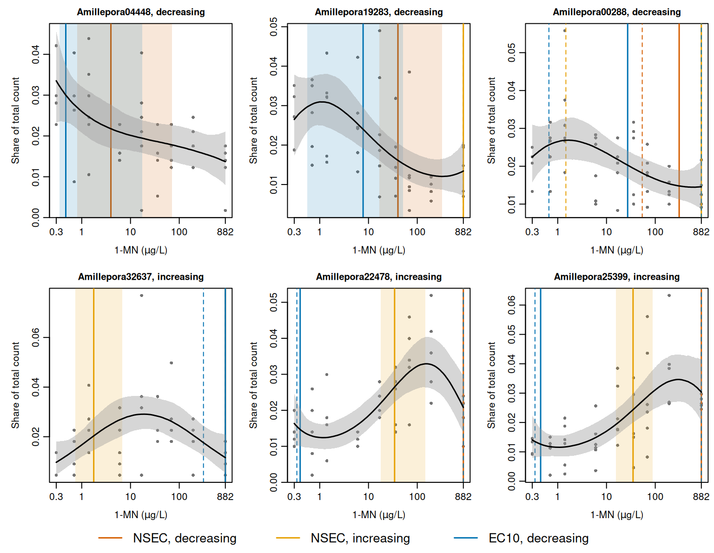

# The multivariate brms case study

This case study shows how NSECs and ECx values are estimated with toxval
from a multivariate
[`brm()`](https://paulbuerkner.com/brms/reference/brm.html) fit, in
which each response is fitted as a separate curve and some responses
decrease with concentration while others increase. It also shows how
toxval measures the size of an increase for a beta-binomial response
whose number of trials is the gene’s total count rather than a ceiling
on the response.

The data and the fit are from the gene expression analysis of Luter et
al. (in review), in which one multivariate model with a beta-binomial
response for each gene was fitted with
[`brm()`](https://paulbuerkner.com/brms/reference/brm.html), and an NSEC
was estimated for each gene in each direction (i.e. for a decrease and
for an increase in expression). We take six of those genes, together
with the posterior draws of the original fit. The NSEC and the ECx are
defined in the vignettes on the
[NSEC](https://open-aims.github.io/toxval/articles/nsec-definition.html)
and the
[ECx](https://open-aims.github.io/toxval/articles/ecx-definition.html).

## The study and the data

Larvae of *A. millepora* were exposed to 1-methylnaphthalene (1-MN) for
48 h at 8 concentrations (measured at 0.7 to 882 µg/L) and a control. In
all, 48 samples were sequenced (4 to 6 per concentration), and the read
counts were batch-corrected with `sva` to account for RNA extractions
performed on different days. Genes whose expression changed with
concentration were then selected with `DRomics` (at a false discovery
rate of 0.05), and a concentration-response model was fitted to each.
The 78 genes fitted by `DRomics` are those modelled here. The original
analysis chose one direction for each gene by the rule described under
NSECs below, which classed 53 of the 78 genes as decreasing and 25 as
increasing. It then retained the 52 genes (27 decreasing and 25
increasing) for which the NSEC in that direction was below the highest
concentration.

For each gene and sample, the response is the gene’s count in that
sample and the number of trials is the gene’s total count over all 48
samples, so that each observation is that sample’s share of the gene’s
total. Although a count cannot exceed this total, the total is not a
level that expression approaches (it is the same for every sample of a
gene, and sets the scale of the curve but not its shape), and it does
not bound an increase in expression. As in the original analysis, the
control samples (with a measured concentration of 0) are placed at 0.3
µg/L so that concentration can be log-transformed.

We use six genes, three retained as decreasing and three as increasing
([Table 1](#tbl-genes)), which include the genes with the smallest and
the largest number of trials of the 78.

| Gene            | Retained direction |  Trials |
|:----------------|:-------------------|--------:|
| Amillepora04448 | decreasing         |     570 |
| Amillepora19283 | decreasing         |  16,045 |
| Amillepora00288 | decreasing         |   1,201 |
| Amillepora32637 | increasing         |     221 |
| Amillepora22478 | increasing         |     501 |
| Amillepora25399 | increasing         | 357,533 |

Table 1: The six genes, the direction for which the original analysis
retained each, and the number of trials (the gene’s total count over the
48 samples).

## The fit

We used the model of the original analysis, in which each gene has its
own cubic polynomial in log concentration and its own beta-binomial
precision, with the default priors of
[`brm()`](https://paulbuerkner.com/brms/reference/brm.html). Residual
correlations between genes are not modelled (`set_rescor(FALSE)`). In
outline:

``` r

formula <- bf(
  gene_Amillepora04448 | trials(n_Amillepora04448) ~
    poly(log_x, 3, raw = TRUE)
) +
  # one bf() for each of the other five genes
  set_rescor(FALSE)

fit <- brm(
  formula,
  data = dat_use,
  family = "beta_binomial",
  chains = 4,
  iter = 2000,
  warmup = 1000,
  init = 0,
  seed = 100
)
```

The original fit of all 78 genes is too large to store with the article.
However, because the genes share no parameter, the posterior of each
gene does not depend on whether it is fitted with the other 77 genes or
with five others, and the original draws for six genes are therefore a
sample from the six-gene model. The script `data-raw/fit_multivariate.R`
fits the six-gene model with the settings of the original analysis (4
chains of 2000 iterations, of which 1000 are warmup, giving 4,000
posterior draws). It checks that the data and the default priors equal
those of the original fit for these genes, and then replaces the draws
with the original fit’s draws for the corresponding parameters, chain by
chain and iteration by iteration (`data-raw/original_draws.R`). The
stored fit therefore gives the estimates of the original fit, and not
estimates that differ from them by Monte Carlo error. The posterior
summaries of the 30 parameters (an intercept, three polynomial
coefficients and a precision for each gene) equal those of the original
fit. In the original run the largest $`\hat{R}`$ was 1.004, the smallest
ratio of effective sample size to draws was 0.63, and no transitions
were divergent.

## NSECs

We apply
[`nsec()`](https://open-aims.github.io/toxval/reference/nsec.md) to the
fit, with `x_var` naming the predictor. It reads the six responses and
their trials from the fit, evaluates the curve of each gene at 500
values of `log_x` spanning the data, once per draw, and returns one row
for each gene and direction, with the NSECs back-transformed to µg/L by
`xform = exp`. Each beta-binomial response is predicted at one trial, so
that each curve is the expected share of the gene’s total count. The
result also gives `ecnsec`, the effect at the NSEC as a proportion of
the span named by `type`. Under the default `type = "absolute"` the
decreasing span is the control, so the decreasing `ecnsec` is the
proportional decrease from the control. The increasing span is described
under *The gene total as the number of trials*.

``` r

nsec_genes <- nsec(fit, x_var = "log_x", xform = exp, draws = TRUE)
#> Warning: Some realisations have no crossing within the evaluated range, so a reported quantile is at the highest concentration, or have no reference and were excluded. Consider a wider `x_range`.
#> * response geneAmillepora19283, increasing: 99.1% censored
#> * response geneAmillepora00288, decreasing: 35.6% censored
#> * response geneAmillepora00288, increasing: 97.0% censored
#> * response geneAmillepora32637, decreasing: 99.7% censored
#> * response geneAmillepora22478, decreasing: 98.0% censored
#> * response geneAmillepora25399, decreasing: 99.8% censored
nsec_genes[c(
  "direction",
  "response",
  "estimate",
  "conf.low",
  "conf.high",
  "ecnsec"
)]
#> # A tibble: 12 × 6
#> # Model:    brmsfit
#> # Settings: resolution 500 | 4000 posterior draws
#>    direction  response            estimate conf.low conf.high ecnsec
#>    <chr>      <fct>                  <dbl>    <dbl>     <dbl>  <dbl>
#>  1 decreasing geneAmillepora04448     3.96    0.800     70.9  0.351 
#>  2 increasing geneAmillepora04448    NA      NA         NA    0.0155
#>  3 decreasing geneAmillepora19283    40.2    16.6      324.   0.391 
#>  4 increasing geneAmillepora19283   882     882        882    0.0140
#>  5 decreasing geneAmillepora00288   309.     54.1      882    0.344 
#>  6 increasing geneAmillepora00288   882       1.47     882    0.0107
#>  7 decreasing geneAmillepora32637   882     882        882    0.593 
#>  8 increasing geneAmillepora32637     1.76    0.745      6.82 0.0107
#>  9 decreasing geneAmillepora22478   882     882        882    0.451 
#> 10 increasing geneAmillepora22478    34.3    17.7      145.   0.0103
#> 11 decreasing geneAmillepora25399   882     882        882    0.510 
#> 12 increasing geneAmillepora25399    35.1    15.8       88.7  0.0105
```

The control of each draw is its predicted response at the lowest
concentration in the data (0.3 µg/L), which is both the default of
`x_control` and the start of the grid.

The warning lists the rows in which a reported quantile falls among
draws that do not cross the reference within the tested range. These
draws are ranked above 882 µg/L, and an interval limit that falls among
them is reported as 882 µg/L. In the direction for which each gene was
not retained, between 97.0% and 99.9% of the draws are censored in this
way, and the estimate is 882 µg/L. The exception is the increasing row
of Amillepora04448, which is `NA` and is not listed because none of its
draws crosses the increasing reference. Of these draws, the 40 that
start above the reference fall below it and remain below it, so they
show no effect within the tested range and are censored with the rest.

For each gene, the original analysis kept the direction whose NSEC was
lower at the 0.8 quantile of its draws.
[`nsec()`](https://open-aims.github.io/toxval/reference/nsec.md) has no
argument for this rule, although the user can apply it as a filter on
the result returned with `draws = TRUE`:

``` r

lower <- nsec_genes |>
  dplyr::mutate(
    at_criterion = vapply(
      draws,
      \(d) quantile(d$value.draw, 0.8, na.rm = TRUE),
      numeric(1)
    )
  ) |>
  dplyr::group_by(response) |>
  dplyr::slice_min(at_criterion, n = 1, with_ties = FALSE) |>
  dplyr::ungroup()
lower[c("direction", "response", "estimate", "conf.low", "conf.high")]
#> # A tibble: 6 × 5
#>   direction  response            estimate conf.low conf.high
#>   <chr>      <fct>                  <dbl>    <dbl>     <dbl>
#> 1 decreasing geneAmillepora04448     3.96    0.800     70.9 
#> 2 decreasing geneAmillepora19283    40.2    16.6      324.  
#> 3 decreasing geneAmillepora00288   309.     54.1      882   
#> 4 increasing geneAmillepora32637     1.76    0.745      6.82
#> 5 increasing geneAmillepora22478    34.3    17.7      145.  
#> 6 increasing geneAmillepora25399    35.1    15.8       88.7
```

The filter keeps, for each gene, the direction that the original
analysis kept ([Table 1](#tbl-genes)).

## ECx

We apply [`ecx()`](https://open-aims.github.io/toxval/reference/ecx.md)
to the fit in the same way to obtain the EC10 of each gene in each
direction. Under the default `type = "absolute"`, the decreasing EC10 is
the concentration at which the curve falls 10% below its control. For a
response on the proportion scale, however, the increasing EC10 is based
on extra risk (i.e. it is the concentration at which the curve rises by
10% of the distance from the control to 1).

``` r

ec10 <- ecx(fit, x_var = "log_x", proportion = 0.1, xform = exp, draws = TRUE)
#> Warning: Some realisations have no crossing within the evaluated range, so a reported quantile is at the highest concentration, or have no reference and were excluded. Consider a wider `x_range`.
#> * response geneAmillepora00288, decreasing: 4.0% censored
#> * response geneAmillepora32637, decreasing: 71.2% censored
#> * response geneAmillepora22478, decreasing: 20.7% censored
#> * response geneAmillepora25399, decreasing: 36.0% censored
ec10[c(
  "direction",
  "response",
  "estimate",
  "conf.low",
  "conf.high",
  "control",
  "reference"
)]
#> # A tibble: 12 × 7
#> # Model:    brmsfit
#> # Settings: resolution 500 | 4000 posterior draws
#>    direction  response            estimate conf.low conf.high control reference
#>    <chr>      <fct>                  <dbl>    <dbl>     <dbl>   <dbl>     <dbl>
#>  1 decreasing geneAmillepora04448    0.471    0.353      17.3 0.0335    0.0302 
#>  2 increasing geneAmillepora04448   NA       NA          NA   0.0335    0.130  
#>  3 decreasing geneAmillepora19283    7.75     0.549      51.3 0.0265    0.0238 
#>  4 increasing geneAmillepora19283   NA       NA          NA   0.0265    0.124  
#>  5 decreasing geneAmillepora00288   27.2      0.659     882   0.0224    0.0202 
#>  6 increasing geneAmillepora00288   NA       NA          NA   0.0224    0.120  
#>  7 decreasing geneAmillepora32637  882      314.        882   0.00969   0.00872
#>  8 increasing geneAmillepora32637   NA       NA          NA   0.00969   0.109  
#>  9 decreasing geneAmillepora22478    0.397    0.340     882   0.0163    0.0147 
#> 10 increasing geneAmillepora22478   NA       NA          NA   0.0163    0.115  
#> 11 decreasing geneAmillepora25399    0.446    0.341     882   0.0141    0.0126 
#> 12 increasing geneAmillepora25399   NA       NA          NA   0.0141    0.113
```

For the three decreasing genes, the decreasing EC10s range from 0.471 to
27.2 µg/L. The lowest (for Amillepora04448) is between the control at
0.3 µg/L and the lowest tested concentration (0.7 µg/L), a range in
which the curve is interpolated by the cubic. The increasing genes
Amillepora22478 and Amillepora25399 also have decreasing EC10s below 0.7
µg/L (with upper limits at 882 µg/L), because their median curves first
dip by 18% to 24% below the control before they rise
([Figure 1](#fig-curves)). The warning lists the decreasing rows in
which a reported quantile falls among draws that do not fall 10% below
the control within the tested range. The largest share of such draws
(71.2%) is for Amillepora32637, whose decreasing EC10 is therefore 882
µg/L.

No gene has an increasing EC10, because no draw rises to its reference,
and each increasing row is therefore `NA`. The reference is 3.9 to 11
times the control, since 10% of the distance from a control share near
0.020 to 1 is several times the control itself, whereas the median
curves of the increasing genes rise to at most 3.0 times their control.
The span that sets this reference (the distance from the control to 1)
is discussed below under *The gene total as the number of trials*.

## Fitted curves and estimates

The curves in [Figure 1](#fig-curves) are drawn from
`toxval_predict(fit, x_var = "log_x")`, which returns the predicted
curves that
[`nsec()`](https://open-aims.github.io/toxval/reference/nsec.md) and
[`ecx()`](https://open-aims.github.io/toxval/reference/ecx.md) evaluate
above.



Figure 1: Each gene’s share of its total count in each sample (grey
points), the posterior median curve at one trial (black line) and its
95% credible band (grey). Solid vertical lines mark the medians of the
decreasing NSEC (vermillion), the increasing NSEC (orange) and the
decreasing EC10 (blue). A 95% interval is shaded in the colour of its
estimate, or bounded by dashed lines where it reaches the highest
concentration, 882 µg/L; a line at that concentration is an estimate
whose median draw does not cross its reference within the tested range.
The increasing EC10 of each gene, and the increasing NSEC of
Amillepora04448, are NA and are not drawn. The concentration axis is
logarithmic; the controls are plotted at 0.3 µg/L.

The control share of the six genes ranges from 0.0097 to 0.034
([Figure 1](#fig-curves)), on either side of the 0.021 expected for a
gene expressed equally in all 48 samples. The median curves of the
decreasing genes fall to between 41% and 65% of the control at 882 µg/L,
although those of Amillepora19283 and Amillepora00288 first rise by 17%
to 20% above it. In contrast, the median curves of the increasing genes
rise to a maximum of 2.0 to 3.0 times the control. The NSEC interval is
widest for Amillepora04448 (0.800 to 70.9 µg/L, a factor of 89) and
narrowest for Amillepora25399 (a factor of 5.6).

For each decreasing gene, the decreasing EC10 is below the decreasing
NSEC (0.471 to 27.2 µg/L, against 3.96 to 309 µg/L). For each of these
genes the NSEC reference (the 0.01 quantile of the control draws) is
lower than the EC10 reference (10% below the control), so the curve must
fall further to reach the NSEC reference. For each increasing gene, the
increasing NSEC (1.76 to 35.1 µg/L) is on the rising part of the median
curve, below the concentration of its peak (18.9 to 302 µg/L).

## The gene total as the number of trials

toxval predicts a binomial or beta-binomial response at one trial, so
that each curve is a proportion bounded at 1, and the increasing span of
`type = "absolute"` is 1 minus the control (i.e. extra risk). This span
is correct when the trials are a ceiling on the response, such as the
number of larvae offered. Here, however, the trials are the gene’s total
count over the 48 samples, which is the same for every sample of the
gene and therefore sets the scale of the curve but not its shape. The
control share of each gene is of the order of 1/48
([Figure 1](#fig-curves)), so the span is close to 1. The increasing
`ecnsec` (the effect at the NSEC as a proportion of the span) is then
measured against the gene’s total count rather than against its control,
and is close to 0 for each gene. toxval does not provide an option to
specify the increasing span.

Relative deviation (the increasing `absolute` span for a response with
no upper bound) expresses the change as a proportion of the control,
i.e. $`(R - y_0) / y_0`$ for the reference $`R`$ and the control $`y_0`$
of a draw, which is the fold change minus 1. The choice of span does not
affect the NSEC, because its reference is a quantile of the control
draws. Nor does it affect the decreasing `ecnsec`, because the
decreasing span is the control under either rule.

toxval does not return relative deviation for a beta-binomial response,
but its posterior median can be computed from the result of
[`nsec()`](https://open-aims.github.io/toxval/reference/nsec.md). The
reference $`R`$ is the same for every draw, and relative deviation
decreases as the control increases, so its posterior median is the
relative deviation at the median control, which
[`nsec()`](https://open-aims.github.io/toxval/reference/nsec.md) returns
in the `control` column:

``` r

increasing <- nsec_genes |>
  dplyr::filter(direction == "increasing") |>
  dplyr::mutate(relative_deviation = reference / control - 1)
increasing[c("response", "control", "reference", "ecnsec", "relative_deviation")]
#> # A tibble: 6 × 5
#> # Model:    brmsfit
#> # Settings: resolution 500 | 4000 posterior draws
#>   response            control reference ecnsec relative_deviation
#>   <fct>                 <dbl>     <dbl>  <dbl>              <dbl>
#> 1 geneAmillepora04448 0.0335     0.0485 0.0155              0.448
#> 2 geneAmillepora19283 0.0265     0.0401 0.0140              0.516
#> 3 geneAmillepora00288 0.0224     0.0329 0.0107              0.465
#> 4 geneAmillepora32637 0.00969    0.0203 0.0107              1.10 
#> 5 geneAmillepora22478 0.0163     0.0265 0.0103              0.619
#> 6 geneAmillepora25399 0.0141     0.0244 0.0105              0.733
```

In [Table 2](#tbl-trials) the increasing `ecnsec` that
[`nsec()`](https://open-aims.github.io/toxval/reference/nsec.md) returns
(extra risk) is set beside relative deviation and the decreasing
`ecnsec`.

| Gene | Trials | Control share | Decreasing | Increasing, extra risk | Increasing, relative deviation |
|:---|---:|---:|---:|---:|---:|
| Amillepora04448 | 570 | 0.0335 | 35% | 1.6% | 45% |
| Amillepora19283 | 16,045 | 0.0265 | 39% | 1.4% | 52% |
| Amillepora00288 | 1,201 | 0.0224 | 34% | 1.1% | 46% |
| Amillepora32637 | 221 | 0.00969 | 59% | 1.1% | 110% |
| Amillepora22478 | 501 | 0.0163 | 45% | 1.0% | 62% |
| Amillepora25399 | 357,533 | 0.0141 | 51% | 1.0% | 73% |

Table 2: The effect at the NSEC (`ecnsec`) of each gene, as the
posterior median per cent of its span. Trials is the gene’s total count
over the 48 samples, and the control is the posterior median of the
predicted control as a share of that total. The decreasing `ecnsec` and
the increasing `ecnsec` under extra risk are as
[`nsec()`](https://open-aims.github.io/toxval/reference/nsec.md) returns
them; the increasing `ecnsec` under relative deviation is computed from
the result of
[`nsec()`](https://open-aims.github.io/toxval/reference/nsec.md) as
above.

Under extra risk, the increasing `ecnsec` of the six genes (whose trials
range from 221 to 357,533) ranges from 1.0% to 1.6%. Under relative
deviation it ranges from 45% to 110%. Relative deviation is larger than
extra risk by a factor of 29 to 102, which to within 0.01% is
$`(1 - y_0) / y_0`$ (the ratio of the extra-risk span to the control) at
the median control. Extra risk places the six genes within a 1.5-fold
range of `ecnsec`, compared with a 2.5-fold range under relative
deviation. The decreasing `ecnsec`, which does not depend on the rule,
ranges from 34% to 59%. The extra-risk span also sets the reference of
the increasing EC10, and no gene attains that reference.

## Provenance

- Data: Luter et al., “Molecular responses to 1-methylnaphthalene in
  *Acropora millepora* larvae” (in review). The data are held in the
  [AIMS Data
  Repository](https://apps.aims.gov.au/metadata/view/f6e79a3a-78d4-4d0c-aa18-706cd29b5c50).
  The original script reads `BatchCorrectedData.csv`. The analysis
  folder contains the batch-corrected counts as `BECdata_wSampleID.csv`,
  and `data-raw/fit_multivariate.R` checks that the counts and trials
  built from it equal the data stored in the original fit for these six
  genes. The sample metadata are `Metadata_1-MN.csv` and the gene list
  `DromicsFittedGenesFDR0.05.csv`.
- Retained genes: `lower_NSECs_filtered_52genes.csv`, the original
  analysis’s list of the 52 retained genes and the direction retained
  for each; `toxval_nsec_lower_all78genes.csv`, the direction chosen for
  each of the 78 genes.
- Original fit: `fit3k_bb_DRomicsGenes_poly_iter1000.RData` (`brms`
  2.20.4, `rstan` 2.32.3). Its posterior summary for the six genes is
  stored in `fits/original.rds`.
- Model: `fit_brms_betaBinomial_poly_final.R` in
  [open-AIMS/coral-larvae-1-MN-toxicity](https://github.com/open-AIMS/coral-larvae-1-MN-toxicity).
- Stored fit: 6 genes, 4 chains of 2000 iterations with 1000 warmup,
  4,000 draws, `seed = 100`, `init = 0`. Compilation and sampling took
  144 s on 2026-10-25. The draws of every parameter were then replaced
  with those of the original fit; `lprior` and `lp__`, which the
  original sums over all 78 genes, are set to `NA`. The stored fit, with
  the compiled Stan program removed, is 2.1 MB.
- Software at fitting: R version 4.6.1 (2026-06-24); `brms` 2.23.0,
  `rstan` 2.32.7, `StanHeaders` 2.32.10, toxval 1.0.0.9000 at commit
  e961175039fb10842ecd177db04adede6f354aa9.
- Software at rendering: R version 4.6.2 (2026-10-29); toxval 2.0.0 at
  commit 94c21a5dcc3ba32526f83e42bbbbf27899252323.
