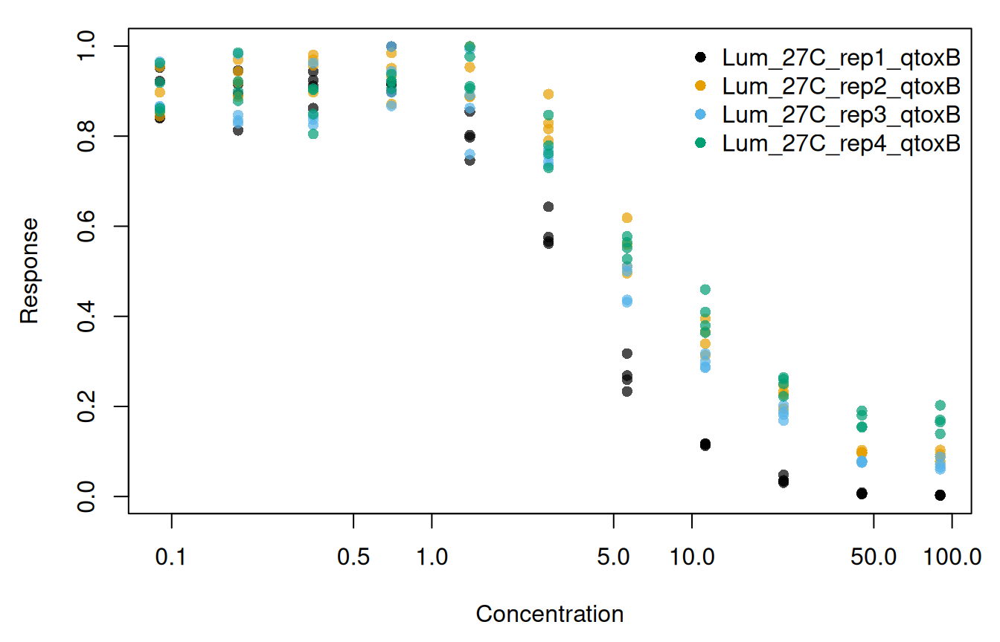
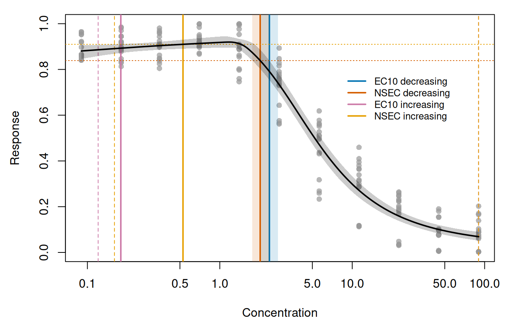
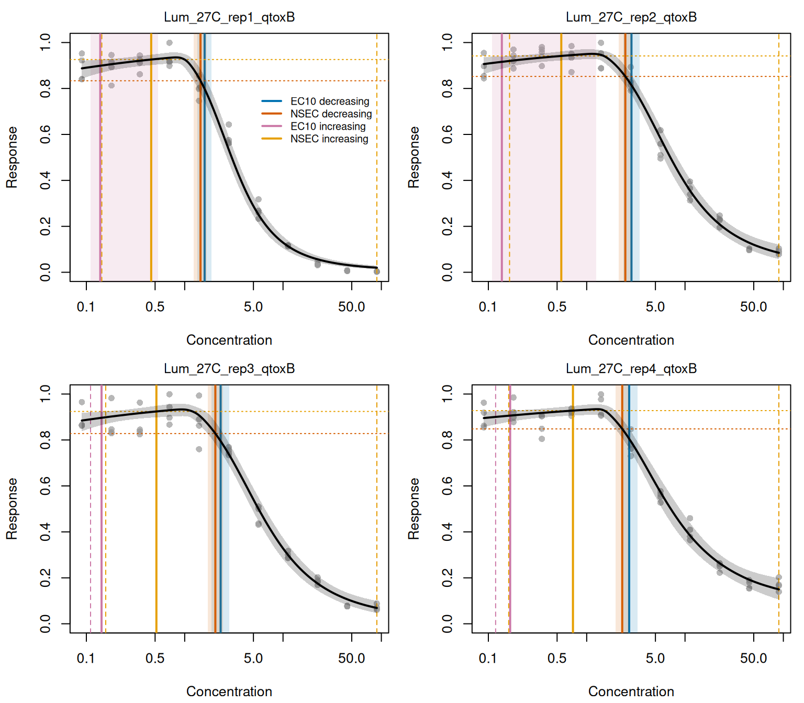
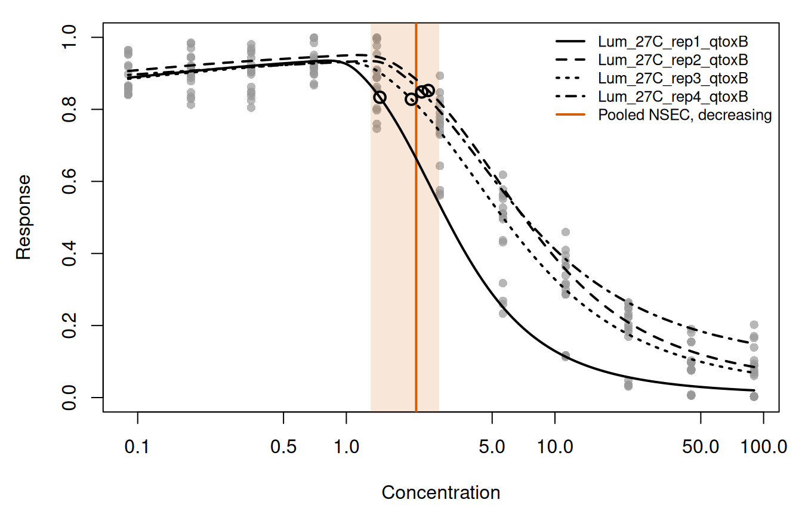
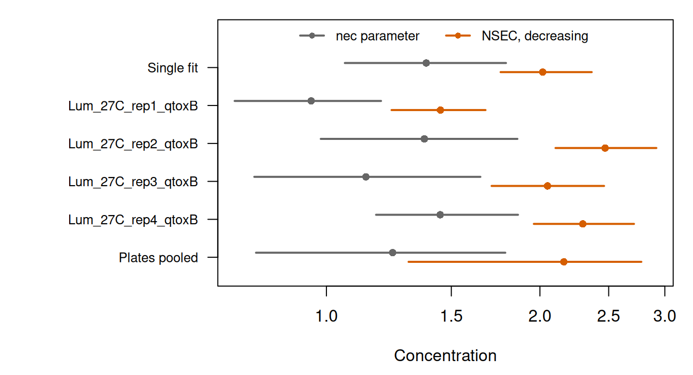

# Single and grouped brms fits

``` r

library(toxval)
```

Here we apply
[`ecx()`](https://open-aims.github.io/toxval/reference/ecx.md) and
[`nsec()`](https://open-aims.github.io/toxval/reference/nsec.md) to a
model fitted with
[`brm()`](https://paulbuerkner.com/brms/reference/brm.html) from the
`brms` package, first as a single curve and then with one curve for each
level of a factor. The definitions of both estimates are given in the
vignettes on the
[ECx](https://open-aims.github.io/toxval/articles/ecx-definition.html)
and the
[NSEC](https://open-aims.github.io/toxval/articles/nsec-definition.html).

The example is a toxicity assay repeated on replicate plates, with the
plate as the factor, and the fitted equation includes a hormesis term
(an initial rise in the response at low concentrations). The models were
fitted in advance by the script `data-raw/vignette_fits_brms.R`, and the
stored fits are read below, so that building the article requires
neither Stan nor the time needed for sampling. The software versions are
given under *Provenance*.

## The plate replicate assay

The data are from the bioluminescent bacterial toxicity assay of Luter
et al. (2025), in which the whole concentration series of one experiment
was run on a single plate. The plate was repeated in four experiments
with one contaminant, and each plate is a level of the factor
`plateRep`.

``` r

fit_single <- readRDS("fits/brms_plate_single.rds")$fit
fit_grouped <- readRDS("fits/brms_plate_grouped.rds")$fit
plates <- fit_grouped$data
head(plates[c("log_x", "plateRep", "y")])
#>       log_x           plateRep         y
#> 1 -2.407946 Lum_27C_rep1_qtoxB 0.8410503
#> 2 -2.407946 Lum_27C_rep1_qtoxB 0.8401287
#> 3 -2.407946 Lum_27C_rep1_qtoxB 0.9221791
#> 4 -2.407946 Lum_27C_rep1_qtoxB 0.9521653
#> 5 -1.714798 Lum_27C_rep1_qtoxB 0.8128610
#> 6 -1.714798 Lum_27C_rep1_qtoxB 0.8927248
```

The data contain 176 observations (4 plates, each with 4 wells at each
of 11 concentrations from 0.09 to 90). Concentration is stored as its
natural logarithm in `log_x`, and the response `y` is a proportion on
the open interval (0, 1). Each plate held artificial seawater controls
and a series of 1:2 dilutions of the toxicant, each in four wells (Luter
et al. 2025). However, the data contain no zero concentration. The
lowest concentration (0.09) is half the next (0.18), the ratio between
successive dilutions. We therefore take its wells to be the controls,
which were given the concentration of one further dilution so that the
logarithm is defined. Because `x_control` defaults to the lowest
concentration in the data, the control for all estimates below is the
predicted response at 0.09, which is also the start of the prediction
grid.

``` r

op <- par(mar = c(4.5, 4.5, 1, 1))
plot(
  exp(plates$log_x), plates$y,
  log = "x", pch = 16, col = adjustcolor(plate_cols[plates$plateRep], 0.7),
  xlab = "Concentration", ylab = "Response"
)
legend("topright", legend = plate_levels, col = plate_cols, pch = 16, bty = "n")
par(op)
```



Figure 1: The response of each well against concentration (log axis),
coloured by plate.

On each plate the response at the control was near 0.89, and it rose
slightly to a peak mean at the third to fifth concentration before
declining ([Figure 1](#fig-data)). The largest response in the data
(0.999) was recorded in 4 readings, at the fourth and fifth
concentrations, i.e. within that peak. The plates differ at the highest
concentration, where the mean of plate Lum_27C_rep1_qtoxB is 0.003,
whereas the means of the other three plates are 0.07 to 0.17. The rise
before the decline is hormesis, which an equation that can only decline
from the control could not follow, so the equation fitted below includes
a hormesis term.

## The model

We fitted a threshold equation with a hormesis term, written as a
nonlinear `brms` formula. Up to the threshold `nec`, the predictor is
`top` plus a linear rise in `log_x` with slope `exp(slope)`. Beyond
`nec`, the difference between that predictor and `bot` is multiplied by
an exponential decay with rate `exp(beta)`, so that the curve falls
towards the lower asymptote `bot`. The family is
[`Beta()`](https://paulbuerkner.com/brms/reference/brmsfamily.html),
whose default link is the logit, and the whole right-hand side of the
formula is therefore on the logit scale.

``` r

library(brms)

formula_nec <- y ~ bot +
  ((top + exp(slope) * log_x) - bot) *
    exp(-exp(beta) * (log_x - nec) * step(log_x - nec))

bf_single <- bf(formula_nec, bot + top + beta + nec + slope ~ 1, nl = TRUE)
bf_grouped <- bf(formula_nec, bot + top + beta + nec + slope ~ plateRep, nl = TRUE)
```

The single fit estimates one value for each parameter, whereas the
grouped fit estimates each parameter separately for each plate (as an
intercept, which is the value for the first plate, and the difference of
each other plate from it). In the grouped fit, `plateRep` is therefore a
population-level effect on each nonlinear parameter.

We give the priors in full below. For the single fit they are centred on
the data, i.e. on a response near 0.88 (logit 2) for `top` at
`log_x = 0` (a concentration of 1, which is where `top` is defined, and
not at the control), on a lower asymptote near 0.12 (logit -2) for
`bot`, and on a threshold inside the observed range of `log_x` for
`nec`. The grouped fit uses these priors for the intercepts, and its
plate differences are centred on 0 (no difference between plates). The
intercept priors and the difference priors are specified separately
because a prior written without `coef` applies to all coefficients of
its parameter.

``` r

prior_single <- c(
  prior(normal(2, 2), nlpar = "top"),
  prior(normal(-2, 2), nlpar = "bot"),
  prior(normal(1, 2), nlpar = "nec"),
  prior(normal(0, 2), nlpar = "beta"),
  prior(normal(-1, 2), nlpar = "slope")
)
prior_grouped <- c(
  prior(normal(2, 2), nlpar = "top", coef = "Intercept"),
  prior(normal(-2, 2), nlpar = "bot", coef = "Intercept"),
  prior(normal(1, 2), nlpar = "nec", coef = "Intercept"),
  prior(normal(0, 2), nlpar = "beta", coef = "Intercept"),
  prior(normal(-1, 2), nlpar = "slope", coef = "Intercept"),
  prior(normal(0, 2), nlpar = "top"),
  prior(normal(0, 2), nlpar = "bot"),
  prior(normal(0, 1), nlpar = "nec"),
  prior(normal(0, 1), nlpar = "beta"),
  prior(normal(0, 1), nlpar = "slope")
)
```

The precision parameter `phi` was given the `brms` default prior. Both
models were fitted with identical sampler settings: 4 chains of 5000
iterations (the first 2500 of each used as warmup), all parameters
initialised at 0 and not at random values (`init = 0`), draws saved for
all parameters (`save_pars(all = TRUE)`), and a fixed seed.

``` r

fit_single <- brm(
  bf_single, data = plates, family = Beta(), prior = prior_single,
  chains = 4, iter = 5000, warmup = 2500, init = 0,
  save_pars = save_pars(all = TRUE), seed = 700
)
fit_grouped <- brm(
  bf_grouped, data = plates, family = Beta(), prior = prior_grouped,
  chains = 4, iter = 5000, warmup = 2500, init = 0,
  save_pars = save_pars(all = TRUE), seed = 700
)
```

The stored fits were made by `data-raw/vignette_fits_brms.R` with these
arguments, with the four chains run in parallel and no warmup draws
kept.

Each fit contains 10,000 posterior draws, without thinning, and no
divergent transitions occurred in either fit. The largest R-hat is 1.002
for the single fit and 1.001 for the grouped fit, and the smallest
effective sample sizes (calculated from
[`neff_ratio()`](https://mc-stan.org/bayesplot/reference/bayesplot-extractors.html))
are 2544 and 2751 draws, respectively.

## Estimates from the single fit

A `brmsfit` may have several predictors, and in a nonlinear formula
these are mixed with the parameters, so the user must name the predictor
with `x_var`. If `x_var` is not given, the call is refused:

``` r

ecx(fit_single)
#> Error in `toxval_predict.brmsfit()`:
#> ! `x_var` must be supplied for a `brmsfit`.
```

Because the model was fitted on log concentration, we use `xform = exp`
to return each estimate as a concentration. The transformation is
applied to each realisation before summarising, so that the median and
the interval limits are those of the concentrations. The argument
`xform` is optional, and without it the estimates are returned on the
`log_x` scale.

``` r

ecx_single <- ecx(fit_single, x_var = "log_x", xform = exp)
#> Warning: Some realisations have no crossing within the evaluated range, so a reported quantile is at the highest concentration, or have no reference and were excluded. Consider a wider `x_range`.
#> * increasing: 8.1% censored
ecx_single
#> # A tibble: 2 × 10
#> # Model:    brmsfit
#> # Settings: resolution 500 | 10000 posterior draws
#>   metric direction  estimate conf.low conf.high proportion type     control
#>   <chr>  <chr>         <dbl>    <dbl>     <dbl>      <dbl> <chr>      <dbl>
#> 1 ecx    decreasing    2.37     2.04       2.76        0.1 absolute   0.881
#> 2 ecx    increasing    0.179    0.121     90.0         0.1 absolute   0.881
#> # ℹ 2 more variables: reference <dbl>, asymptote <dbl>
```

``` r

nsec_single <- nsec(fit_single, x_var = "log_x", xform = exp)
#> Warning: Some realisations have no crossing within the evaluated range, so a reported quantile is at the highest concentration, or have no reference and were excluded. Consider a wider `x_range`.
#> * increasing: 17.9% censored
nsec_single
#> # A tibble: 2 × 14
#> # Model:    brmsfit
#> # Settings: resolution 500 | 10000 posterior draws
#>   metric direction  estimate conf.low conf.high sig_val type     anchor control
#>   <chr>  <chr>         <dbl>    <dbl>     <dbl>   <dbl> <chr>    <chr>    <dbl>
#> 1 nsec   decreasing    2.02     1.76       2.37    0.01 absolute model    0.881
#> 2 nsec   increasing    0.527    0.160     90.0     0.01 absolute model    0.881
#> # ℹ 5 more variables: reference <dbl>, asymptote <dbl>, ecnsec <dbl>,
#> #   ecnsec.low <dbl>, ecnsec.high <dbl>
```

Every argument of this call other than `x_var` and `xform` takes its
default. [Table 1](#tbl-nsec-columns) gives the value of each column of
the decreasing row, what it is, and the argument and default that set
it. The [`ecx()`](https://open-aims.github.io/toxval/reference/ecx.md)
result has the same columns, with `proportion` in place of `sig_val` and
without `anchor` and `ecnsec`.

| Column | Value | Meaning | Set by |
|:---|:---|:---|:---|
| `metric`, `direction` | nsec, decreasing | The estimate and the direction of the change. Both directions are always returned. |  |
| `estimate`, `conf.low`, `conf.high` | 2.02 (1.76 to 2.37) | The median and 95 per cent interval of the NSEC realisations, after `xform`. | `prob_vals = c(0.5, 0.025, 0.975)` |
| `sig_val` | 0.01 | The quantile of the control realisations that sets the decreasing reference; 1 - `sig_val` sets the increasing one. | `sig_val = 0.01` |
| `control` | 0.881 | The median predicted response at the control concentration (0.09). | `x_control = NULL`: the lowest concentration in the data |
| `reference` | 0.839 | The `sig_val` quantile of the control realisations. The NSEC is the first concentration at which the curve falls below it. | `sig_val` |
| `type` | absolute | The span that `ecnsec` is a proportion of: for a decreasing response under `"absolute"`, from the control to 0. | `type = "absolute"` |
| `ecnsec`, `ecnsec.low`, `ecnsec.high` | 5 per cent (1 per cent to 7 per cent) | The decline at the NSEC as a proportion of that span, i.e. of the control here. | `type`, `prob_vals` |
| `asymptote` | NA | The asymptote that `ecnsec` is measured to under `type = "relative"`; `NA` otherwise. | `type` |
| `anchor` | model | The control the reference is taken from in a model-averaged fit. A `brmsfit` is one model, so it has no effect here. | `anchor = NULL`: `"model"`, except `"component"` for a `bayesmanecfit` |
| `resolution` (in the header) | 500 | The number of concentrations, evenly spaced on the `log_x` scale from 0.09 to 89.9999999702762, at which each realisation is evaluated. | `resolution = 500`; `x_range = NULL`: the range of the data |

Table 1: The columns of the decreasing row of `nsec_single`, and the
setting (the toxval default in each case) from which each value follows.

The `anchor` argument changes the result only for a model-averaged fit,
and is shown on one in the [`bayesnec` case
study](https://open-aims.github.io/toxval/articles/case-bayesnec.html#the-nsec-reference-under-model-averaging).

To show these estimates against the fitted curve, we predicted the curve
with
[`toxval_predict()`](https://open-aims.github.io/toxval/reference/toxval_predict.md).
Called with the same `x_var`, it gives the curve from which
[`ecx()`](https://open-aims.github.io/toxval/reference/ecx.md) and
[`nsec()`](https://open-aims.github.io/toxval/reference/nsec.md)
obtained the estimates above: a matrix of predicted responses, with one
row for each posterior draw and one column for each value of the grid
`x_vec` (on the `log_x` scale). We use two functions for this figure and
for the figure of the plates. `marks_of()` collects the rows of an
[`ecx()`](https://open-aims.github.io/toxval/reference/ecx.md) and an
[`nsec()`](https://open-aims.github.io/toxval/reference/nsec.md) result,
and `plot_fit()` draws the data, the posterior median curve with its 95
per cent credible band, each estimate with its interval, and the
reference of each NSEC.

``` r

est_cols <- c(
  "EC10 decreasing" = "#0072B2", "NSEC decreasing" = "#D55E00",
  "EC10 increasing" = "#CC79A7", "NSEC increasing" = "#E69F00"
)

marks_of <- function(ecx_tbl, nsec_tbl, level = NULL) {
  rows <- function(tbl) if (is.null(level)) tbl else tbl[tbl$group == level, ]
  cols <- c("direction", "estimate", "conf.low", "conf.high", "reference")
  rbind(
    data.frame(metric = "EC10", rows(ecx_tbl)[cols]),
    data.frame(metric = "NSEC", rows(nsec_tbl)[cols])
  )
}

plot_fit <- function(x_vec, curve, x, y, marks, main = NULL) {
  q <- apply(curve, 2, quantile, c(0.5, 0.025, 0.975))
  plot(x, y, log = "x", ylim = c(0, 1), pch = 16,
       col = adjustcolor("grey60", 0.7), xlab = "Concentration",
       ylab = "Response", main = main, cex.main = 0.95, font.main = 1)
  for (i in seq_len(nrow(marks))) {
    col <- est_cols[[paste(marks$metric[i], marks$direction[i])]]
    lim <- c(marks$conf.low[i], marks$conf.high[i])
    # An interval that reaches the highest concentration is censored there,
    # so draw its limits as dashed lines rather than a band.
    if (lim[2] >= max(x)) {
      abline(v = lim, col = col, lty = 2)
    } else {
      rect(lim[1], -1, lim[2], 2, col = adjustcolor(col, 0.15), border = NA)
    }
    abline(v = marks$estimate[i], col = col, lwd = 2)
    if (marks$metric[i] == "NSEC") {
      abline(h = marks$reference[i], col = col, lty = 3)
    }
  }
  polygon(exp(c(x_vec, rev(x_vec))), c(q[2, ], rev(q[3, ])),
          col = adjustcolor("black", 0.2), border = NA)
  lines(exp(x_vec), q[1, ], lwd = 2)
}
```

``` r

pred_single <- toxval_predict(fit_single, x_var = "log_x")

op <- par(mar = c(4.5, 4.5, 1, 1))
plot_fit(pred_single$x_vec, pred_single$curves[[1]],
         exp(plates$log_x), plates$y, marks_of(ecx_single, nsec_single))
legend(8, 0.8, legend = names(est_cols), col = est_cols, lwd = 2,
       bty = "n", cex = 0.8)
par(op)
```



Figure 2: The single fit. The data of all four plates (grey points), the
posterior median curve (black line) and its 95 per cent credible band
(grey), with the median of each estimate (vertical lines). The 95 per
cent interval of an estimate is shaded in its colour, or marked by
dashed lines where its upper limit is the highest concentration. The
reference of each NSEC is a dotted horizontal line in its colour. The
concentration axis is logarithmic.

The median curve of the single fit peaks at a concentration of 1.18
([Figure 2](#fig-single)). In the decreasing direction the EC10 is 2.37
(2.04 to 2.76) (blue), i.e. the concentration on the decline at which
the curve falls from the control (0.881) to 0.793 (10 per cent of the
way from the control to 0). The decreasing NSEC is 2.02 (1.76 to 2.37)
(vermillion), which is below the EC10 because its reference (0.839, the
dotted vermillion line) is closer to the control than the EC10
reference. At the NSEC the decline is 5 per cent of the control
([Table 1](#tbl-nsec-columns)).

For each realisation,
[`ecx()`](https://open-aims.github.io/toxval/reference/ecx.md) and
[`nsec()`](https://open-aims.github.io/toxval/reference/nsec.md) take
the first concentration at which the curve crosses the reference in the
direction of the row, interpolated between grid points. Because the
curve first rises above the control, the decreasing references are
crossed only on the decline beyond the peak, and the increasing
references only on the rise below it. Under `type = "absolute"` a Beta
response is a proportion, so the increasing reference of the EC10 is the
control plus 10 per cent of the difference between the control and 1
(0.893). The increasing EC10 is 0.179 (pink), close to the second
concentration (0.18), and the increasing NSEC, at which the rise exceeds
the 0.99 quantile of the control (0.910, the dotted orange line), is
0.53 (orange). In some realisations the response never rises as far as
these references, and the upper limit of both intervals is therefore the
highest concentration (90, dashed lines), as the warnings report. How
toxval places such realisations is shown in the [multivariate `brms`
case
study](https://open-aims.github.io/toxval/articles/case-brms-multivariate.html).

## Estimates for each plate

With `group_var = "plateRep"`, one curve is predicted, and one estimate
returned, for each plate. This requires `plateRep` to be a
population-level effect in the fit (as it is here), because
[`toxval_predict()`](https://open-aims.github.io/toxval/reference/toxval_predict.md)
marginalises over group-level effects. A plate entered only as
`(1 | plateRep)` would give all plates one common curve, and the call
would be refused.

``` r

ecx_grouped <- ecx(fit_grouped, x_var = "log_x", group_var = "plateRep", xform = exp)
#> Warning: Some realisations have no crossing within the evaluated range, so a reported quantile is at the highest concentration, or have no reference and were excluded. Consider a wider `x_range`.
#> * group Lum_27C_rep3_qtoxB, increasing: 3.1% censored
#> * group Lum_27C_rep4_qtoxB, increasing: 3.6% censored
ecx_grouped[, c("direction", "group", "estimate", "conf.low", "conf.high", "control")]
#> # A tibble: 8 × 6
#> # Model:    brmsfit
#> # Settings: resolution 500 | 10000 posterior draws
#>   direction  group              estimate conf.low conf.high control
#>   <chr>      <fct>                 <dbl>    <dbl>     <dbl>   <dbl>
#> 1 decreasing Lum_27C_rep1_qtoxB    1.59     1.34      1.87    0.888
#> 2 increasing Lum_27C_rep1_qtoxB    0.138    0.111     0.539   0.888
#> 3 decreasing Lum_27C_rep2_qtoxB    2.85     2.36      3.45    0.906
#> 4 increasing Lum_27C_rep2_qtoxB    0.137    0.108     1.25    0.906
#> 5 decreasing Lum_27C_rep3_qtoxB    2.32     1.88      2.85    0.885
#> 6 increasing Lum_27C_rep3_qtoxB    0.143    0.110    90.0     0.885
#> 7 decreasing Lum_27C_rep4_qtoxB    2.70     2.28      3.28    0.895
#> 8 increasing Lum_27C_rep4_qtoxB    0.167    0.119    90.0     0.895
```

``` r

nsec_grouped <- nsec(
  fit_grouped,
  x_var = "log_x", group_var = "plateRep", xform = exp, draws = TRUE
)
#> Warning: Some realisations have no crossing within the evaluated range, so a reported quantile is at the highest concentration, or have no reference and were excluded. Consider a wider `x_range`.
#> * group Lum_27C_rep1_qtoxB, increasing: 16.7% censored
#> * group Lum_27C_rep2_qtoxB, increasing: 14.3% censored
#> * group Lum_27C_rep3_qtoxB, increasing: 20.4% censored
#> * group Lum_27C_rep4_qtoxB, increasing: 24.7% censored
nsec_grouped[, c("direction", "group", "estimate", "control", "reference", "ecnsec")]
#> # A tibble: 8 × 6
#> # Model:    brmsfit
#> # Settings: resolution 500 | 10000 posterior draws
#>   direction  group              estimate control reference ecnsec
#>   <chr>      <fct>                 <dbl>   <dbl>     <dbl>  <dbl>
#> 1 decreasing Lum_27C_rep1_qtoxB    1.45    0.888     0.834 0.0609
#> 2 increasing Lum_27C_rep1_qtoxB    0.456   0.888     0.926 0.342 
#> 3 decreasing Lum_27C_rep2_qtoxB    2.47    0.906     0.852 0.0595
#> 4 increasing Lum_27C_rep2_qtoxB    0.552   0.906     0.942 0.377 
#> 5 decreasing Lum_27C_rep3_qtoxB    2.05    0.885     0.828 0.0640
#> 6 increasing Lum_27C_rep3_qtoxB    0.516   0.885     0.924 0.343 
#> 7 decreasing Lum_27C_rep4_qtoxB    2.30    0.895     0.848 0.0527
#> 8 increasing Lum_27C_rep4_qtoxB    0.725   0.895     0.928 0.311
```

Each plate has its own `control`, predicted from that plate’s curve at
0.09, and its own `reference`, the 0.01 (decreasing) or 0.99
(increasing) quantile of that plate’s control realisations. The NSEC of
each plate is therefore measured against the variation of its own
control. The controls range from 0.885 to 0.906, and the decreasing
references from 0.828 to 0.852.

For the grouped fit,
[`toxval_predict()`](https://open-aims.github.io/toxval/reference/toxval_predict.md)
returns one curve for each plate in `curves`, and the plate of each
curve is given in `keys$group`. Below we draw each plate with its own
curve and estimates, using the functions defined above.

``` r

pred_grouped <- toxval_predict(fit_grouped, x_var = "log_x", group_var = "plateRep")

op <- par(mfrow = c(2, 2), mar = c(4.2, 4.2, 2, 0.8))
for (i in seq_along(pred_grouped$curves)) {
  level <- as.character(pred_grouped$keys$group[i])
  in_plate <- plates$plateRep == level
  plot_fit(pred_grouped$x_vec, pred_grouped$curves[[i]],
           exp(plates$log_x[in_plate]), plates$y[in_plate],
           marks_of(ecx_grouped, nsec_grouped, level), main = level)
  if (i == 1) {
    legend(90, 0.8, xjust = 1, legend = names(est_cols), col = est_cols, lwd = 2,
           bty = "n", cex = 0.75)
  }
}
par(op)
```



Figure 3: The grouped fit, one panel for each plate. Each panel shows
the data of that plate (grey points), its posterior median curve (black
line) and 95 per cent credible band (grey), and the median and 95 per
cent interval of each of its estimates, as in [Figure 2](#fig-single).
The concentration axis is logarithmic.

For plate Lum_27C_rep1_qtoxB the decreasing NSEC is 1.45 (1.24 to 1.68),
and its interval is below the intervals of the other three plates, whose
estimates are 2.05 to 2.47 ([Figure 3](#fig-plates)). This is the plate
whose response falls furthest. At the highest concentration its median
curve is 0.020 (against an observed mean of 0.003), whereas the median
curves of the other three plates are 0.07 to 0.15. The decreasing EC10
estimates order the plates identically, from 1.59 for plate
Lum_27C_rep1_qtoxB to 2.85. At the decreasing NSEC of each plate, the
decline (`ecnsec`) is 5 per cent to 6 per cent of its control. Together
with the narrow range of the controls, this suggests that the plates
differ in where the decline begins and how far it goes, and not in their
response at the control.

The median curves of the plates peak at concentrations of 0.81 to 1.28.
As for the single fit, the increasing estimates of each plate are on the
rise below that peak and the decreasing estimates on the decline above
it. The intervals of the increasing estimates extend to the highest
concentration, with the exception of the increasing EC10 of plates
Lum_27C_rep1_qtoxB and Lum_27C_rep2_qtoxB. By contrast, the single fit
gives one curve for all four plates, and at the highest concentration
its median is 0.069 (with a credible band of 0.052 to 0.090), which is
between the plate means of 0.003 to 0.169 ([Figure 2](#fig-single)).

Without `group_var`, predictions cannot be made from the grouped fit,
because each prediction requires a plate:

``` r

nsec(fit_grouped, x_var = "log_x")
#> Error in `tryCatchOne()`:
#> ! `object` needs a value of 'plateRep' to predict; name it as `x_var`, or as `group_var` to get one curve per level.
```

## Pooling the plates

The toxval package does not pool estimates across the levels of a
population-level effect. However, the user can pool the decreasing NSEC
realisations of the plates (returned with `draws = TRUE`) to obtain one
value across plates:

``` r

pooled <- unlist(lapply(dec_nsec$draws, function(d) d$value.draw))
pooled_q <- quantile(pooled, c(0.5, 0.025, 0.975))
pooled_q
#>      50%     2.5%    97.5% 
#> 2.161590 1.305763 2.779449
```

``` r

nsec_col <- est_cols[["NSEC decreasing"]]
op <- par(mar = c(4.5, 4.5, 1, 1))
plot(exp(plates$log_x), plates$y, log = "x", ylim = c(0, 1), pch = 16,
     col = adjustcolor("grey60", 0.7), xlab = "Concentration", ylab = "Response")
rect(pooled_q[2], -1, pooled_q[3], 2, col = adjustcolor(nsec_col, 0.15), border = NA)
abline(v = pooled_q[1], col = nsec_col, lwd = 2)
for (i in seq_along(pred_grouped$curves)) {
  median_curve <- apply(pred_grouped$curves[[i]], 2, median)
  lines(exp(pred_grouped$x_vec), median_curve, lty = i, lwd = 2)
  level <- as.character(pred_grouped$keys$group[i])
  at <- dec_nsec$estimate[dec_nsec$group == level]
  points(at, approx(exp(pred_grouped$x_vec), median_curve, at)$y, cex = 1.3, lwd = 2)
}
legend("topright", bty = "n", cex = 0.8, lwd = 2,
       legend = c(as.character(pred_grouped$keys$group), "Pooled NSEC, decreasing"),
       lty = c(seq_along(pred_grouped$curves), 1),
       col = c(rep("black", length(pred_grouped$curves)), nsec_col))
par(op)
```



Figure 4: The data of all four plates (grey points) and the posterior
median curve of each plate from the grouped fit (black, one line type
per plate), with the decreasing NSEC of each plate (open circles, on its
curve). The median of the pooled decreasing NSEC is marked by the
vermillion line, and its 95 per cent interval by the vermillion band.
The concentration axis is logarithmic.

The pooled decreasing NSEC is 2.16 (1.31 to 2.78). Its interval includes
the decreasing NSEC of each plate (1.45 to 2.47, the open circles in
[Figure 4](#fig-pooled)), and it is wider than the interval of any
individual plate, because it includes the difference between plates.

## The `nec` parameter and the NSEC

The `nec` parameter of the equation is a threshold within the equation,
and is not a toxicity estimate computed from the fitted curve. The
toxval package computes estimates from the fitted curve only, so we take
the `nec` parameter from the posterior draws of each fit with
[`as_draws_df()`](https://mc-stan.org/posterior/reference/draws_df.html).
The parameter is on the `log_x` scale. In the grouped fit,
`b_nec_Intercept` is the value for the first plate, and the value for
each other plate is the intercept plus the difference for that plate.

``` r

nec_single <- exp(brms::as_draws_df(fit_single, variable = "b_nec_Intercept")$b_nec_Intercept)

draws_grouped <- brms::as_draws_df(fit_grouped, variable = "^b_nec_", regex = TRUE)
nec_grouped <- sapply(plate_levels, function(level) {
  log_nec <- draws_grouped$b_nec_Intercept
  difference <- paste0("b_nec_plateRep", level)
  if (difference %in% names(draws_grouped)) {
    log_nec <- log_nec + draws_grouped[[difference]]
  }
  exp(log_nec)
})
apply(nec_grouped, 2, quantile, c(0.5, 0.025, 0.975))
#>       Lum_27C_rep1_qtoxB Lum_27C_rep2_qtoxB Lum_27C_rep3_qtoxB
#> 50%            0.9517283          1.3742687          1.1368578
#> 2.5%           0.7423963          0.9818863          0.7913109
#> 97.5%          1.1939032          1.8588226          1.6483091
#>       Lum_27C_rep4_qtoxB
#> 50%             1.446545
#> 2.5%            1.174939
#> 97.5%           1.862340
```

``` r

nec_rows <- rbind("Single fit" = nec_s_q, t(nec_g_q), "Plates pooled" = nec_pool_q)
nsec_rows <- rbind(
  unlist(nsec_s_dec[c("estimate", "conf.low", "conf.high")]),
  as.matrix(dec_nsec[match(plate_levels, dec_nsec$group),
                     c("estimate", "conf.low", "conf.high")]),
  pooled_q
)
at <- rev(seq_len(nrow(nec_rows)))
op <- par(mar = c(4.5, 11, 1, 1))
plot(NA, log = "x", xlim = range(nec_rows, nsec_rows), ylim = c(0.5, max(at) + 1),
     yaxt = "n", xlab = "Concentration", ylab = "")
axis(2, at = at, labels = rownames(nec_rows), las = 1, cex.axis = 0.8)
segments(nec_rows[, 2], at + 0.12, nec_rows[, 3], at + 0.12, col = "grey40", lwd = 2)
points(nec_rows[, 1], at + 0.12, pch = 16, col = "grey40")
segments(nsec_rows[, 2], at - 0.12, nsec_rows[, 3], at - 0.12, col = nsec_col, lwd = 2)
points(nsec_rows[, 1], at - 0.12, pch = 16, col = nsec_col)
legend("top", horiz = TRUE, bty = "n", cex = 0.8, pch = 16, lwd = 2,
       col = c("grey40", nsec_col), legend = c("nec parameter", "NSEC, decreasing"))
par(op)
```



Figure 5: The median and 95 per cent interval of the `nec` parameter
(grey) and of the decreasing NSEC (vermillion), for the single fit, for
each plate of the grouped fit, and for the realisations of the four
plates pooled. The concentration axis is logarithmic.

For the single fit the `nec` parameter is 1.38 (1.06 to 1.79), compared
with a decreasing NSEC of 2.02. For the grouped fit it is 0.95 to 1.45
across the plates, and 1.24 (0.80 to 1.79) when the realisations of the
plates are pooled as for the NSEC above. In each fit the median of the
`nec` parameter is below the decreasing NSEC ([Figure 5](#fig-nec)).
This is because the parameter marks where the hormetic rise ends and the
decay begins, after which the response must fall back past the control
and below the 0.01 quantile of the control realisations, which occurs
only at a higher concentration.

## Provenance

- Data: `data-raw/example_pgl.csv`, from the assay of Luter et
  al. (2025). The first, unnamed column of the file is a row index and
  is dropped.
- Fits: made by `data-raw/vignette_fits_brms.R` with seed 700, on
  2026-10-25, with R version 4.6.1 (2026-06-24), `brms` 2.23.0 and
  `rstan` 2.32.7. Fitting, including compilation of the Stan program,
  took 142 s for the single fit and 253 s for the grouped fit. The
  stored files are 0.76 MB and 1.89 MB. Each keeps all 10,000
  post-warmup draws; warmup draws and the compiled Stan program are not
  stored.
- Rendered with toxval 2.0.0 at commit
  94c21a5dcc3ba32526f83e42bbbbf27899252323, `brms` 2.23.0 and R version
  4.6.2 (2026-10-29).

Luter, H. M., Damjanovic, K., Thomas, M. C., Fisher, R., Høj, L. and
Negri, A. P. (2025). A bioluminescent bacterial toxicity assay for
tropical marine environments. *Environmental Toxicology*.
<https://doi.org/10.1002/tox.70003>
