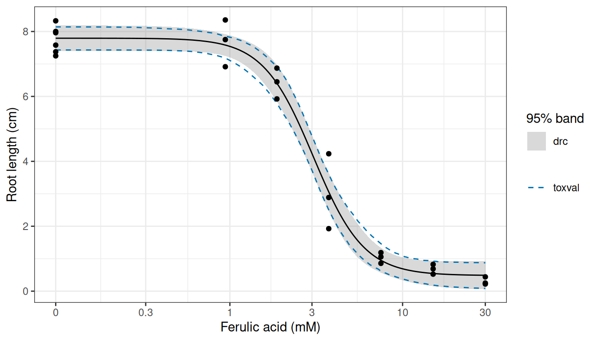
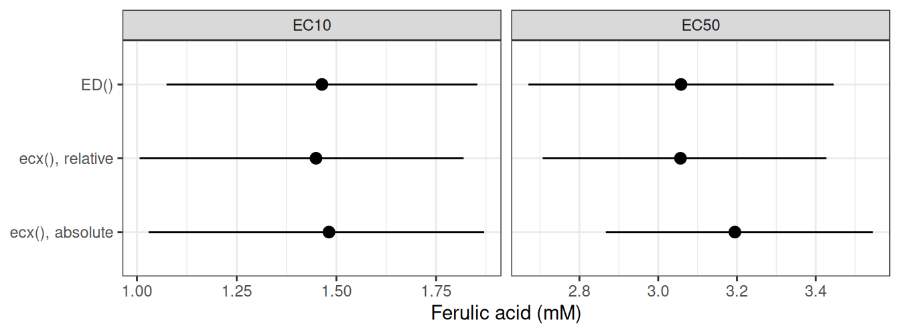
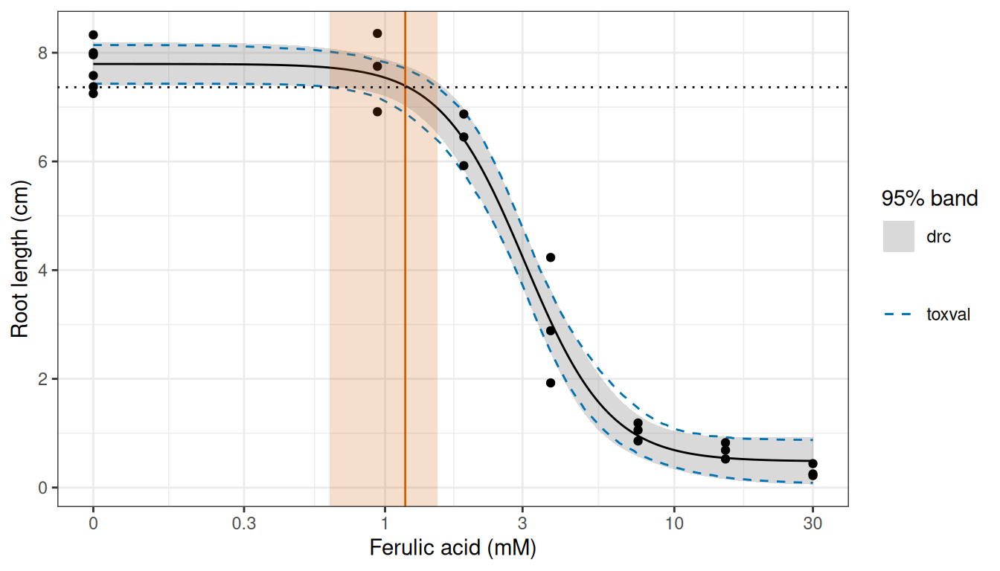
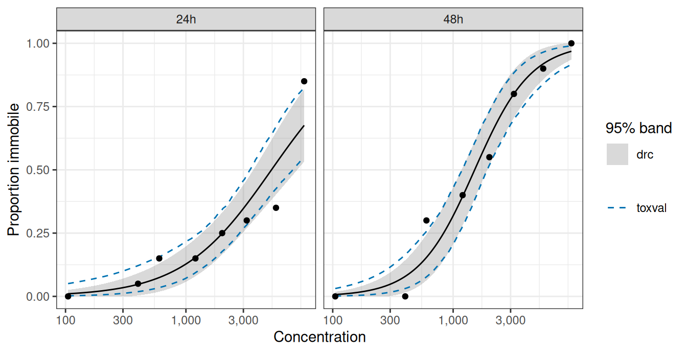
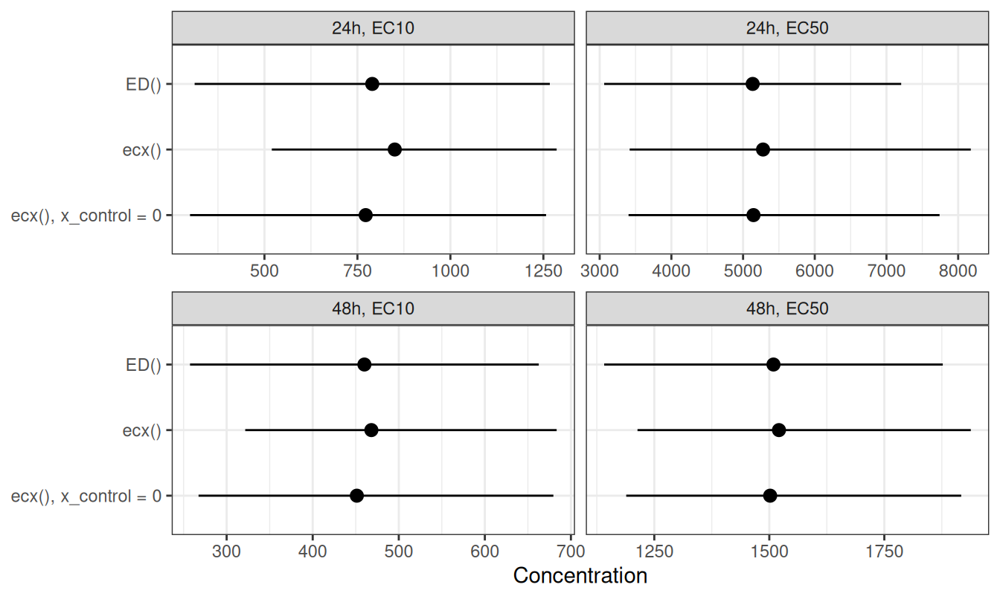

# Estimates from drc fits

``` r

library(ggplot2)
```

The `drc` package fits concentration-response curves with
[`drm()`](https://rdrr.io/pkg/drc/man/drm.html), and estimates effect
concentrations from a fitted curve with
[`ED()`](https://rdrr.io/pkg/drc/man/ED.drc.html). toxval’s
[`ecx()`](https://open-aims.github.io/toxval/reference/ecx.md) and
[`nsec()`](https://open-aims.github.io/toxval/reference/nsec.md) also
accept a [`drm()`](https://rdrr.io/pkg/drc/man/drm.html) fit, so a
fitted curve can be summarised with either package. Here we fit two
datasets shipped with `drc` and compare the estimates from each package:
`ryegrass`, a continuous response described by one curve, and
`daphnids`, a binomial response described by one curve for each of two
exposure times. The definitions used by toxval are given in the articles
on the
[ECx](https://open-aims.github.io/toxval/articles/ecx-definition.html)
and the
[NSEC](https://open-aims.github.io/toxval/articles/nsec-definition.html).

## A single curve

`ryegrass` contains the root length (cm) of perennial ryegrass grown at
6 concentrations of ferulic acid, from 0.94 to 30 mM, and in 6 controls
without it. We fitted the four-parameter log-logistic equation
[`LL.4()`](https://rdrr.io/pkg/drc/man/LL.4.html), in which the response
declines from an upper limit `d` to a lower limit `c`, with a slope `b`
and with `e` the concentration at which the response is halfway between
`d` and `c`.

``` r

fit <- drc::drm(rootl ~ conc, data = ryegrass, fct = drc::LL.4())
summary(fit)
#> 
#> Model fitted: Log-logistic (ED50 as parameter) (4 parms)
#> 
#> Parameter estimates:
#> 
#>               Estimate Std. Error t-value   p-value    
#> b:(Intercept)  2.98222    0.46506  6.4125 2.960e-06 ***
#> c:(Intercept)  0.48141    0.21219  2.2688   0.03451 *  
#> d:(Intercept)  7.79296    0.18857 41.3272 < 2.2e-16 ***
#> e:(Intercept)  3.05795    0.18573 16.4644 4.268e-13 ***
#> ---
#> Signif. codes:  0 '***' 0.001 '**' 0.01 '*' 0.05 '.' 0.1 ' ' 1
#> 
#> Residual standard error:
#> 
#>  0.5196256 (20 degrees of freedom)
```

The fitted root length declines from 7.79 cm to 0.48 cm, and is halfway
between these limits at 3.06 mM.

### The confidence band on the curve

Both packages give a 95% confidence band on the fitted curve, although
they compute it differently. In `drc`,
[`predict()`](https://rdrr.io/r/stats/predict.html) with
`interval = "confidence"` gives a band from the delta method (a linear
approximation of the curve at the parameter estimates). toxval’s
[`toxval_predict()`](https://open-aims.github.io/toxval/reference/toxval_predict.md)
instead draws `n_boot` parameter vectors (1000 by default) from a
multivariate normal distribution with mean `coef(fit)` and covariance
`vcov(fit)`, and evaluates the curve at each vector. A parameter that
the equation requires to be positive (here `e`) is drawn on the log
scale. We refer to each evaluated curve as a realisation (i.e. a
parametric bootstrap replicate), and took the band as the 2.5 and 97.5
percentiles of the realisations at each concentration. By default the
realisations are evaluated at 500 concentrations from the control
concentration (here 0 mM) to the highest concentration in the data, and
we evaluated the `drc` band at these concentrations.
[`ecx()`](https://open-aims.github.io/toxval/reference/ecx.md) and
[`nsec()`](https://open-aims.github.io/toxval/reference/nsec.md) call
[`toxval_predict()`](https://open-aims.github.io/toxval/reference/toxval_predict.md)
themselves, and the `seed` argument of each function makes the
realisations reproducible.

``` r

pred <- toxval_predict(fit, seed = 42)
toxval_q <- apply(pred$curves[[1]], 2, quantile, probs = c(0.025, 0.975))
bands <- data.frame(
  conc = pred$x_vec,
  predict(fit, data.frame(conc = pred$x_vec), interval = "confidence"),
  toxval_lower = toxval_q[1, ],
  toxval_upper = toxval_q[2, ]
)
head(bands)
#>         conc Prediction    Lower    Upper toxval_lower toxval_upper
#> 1 0.00000000   7.792958 7.399614 8.186303     7.431087     8.141416
#> 2 0.06012024   7.792899 7.399657 8.186140     7.431054     8.140901
#> 3 0.12024048   7.792488 7.399826 8.185149     7.430808     8.139273
#> 4 0.18036072   7.791381 7.400063 8.182699     7.430122     8.134918
#> 5 0.24048096   7.789240 7.400213 8.178266     7.428762     8.131080
#> 6 0.30060120   7.785728 7.400042 8.171413     7.426519     8.114769
```

``` r

p_ryegrass <- ggplot(bands, aes(conc)) +
  geom_ribbon(aes(ymin = Lower, ymax = Upper, fill = "drc"), alpha = 0.3) +
  geom_line(aes(y = toxval_lower, colour = "toxval"), linetype = 2) +
  geom_line(aes(y = toxval_upper, colour = "toxval"), linetype = 2) +
  geom_line(aes(y = Prediction)) +
  geom_point(aes(y = rootl), data = ryegrass) +
  scale_x_continuous(
    transform = scales::pseudo_log_trans(sigma = 0.1),
    breaks = c(0, 0.3, 1, 3, 10, 30),
    labels = c("0", "0.3", "1", "3", "10", "30")
  ) +
  scale_fill_manual(values = c(drc = "grey50")) +
  scale_colour_manual(values = c(toxval = "#0072B2")) +
  labs(x = "Ferulic acid (mM)", y = "Root length (cm)", fill = "95% band", colour = NULL) +
  theme_bw()
p_ryegrass
```



Figure 1: Root length of ryegrass against the concentration of ferulic
acid (points), with the
[`LL.4()`](https://rdrr.io/pkg/drc/man/LL.4.html) fit (black line), the
95% confidence band from
[`predict()`](https://rdrr.io/r/stats/predict.html) in `drc` (grey) and
the 95% band from the toxval realisations (dashed blue lines). The
concentration axis is a pseudo-logarithmic scale, which is linear near 0
and logarithmic above about 0.1 mM, so that the controls can be shown.

The `drc` and toxval bands are close over the observed range
([Figure 1](#fig-bands-ryegrass)), and their limits differ by at most
0.15 cm. The largest difference is at 1.32 mM, at the start of the
decline, where both limits of the toxval band are below those of the
`drc` band.

### EC10 and EC50

[`ED()`](https://rdrr.io/pkg/drc/man/ED.drc.html) and
[`ecx()`](https://open-aims.github.io/toxval/reference/ecx.md) measure
the effect from different points by default, so we matched their
definitions before comparing the estimates. Both packages express the
effect as a proportion of the difference between two response values.
[`ED()`](https://rdrr.io/pkg/drc/man/ED.drc.html) uses the fitted limits
`d` and `c`, so its EC10 is the concentration at which the response has
fallen by 10% of `d - c`.
[`ecx()`](https://open-aims.github.io/toxval/reference/ecx.md) takes the
effect as a proportion (e.g. `proportion = 0.1` for the EC10), always
starts from the control (the predicted response at the lowest
concentration in the data, here 0 mM), and takes the other value from
its `type` argument. Under `type = "relative"` the other value is `c`,
and because [`LL.4()`](https://rdrr.io/pkg/drc/man/LL.4.html) equals `d`
at a concentration of 0, this matches the definition used by
[`ED()`](https://rdrr.io/pkg/drc/man/ED.drc.html). Under the default,
`type = "absolute"`, the other value is 0, so the EC10 is the
concentration at which the response is 90% of the control.

``` r

ed <- drc::ED(fit, c(10, 50), interval = "delta")
#> 
#> Estimated effective doses
#> 
#>        Estimate Std. Error   Lower   Upper
#> e:1:10  1.46371    0.18677 1.07411 1.85330
#> e:1:50  3.05795    0.18573 2.67053 3.44538
```

``` r

ecx_rel <- ecx(fit, proportion = c(0.1, 0.5), type = "relative", seed = 42)
ecx_rel
#> # A tibble: 4 × 10
#> # Model:    drc
#> # Settings: resolution 500 | 1000 bootstrap realisations
#>   metric direction  estimate conf.low conf.high proportion type     control
#>   <chr>  <chr>         <dbl>    <dbl>     <dbl>      <dbl> <chr>      <dbl>
#> 1 ecx    decreasing     1.45     1.01      1.82        0.1 relative    7.80
#> 2 ecx    increasing    NA       NA        NA           0.1 relative   NA   
#> 3 ecx    decreasing     3.06     2.71      3.43        0.5 relative    7.80
#> 4 ecx    increasing    NA       NA        NA           0.5 relative   NA   
#> # ℹ 2 more variables: reference <dbl>, asymptote <dbl>
```

``` r

ecx_abs <- ecx(fit, proportion = c(0.1, 0.5), seed = 42)
ecx_abs
#> # A tibble: 4 × 10
#> # Model:    drc
#> # Settings: resolution 500 | 1000 bootstrap realisations
#>   metric direction  estimate conf.low conf.high proportion type     control
#>   <chr>  <chr>         <dbl>    <dbl>     <dbl>      <dbl> <chr>      <dbl>
#> 1 ecx    decreasing     1.48     1.03      1.87        0.1 absolute    7.80
#> 2 ecx    increasing    NA       NA        NA           0.1 absolute    7.80
#> 3 ecx    decreasing     3.19     2.87      3.55        0.5 absolute    7.80
#> 4 ecx    increasing    NA       NA        NA           0.5 absolute    7.80
#> # ℹ 2 more variables: reference <dbl>, asymptote <dbl>
```

[`ecx()`](https://open-aims.github.io/toxval/reference/ecx.md) returns a
row for each direction of change. Because this curve only declines, the
increasing rows are `NA`. The `reference` column gives the response at
which each ECx is read, and the `control` column the response it is
measured from.

``` r

from_ecx <- function(res, method) {
  dec <- res[res$direction == "decreasing", ]
  data.frame(
    method,
    effect = paste0("EC", 100 * dec$proportion),
    estimate = dec$estimate,
    lower = dec$conf.low,
    upper = dec$conf.high
  )
}
ec_ryegrass <- rbind(
  data.frame(
    method = "ED()",
    effect = c("EC10", "EC50"),
    estimate = ed[, "Estimate"],
    lower = ed[, "Lower"],
    upper = ed[, "Upper"],
    row.names = NULL
  ),
  from_ecx(ecx_rel, "ecx(), relative"),
  from_ecx(ecx_abs, "ecx(), absolute")
)
ec_ryegrass
#>            method effect estimate    lower    upper
#> 1            ED()   EC10 1.463706 1.074109 1.853302
#> 2            ED()   EC50 3.057955 2.670526 3.445384
#> 3 ecx(), relative   EC10 1.448839 1.006625 1.818876
#> 4 ecx(), relative   EC50 3.056538 2.706619 3.427224
#> 5 ecx(), absolute   EC10 1.481375 1.029068 1.870459
#> 6 ecx(), absolute   EC50 3.194687 2.867163 3.545310
```

``` r

ggplot(ec_ryegrass, aes(estimate, method)) +
  geom_pointrange(aes(xmin = lower, xmax = upper)) +
  facet_wrap(~effect, scales = "free_x") +
  scale_y_discrete(limits = rev(unique(ec_ryegrass$method))) +
  labs(x = "Ferulic acid (mM)", y = NULL) +
  theme_bw()
```



Figure 2: The EC10 (left) and EC50 (right) of the
[`LL.4()`](https://rdrr.io/pkg/drc/man/LL.4.html) fit to `ryegrass` from
[`ED()`](https://rdrr.io/pkg/drc/man/ED.drc.html) and from
[`ecx()`](https://open-aims.github.io/toxval/reference/ecx.md) under two
definitions. Points: the estimates. Lines: the 95% intervals, from the
delta method for [`ED()`](https://rdrr.io/pkg/drc/man/ED.drc.html) and
from the 2.5 and 97.5 percentiles of 1000 realisations for
[`ecx()`](https://open-aims.github.io/toxval/reference/ecx.md).

Under the matched definition, the two packages return very similar
results: [`ecx()`](https://open-aims.github.io/toxval/reference/ecx.md)
gives an EC10 of 1.45 mM and an EC50 of 3.06 mM, compared with 1.46 and
3.06 mM from [`ED()`](https://rdrr.io/pkg/drc/man/ED.drc.html)
([Figure 2](#fig-ec-ryegrass)). The default
[`ecx()`](https://open-aims.github.io/toxval/reference/ecx.md) estimates
are higher (1.48 and 3.19 mM), because its EC10 is read at a lower
response (7.02 cm, compared with 7.06 cm under `relative`). These
reference responses differ by a tenth of the lower limit `c`, so the
difference between the `absolute` and `relative` estimates would be
larger for a curve with a higher lower limit. For these data `c` is
small compared with `d` (0.48 against 7.79 cm), and the `absolute` and
`relative` intervals overlap for both estimates.

The intervals differ because the packages convert the uncertainty in the
parameters into an interval on the ECx in different ways, although both
take that uncertainty from `vcov(fit)`. The delta method used by
[`ED()`](https://rdrr.io/pkg/drc/man/ED.drc.html) replaces the ECx by
its linear approximation at the parameter estimates. This gives a
standard error, and an interval of the estimate plus or minus 2.09
standard errors (the 0.975 quantile of a *t* distribution on 20 residual
degrees of freedom), which is symmetric by construction.
[`ecx()`](https://open-aims.github.io/toxval/reference/ecx.md) instead
finds the ECx of each realisation and returns the median and the 2.5 and
97.5 percentiles of these values. Its interval can therefore be
asymmetric where the ECx is a nonlinear function of the parameters. For
example, the `relative` EC10 interval extends 0.44 mM below the estimate
and 0.37 mM above it, whereas the
[`ED()`](https://rdrr.io/pkg/drc/man/ED.drc.html) interval extends 0.39
mM on each side. The point estimates also differ slightly, because
[`ED()`](https://rdrr.io/pkg/drc/man/ED.drc.html) gives the ECx at the
parameter estimates whereas
[`ecx()`](https://open-aims.github.io/toxval/reference/ecx.md) gives the
median over the realisations.

The [`ecx()`](https://open-aims.github.io/toxval/reference/ecx.md)
limits are percentiles of a finite set of realisations, so they change
slightly with the `seed`. A larger `n_boot` reduces this variation,
although the computation then takes longer.

## NSEC

The no-significant-effect concentration (NSEC) is the concentration at
which the fitted response departs from the control by more than the
uncertainty in the control allows. `drc` does not provide a method for
estimating the NSEC from a fitted model, and this is one of the
motivations for the development of toxval.
[`nsec()`](https://open-aims.github.io/toxval/reference/nsec.md) takes
as its reference the 0.01 quantile (set by `sig_val`) of the control
across the realisations, finds the concentration at which each
realisation crosses that reference, and summarises these concentrations
as for [`ecx()`](https://open-aims.github.io/toxval/reference/ecx.md).

``` r

ns <- nsec(fit, seed = 42)
ns
#> # A tibble: 2 × 14
#> # Model:    drc
#> # Settings: resolution 500 | 1000 bootstrap realisations
#>   metric direction  estimate conf.low conf.high sig_val type     anchor control
#>   <chr>  <chr>         <dbl>    <dbl>     <dbl>   <dbl> <chr>    <chr>    <dbl>
#> 1 nsec   decreasing     1.18    0.637      1.52    0.01 absolute model     7.80
#> 2 nsec   increasing    NA      NA         NA       0.01 absolute model     7.80
#> # ℹ 5 more variables: reference <dbl>, asymptote <dbl>, ecnsec <dbl>,
#> #   ecnsec.low <dbl>, ecnsec.high <dbl>
ns_dec <- ns[ns$direction == "decreasing", ]
```

``` r

p_ryegrass +
  annotate(
    "rect",
    xmin = ns_dec$conf.low, xmax = ns_dec$conf.high, ymin = -Inf, ymax = Inf,
    fill = "#D55E00", alpha = 0.2
  ) +
  geom_vline(xintercept = ns_dec$estimate, colour = "#D55E00") +
  geom_hline(yintercept = ns_dec$reference, linetype = 3)
```



Figure 3: [Figure 1](#fig-bands-ryegrass) with the decreasing NSEC from
[`nsec()`](https://open-aims.github.io/toxval/reference/nsec.md)
(vermillion line) and its 95% interval (vermillion shading), and the
reference response used by
[`nsec()`](https://open-aims.github.io/toxval/reference/nsec.md) (dotted
line).

The NSEC is 1.18 mM (0.64 to 1.52), the concentration at which the curve
falls below the reference of 7.37 cm ([Figure 3](#fig-nsec-ryegrass)).
This is below the EC10 of 1.45 mM, and the `ecnsec` column gives the
effect at the NSEC as a proportion of the control, here 5.5%.

`drc` also provides equations with a threshold
(e.g. [`NEC.3()`](https://rdrr.io/pkg/drc/man/NEC.html)), in which the
response is constant up to a no-effect concentration (NEC) that is
estimated as the parameter `e`.
[`nsec()`](https://open-aims.github.io/toxval/reference/nsec.md) does
not accept fits of these equations.

## A grouped fit

`daphnids` contains the number of immobile daphnids out of 20 at 8
concentrations of a toxic substance, from 105 to 9,596, counted after 24
h and again (in the same animals) after 48 h. Because the response is a
count out of a known total, we fitted the two-parameter log-logistic
equation [`LL.2()`](https://rdrr.io/pkg/drc/man/LL.2.html) with
`type = "binomial"` and the total as weights, with one curve per
exposure time (`curveid = time`).
[`LL.2()`](https://rdrr.io/pkg/drc/man/LL.2.html) fixes the lower limit
at 0 and the upper limit at 1, so the fitted response is the proportion
immobile.

``` r

daphnids <- drc::daphnids
fit_daph <- drc::drm(
  no / total ~ dose,
  weights = total,
  curveid = time,
  data = daphnids,
  fct = drc::LL.2(),
  type = "binomial"
)
ed_daph <- drc::ED(fit_daph, c(10, 50), interval = "delta")
#> 
#> Estimated effective doses
#> 
#>          Estimate Std. Error   Lower   Upper
#> e:24h:10   789.83     243.66  312.25 1267.40
#> e:24h:50  5134.03    1056.74 3062.86 7205.21
#> e:48h:10   460.06     103.37  257.46  662.65
#> e:48h:50  1509.07     187.76 1141.06 1877.07
```

In [`ecx()`](https://open-aims.github.io/toxval/reference/ecx.md), the
column passed to [`drm()`](https://rdrr.io/pkg/drc/man/drm.html) as
`curveid` is given in `group_var`, and the result has one set of rows
per curve, identified by the `group` column.

``` r

ecx_daph <- ecx(fit_daph, proportion = c(0.1, 0.5), group_var = "time", seed = 42)
ecx_daph
#> # A tibble: 8 × 11
#> # Model:    drc
#> # Settings: resolution 500 | 1000 bootstrap realisations
#>   metric direction  group estimate conf.low conf.high proportion type    control
#>   <chr>  <chr>      <fct>    <dbl>    <dbl>     <dbl>      <dbl> <chr>     <dbl>
#> 1 ecx    decreasing 24h        NA       NA        NA         0.1 absolu… 0.0102 
#> 2 ecx    increasing 24h       850.     520.     1286.        0.1 absolu… 0.0102 
#> 3 ecx    decreasing 24h        NA       NA        NA         0.5 absolu… 0.0102 
#> 4 ecx    increasing 24h      5279.    3418.     8176.        0.5 absolu… 0.0102 
#> 5 ecx    decreasing 48h        NA       NA        NA         0.1 absolu… 0.00727
#> 6 ecx    increasing 48h       468.     322.      683.        0.1 absolu… 0.00727
#> 7 ecx    decreasing 48h        NA       NA        NA         0.5 absolu… 0.00727
#> 8 ecx    increasing 48h      1521.    1214.     1938.        0.5 absolu… 0.00727
#> # ℹ 2 more variables: reference <dbl>, asymptote <dbl>
```

Because the proportion immobile rises with concentration, the estimates
are in the increasing rows.
[`ED()`](https://rdrr.io/pkg/drc/man/ED.drc.html) takes the increasing
effect as a proportion of the difference between `c` and `d`, which
[`LL.2()`](https://rdrr.io/pkg/drc/man/LL.2.html) fixes at 0 and 1.
Unlike the `ryegrass` fit, this fit does not need `type = "relative"`
for [`ecx()`](https://open-aims.github.io/toxval/reference/ecx.md) and
[`ED()`](https://rdrr.io/pkg/drc/man/ED.drc.html) to agree. For
`ryegrass` the packages differed in the value the response falls towards
(0 for the default
[`ecx()`](https://open-aims.github.io/toxval/reference/ecx.md) and `c`
for [`ED()`](https://rdrr.io/pkg/drc/man/ED.drc.html)), and
`type = "relative"` replaced 0 by `c`. Here, for a response on the
proportion scale, the default `type = "absolute"` already takes the
value the response rises towards as 1, which is also the upper limit `d`
of [`LL.2()`](https://rdrr.io/pkg/drc/man/LL.2.html), so
`type = "relative"` returns identical estimates and intervals. The
packages differ instead in the value the response rises from.
[`ecx()`](https://open-aims.github.io/toxval/reference/ecx.md) starts
from the control, the predicted proportion immobile at the lowest tested
concentration (105), which is 0.0102 at 24 h and 0.0073 at 48 h, whereas
[`ED()`](https://rdrr.io/pkg/drc/man/ED.drc.html) starts from `c` = 0.
The `type` argument does not change the control, but `x_control` does:
supplying `x_control = 0` predicts the control at a concentration of 0,
where [`LL.2()`](https://rdrr.io/pkg/drc/man/LL.2.html) equals 0, and
the definitions then coincide.

``` r

ecx_daph0 <- ecx(
  fit_daph,
  proportion = c(0.1, 0.5),
  group_var = "time",
  x_control = 0,
  seed = 42
)
#> Warning: `x_control`, 0, lies outside the range of the data, 105 to 9595.57, so
#> the control response is predicted at a concentration that was not tested.
#> Warning: Some realisations have no crossing within the evaluated range, so a reported quantile is at the highest concentration, or have no reference and were excluded. Consider a wider `x_range`.
#> * group 24h, decreasing: 100.0% excluded
#> * group 24h, decreasing: 100.0% excluded
#> * group 48h, decreasing: 100.0% excluded
#> * group 48h, decreasing: 100.0% excluded
```

The call gives two warnings. The first is that 0 is outside the tested
concentrations, so the control is a prediction beyond the data. The
second is that the decreasing rows have no reference, because a
proportion cannot fall below a control of 0.

``` r

from_ecx_group <- function(res, method) {
  inc <- res[res$direction == "increasing", ]
  data.frame(
    time = inc$group,
    method,
    effect = paste0("EC", 100 * inc$proportion),
    estimate = inc$estimate,
    lower = inc$conf.low,
    upper = inc$conf.high
  )
}
ec_daph <- rbind(
  data.frame(
    time = sub("e:(.*):.*", "\\1", rownames(ed_daph)),
    method = "ED()",
    effect = paste0("EC", sub(".*:", "", rownames(ed_daph))),
    estimate = ed_daph[, "Estimate"],
    lower = ed_daph[, "Lower"],
    upper = ed_daph[, "Upper"],
    row.names = NULL
  ),
  from_ecx_group(ecx_daph, "ecx()"),
  from_ecx_group(ecx_daph0, "ecx(), x_control = 0")
)
ec_daph <- ec_daph[order(ec_daph$time, ec_daph$effect), ]
ec_daph
#>    time               method effect  estimate     lower     upper
#> 1   24h                 ED()   EC10  789.8286  312.2547 1267.4026
#> 5   24h                ecx()   EC10  850.4098  519.7638 1285.6880
#> 9   24h ecx(), x_control = 0   EC10  772.2386  299.8786 1257.2804
#> 2   24h                 ED()   EC50 5134.0334 3062.8573 7205.2096
#> 6   24h                ecx()   EC50 5278.6408 3418.3560 8176.2273
#> 10  24h ecx(), x_control = 0   EC50 5145.5089 3402.7063 7740.6662
#> 3   48h                 ED()   EC10  460.0561  257.4614  662.6508
#> 7   48h                ecx()   EC10  468.1586  321.6026  683.4182
#> 11  48h ecx(), x_control = 0   EC10  451.2740  267.3729  679.6199
#> 4   48h                 ED()   EC50 1509.0654 1141.0624 1877.0684
#> 8   48h                ecx()   EC50 1521.0104 1213.5145 1937.9812
#> 12  48h ecx(), x_control = 0   EC50 1501.8363 1188.9885 1917.1159
```

``` r

pred_daph <- toxval_predict(fit_daph, group_var = "time", seed = 42)
bands_daph <- do.call(rbind, lapply(seq_along(pred_daph$curves), function(i) {
  time <- as.character(pred_daph$keys$group[i])
  q <- apply(pred_daph$curves[[i]], 2, quantile, probs = c(0.025, 0.975))
  data.frame(
    dose = pred_daph$x_vec,
    time,
    predict(fit_daph, data.frame(dose = pred_daph$x_vec, time = time), interval = "confidence"),
    toxval_lower = q[1, ],
    toxval_upper = q[2, ]
  )
}))
```

``` r

ggplot(bands_daph, aes(dose)) +
  geom_ribbon(aes(ymin = Lower, ymax = Upper, fill = "drc"), alpha = 0.3) +
  geom_line(aes(y = toxval_lower, colour = "toxval"), linetype = 2) +
  geom_line(aes(y = toxval_upper, colour = "toxval"), linetype = 2) +
  geom_line(aes(y = Prediction)) +
  geom_point(aes(y = no / total), data = daphnids) +
  facet_wrap(~time) +
  scale_x_log10(breaks = c(100, 300, 1000, 3000), labels = scales::label_comma()) +
  scale_fill_manual(values = c(drc = "grey50")) +
  scale_colour_manual(values = c(toxval = "#0072B2")) +
  labs(x = "Concentration", y = "Proportion immobile", fill = "95% band", colour = NULL) +
  theme_bw()
```



Figure 4: Proportion of daphnids immobile against concentration at 24 h
(left) and 48 h (right) (points), with the
[`LL.2()`](https://rdrr.io/pkg/drc/man/LL.2.html) fit (black line), the
95% confidence band from
[`predict()`](https://rdrr.io/r/stats/predict.html) in `drc` (grey) and
the 95% band from the toxval realisations (dashed blue lines). The
concentration axis is logarithmic.

The `drc` and toxval bands are close in the steep part of each curve
([Figure 4](#fig-bands-daphnids)). However, at the lowest concentration
the upper limit of the toxval band is higher, at 0.050 compared with
0.026 at 24 h. This appears to be because the delta-method band is
symmetric about the curve, whereas the realisations are bounded below by
0 and skewed upwards where the fitted proportion is near 0.

``` r

ggplot(ec_daph, aes(estimate, method)) +
  geom_pointrange(aes(xmin = lower, xmax = upper)) +
  facet_wrap(~ time + effect, scales = "free_x", ncol = 2, labeller = label_wrap_gen(multi_line = FALSE)) +
  scale_y_discrete(limits = rev(unique(ec_daph$method))) +
  labs(x = "Concentration", y = NULL) +
  theme_bw()
```



Figure 5: The EC10 and EC50 of the
[`LL.2()`](https://rdrr.io/pkg/drc/man/LL.2.html) fits to `daphnids` at
24 h (top) and 48 h (bottom), from
[`ED()`](https://rdrr.io/pkg/drc/man/ED.drc.html) and from
[`ecx()`](https://open-aims.github.io/toxval/reference/ecx.md) with the
control at the lowest tested concentration and at 0. Points: the
estimates. Lines: the 95% intervals, from the delta method for
[`ED()`](https://rdrr.io/pkg/drc/man/ED.drc.html) and from the 2.5 and
97.5 percentiles of 1000 realisations for
[`ecx()`](https://open-aims.github.io/toxval/reference/ecx.md).

With the control at 0, the
[`ecx()`](https://open-aims.github.io/toxval/reference/ecx.md) EC50s are
within 0.5% of the [`ED()`](https://rdrr.io/pkg/drc/man/ED.drc.html)
values and the EC10s within 2.2% ([Figure 5](#fig-ec-daphnids)). The
remaining difference is likely to come from the point estimate, which
for [`ecx()`](https://open-aims.github.io/toxval/reference/ecx.md) is
the median of the realisations. With the control at the lowest tested
concentration, the EC10s differ from
[`ED()`](https://rdrr.io/pkg/drc/man/ED.drc.html) by up to 7.7%, because
the small proportion immobile at that concentration raises the response
at which the EC10 is read. The intervals differ in shape as for
`ryegrass`. For example, the 24 h EC50 interval from
[`ecx()`](https://open-aims.github.io/toxval/reference/ecx.md) with the
control at 0 runs from 3,403 to 7,741, and extends further above the
estimate than below it, whereas the delta-method interval from
[`ED()`](https://rdrr.io/pkg/drc/man/ED.drc.html) runs from 3,063 to
7,205 and is symmetric.

## Provenance

``` r
cat(sprintf("%-10s %s\n", "toxval", as.character(packageVersion("toxval"))))
toxval     2.0.0
cat(sprintf("%-10s %s\n", "commit", toxval_commit))
commit     94c21a5dcc3ba32526f83e42bbbbf27899252323
for (pkg in c("drc", "ggplot2")) {
  cat(sprintf("%-10s %s\n", pkg, as.character(packageVersion(pkg))))
}
drc        4.0.0
ggplot2    4.0.3
cat(sprintf("%-10s %s\n", "R", getRversion()))
R          4.6.2
```

- Data: `ryegrass` and `daphnids` from the `drc` package, used as
  shipped.
- Fits: [`drm()`](https://rdrr.io/pkg/drc/man/drm.html) with its default
  starting values.
- Realisations: `n_boot = 1000` parametric bootstrap draws with
  `seed = 42`.
- Grid: toxval’s default of 500 evenly spaced concentrations from the
  control concentration to the highest concentration in the data.
- The commit line is the commit of the toxval checkout the article was
  rendered from.
