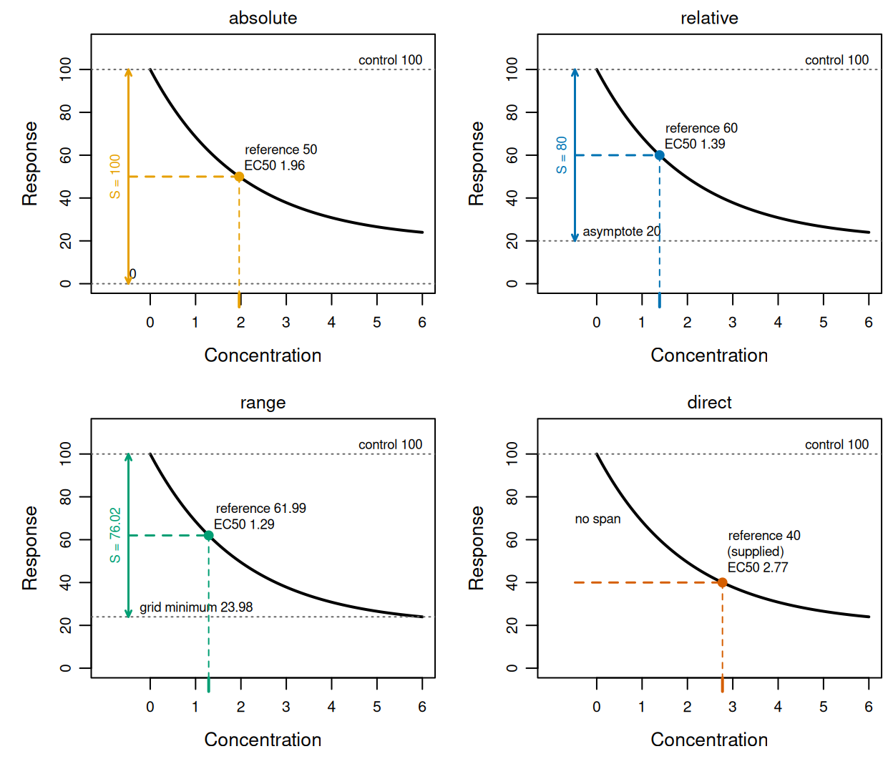
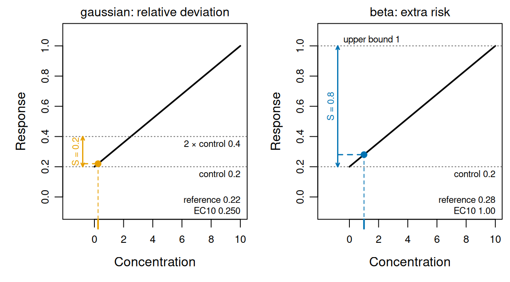
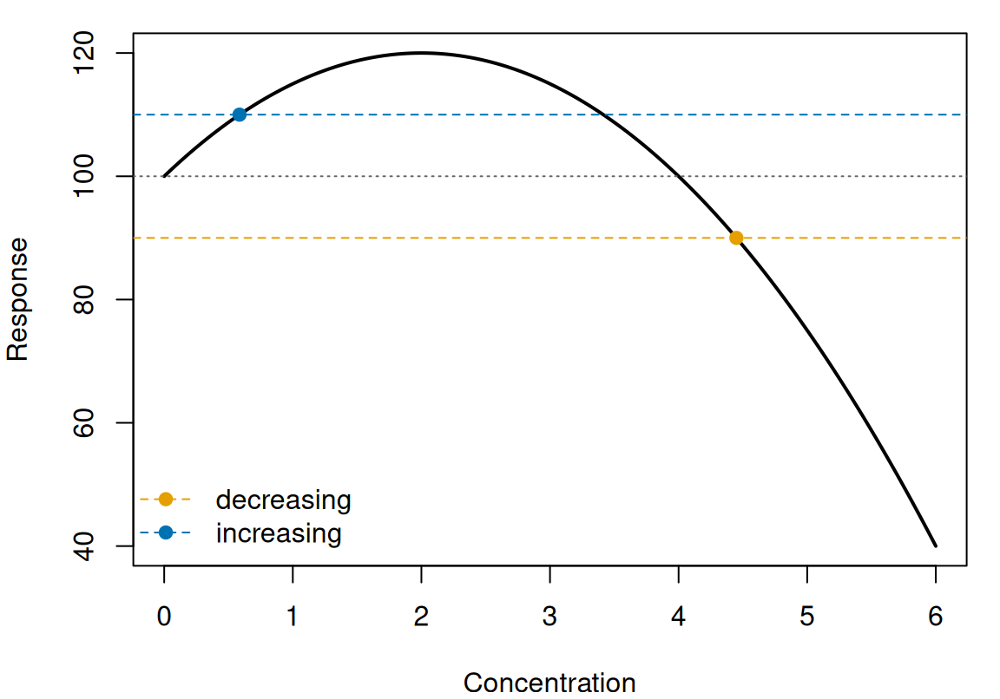
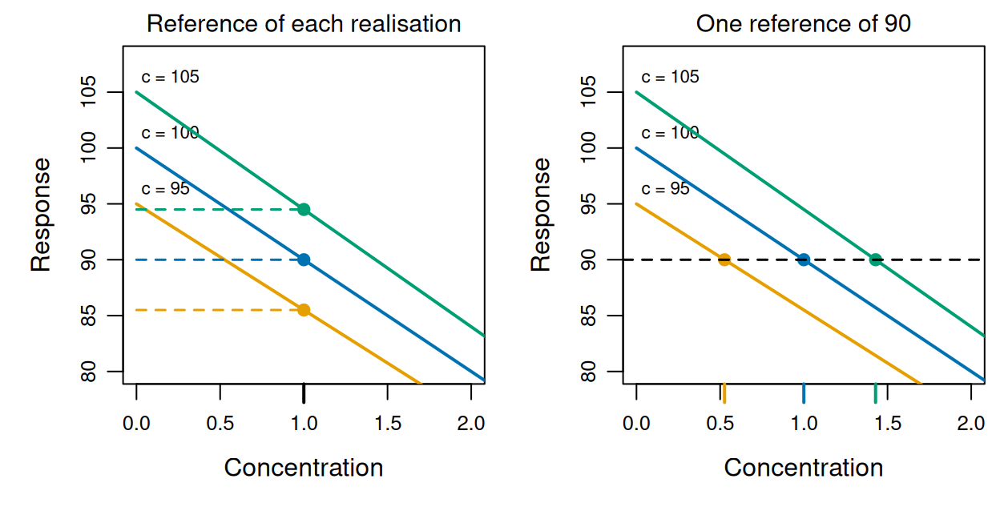
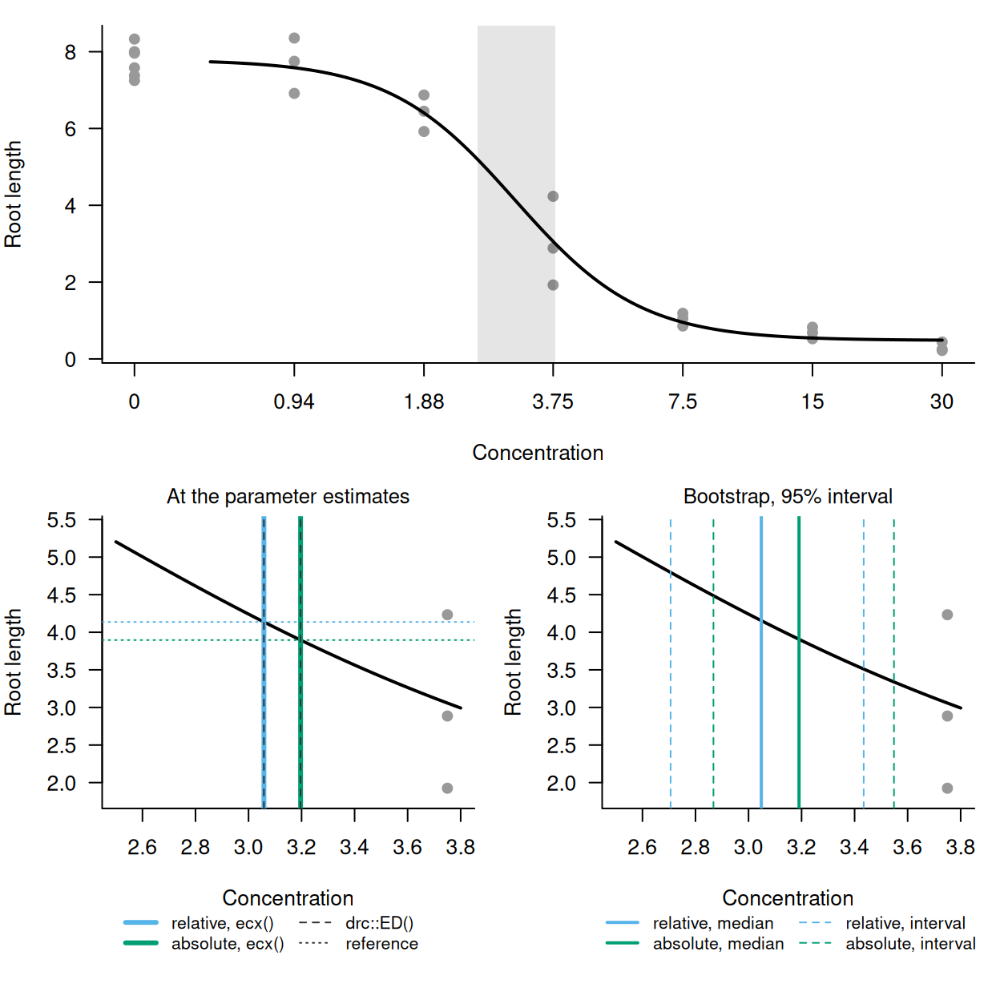
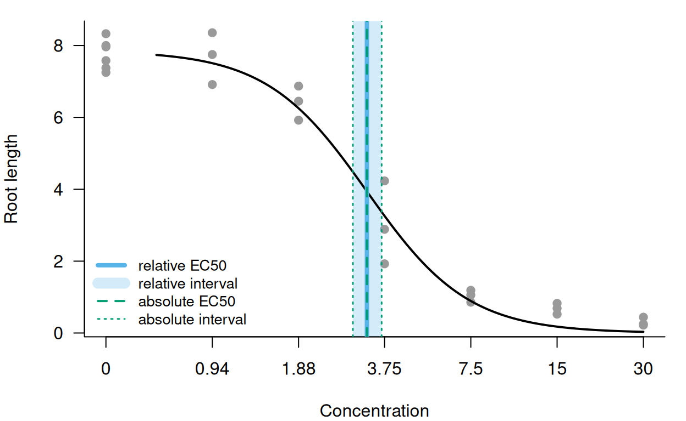

# The ECx definition

``` r

library(toxval)
has_drc <- requireNamespace("drc", quietly = TRUE)
```

## Background

An ECx is the concentration at which a fitted response has changed by x
per cent, so the EC10 is where it has changed by 10 per cent. Software
and guidance differ in what that change is a percentage of, so one fit
can give different ECx values (Daniels et al. 2026).
[`ecx()`](https://open-aims.github.io/toxval/reference/ecx.md) estimates
the concentration at which a fitted curve crosses a reference response.
The estimate is computed separately for each realisation of the fit (a
posterior draw of a Bayesian fit, or a parametric bootstrap replicate of
a frequentist fit), and in two directions, a decrease and an increase.
The control is the predicted response at the control concentration (by
default the lowest concentration in the data, where the grid over which
the curve is evaluated starts). The argument `proportion` gives the
proportion $`p`$ (e.g. `proportion = 0.1` for the EC10), and the
argument `type` names the span of which the effect is a proportion (i.e.
a difference in response, measured separately in each direction as
$`S_{\text{dec}}`$ and $`S_{\text{inc}}`$). The reference of each
realisation is computed from its own control and spans:

``` math
\text{reference} = \text{control} - p\,S_{\text{dec}} \ \text{(decreasing)}, \qquad
\text{reference} = \text{control} + p\,S_{\text{inc}} \ \text{(increasing)}.
```

Under the default, `type = "absolute"`, both spans of a response that is
not a proportion are the control, so the EC10 references are 0.9 and 1.1
times the control. Under `type = "direct"` there is no proportion and no
span, and the response supplied as `reference` is used as the reference
in both directions. The spans of the other types are tabulated under
[ECx definitions](#ecx-definitions). The decreasing ECx of a realisation
is then the first concentration at which its curve passes downward
through the decreasing reference, and the increasing ECx is the first at
which it passes upward through the increasing reference.
[`ecx()`](https://open-aims.github.io/toxval/reference/ecx.md) returns
the median of these values over the realisations, with a 95 per cent
interval by default.

Both directions are sought on each call and returned as rows identified
by the `direction` column (for each curve and proportion, one row for
the first decreasing crossing and one for the first increasing
crossing), and there is no argument for choosing a direction. A
direction in which no realisation crosses is returned with `NA`
estimates, because the crossing was sought and not found.

The examples below use curves defined by formulas with chosen parameter
values, so that each ECx has an exact value.
[`ecx()`](https://open-aims.github.io/toxval/reference/ecx.md) computes
on a `toxval_pred` (the object
[`toxval_predict()`](https://open-aims.github.io/toxval/reference/toxval_predict.md)
builds from a fitted model, with realisations of each curve evaluated
over a grid of concentrations), and the object can also be built
directly with
[`new_toxval_pred()`](https://open-aims.github.io/toxval/reference/new_toxval_pred.md).
We build it with the helper `hand_pred()`, which evaluates a formula
once for each row of a table of parameter values, so that each row
stands in for one realisation.

The helper hand_pred()

``` r

hand_pred <- function(curve, params, x_vec, family = "gaussian",
                      asymptote = NULL) {
  realisations <- t(apply(params, 1, function(p) {
    do.call(curve, c(list(x = x_vec), as.list(p)))
  }))
  new_toxval_pred(
    curves = list(realisations),
    keys = data.frame(row.names = 1L),
    x_vec = x_vec,
    asymptote = asymptote,
    meta = list(
      source_class = "hand-built",
      x_var = "x",
      group_var = NULL,
      multi_var = NULL,
      resolution = length(x_vec),
      x_range = range(x_vec),
      x_control = x_vec[1],
      # the family decides whether the response is a proportion, which sets
      # the increasing span under `type = "absolute"`
      family = family,
      realisation = "draws",
      n_realisation = nrow(params),
      seed = NULL
    )
  )
}
```

## ECx definitions

The argument `type` sets what the effect in an ECx is a proportion of,
and therefore the response at which the ECx is read. Its four values can
give different ECx values from one curve, which we illustrate with one
realisation of the exponential decay $`y = 20 + 80\,e^{-x/2}`$,
evaluated over $`0 \le x \le 6`$. Its control is 100, and its lower
asymptote (the limit of the response as $`x`$ increases without bound)
is 20, which is supplied in the `asymptote` slot. The curve has no upper
asymptote, so that value is `NA`. Its minimum over the grid is
$`20 + 80\,e^{-3}`$ = 23.98.

``` r

x_exp <- seq(0, 6, length.out = 601)
decay <- function(x, top, bot, s) bot + (top - bot) * exp(-x / s)
pred_exp <- hand_pred(
  decay,
  data.frame(top = 100, bot = 20, s = 2),
  x_exp,
  asymptote = list(list(decreasing = 20, increasing = NA_real_))
)

by_type <- list(
  absolute = ecx(pred_exp, proportion = 0.5, type = "absolute"),
  relative = ecx(pred_exp, proportion = 0.5, type = "relative"),
  range = ecx(pred_exp, proportion = 0.5, type = "range"),
  direct = ecx(pred_exp, type = "direct", reference = 40)
)
#> Warning: `type = "relative"` now measures from the control to the asymptote of
#> the curve. Before toxval 2.0.0 it measured to the extent of the curve, which is
#> now `type = "range"`; the two also differ for a non-monotonic curve, because
#> `range` measures from the control rather than from the maximum.
#> Warning: Some realisations have no crossing within the evaluated range, so a reported quantile is at the highest concentration, or have no reference and were excluded. Consider a wider `x_range`.
#> * increasing: 100.0% excluded
ec50_exp <- dplyr::bind_rows(by_type) |>
  dplyr::filter(direction == "decreasing") |>
  dplyr::select(type, proportion, control, reference, asymptote, estimate)
as.data.frame(ec50_exp)
#>       type proportion control reference asymptote estimate
#> 1 absolute        0.5     100  50.00000        NA 1.961662
#> 2 relative        0.5     100  60.00000        20 1.386300
#> 3    range        0.5     100  61.99148        NA 1.289122
#> 4   direct         NA      NA  40.00000        NA 2.772594
```

The EC50 under each `type`, with the span, the reference it gives and
the exact crossing:

| `type` | span $`S`$ | reference | exact EC50 | [`ecx()`](https://open-aims.github.io/toxval/reference/ecx.md) |
|----|----|----|----|----|
| `absolute` | control to 0, 100 | 50 | $`2\ln(8/3)`$ = 1.962 | 1.962 |
| `relative` | control to the asymptote, 80 | 60 | $`2\ln 2`$ = 1.386 | 1.386 |
| `range` | control to the minimum, 76.02 | 61.99 | 1.289 | 1.289 |
| `direct` | none | 40, supplied | $`2\ln 4`$ = 2.773 | 2.773 |



Figure 1: The curve $`y = 20 + 80e^{-x/2}`$ under each `type`: its
control (grey dotted line), the decreasing span (double-headed arrow) to
the level it is measured to (grey dotted line), the EC50 reference
(dashed line) and the crossing
[`ecx()`](https://open-aims.github.io/toxval/reference/ecx.md) returns
(point, and tick on the concentration axis). `direct` has no span, and
its reference is the supplied response.

In each panel of [Figure 1](#fig-types) the arrow runs from the control
of 100 down to the level that `type` measures to (0 under `absolute`,
the asymptote of 20 under `relative`, and the grid minimum of 23.98
under `range`). Because the EC50 reference is halfway along the arrow,
the shortest span (under `range`) gives the highest reference, which is
crossed first, at 1.29. `direct` has no span, and its supplied reference
of 40 is lower than the other three, so it is crossed last, at 2.77.
Each value returned by
[`ecx()`](https://open-aims.github.io/toxval/reference/ecx.md) in the
table agrees with the exact crossing to within one grid step of 0.01.

- `absolute`, the default, measures a decrease from the control to 0, so
  the effect is a percent change in the control level (OECD 2006,
  paragraph 297), as in the percent inhibition of OECD Test Guideline
  201 (OECD 2011, paragraph 50). `proportion` is not capped at 1 under
  `absolute`, because a response that can be negative (e.g. a growth
  rate) has more than complete inhibition when it falls below 0, and the
  equation in paragraph 50 of that guideline places no upper limit on
  the inhibition. The increasing form is described under [An increasing
  response](#an-increasing-response).
- `relative` measures from the control to the asymptote of the fitted
  equation (the lower asymptote for a decrease and the upper asymptote
  for an increase), so the effect is a proportion of the maximum
  achievable effect. The asymptote is usually a parameter of the
  equation, and where it is estimated beyond the observed responses it
  is an extrapolation, whose uncertainty is included in the ECx.
- `range` measures from the control to the lowest response predicted
  over the grid (or the highest, for an increase). It therefore depends
  on the concentrations evaluated; for example, the minimum here, 23.98,
  is the value at the end of the grid ($`x = 6`$).
- `direct` takes no proportion, and the ECx is where the curve crosses
  the response value supplied as `reference`, which is used in both
  directions (i.e. the first downward crossing in the decreasing row and
  the first upward crossing in the increasing row). The `control` column
  is `NA`, although the control is still compared with the reference
  (see [Realisations without an ECx](#realisations-without-an-ecx)).

The names `absolute` and `relative` follow Daniels et al. (2026), for
whom an absolute ECx is a change relative to the control and a relative
ECx is a change relative to the maximum achievable effect. Before toxval
2.0.0, `relative` measured to the extent of the curve, which is now
`range`, so a call that supplies `type = "relative"` warns about its
definition, whatever the data.

### The `proportion` and `reference` arguments

Two arguments give the size of the effect: `proportion` under
`absolute`, `relative` and `range`, and `reference` under `direct`.
`proportion` accepts several values, each giving its own rows, and the
`proportion` column of the result gives the value for each row. Under
`type = "direct"` the value is a response, not a proportion, so it is
supplied as `reference` (also the name of the column that gives it).
`reference` is required under `direct` and refused under the other
types, whereas `proportion` is refused under `direct`, where the
`proportion` column is `NA`.

``` r

ecx(pred_exp, type = "direct")
#> Error in `ecx()`:
#> ! `reference` must be supplied when `type` is 'direct'.
ecx(pred_exp, type = "direct", proportion = 0.5, reference = 40)
#> Error:
#> ! `proportion` must not be supplied when `type` is 'direct'; supply the response value as `reference`.
ecx(pred_exp, proportion = 0.5, reference = 40)
#> Error in `ecx()`:
#> ! `reference` must be NULL unless `type` is 'direct'; the reference is computed from `proportion`.
```

These names differ from those of
[`drc::ED()`](https://rdrr.io/pkg/drc/man/ED.drc.html), whose
`type = "absolute"` is toxval’s `direct`.
[`drc::ED()`](https://rdrr.io/pkg/drc/man/ED.drc.html) takes the
response value in `respLev` (the argument that gives the percentage
under its `type = "relative"`), and its own `reference` argument chooses
between the control and the upper limit as the starting point.

`proportion` above 1 is refused under `relative` and `range`, since the
reference would then be beyond the asymptote or the extent of the curve,
but it is accepted under `absolute`. For example, the line
$`y = 100 - 15x`$ over $`0 \le x \le 10`$ falls to −50, and its EC120 is
the crossing of $`100 - 1.2 \times 100 = -20`$, at $`x = 8`$.

``` r

x_neg <- seq(0, 10, length.out = 501)
pred_neg <- hand_pred(function(x, s) 100 - s * x, data.frame(s = 15), x_neg)
ec120 <- ecx(pred_neg, proportion = 1.2)
ec120[c("direction", "estimate", "proportion", "control", "reference")]
#> # A tibble: 2 × 5
#> # Model:    hand-built
#> # Settings: resolution 501 | 1 posterior draw
#>   direction  estimate proportion control reference
#>   <chr>         <dbl>      <dbl>   <dbl>     <dbl>
#> 1 decreasing        8        1.2     100       -20
#> 2 increasing       NA        1.2     100       220
```

[`ecx()`](https://open-aims.github.io/toxval/reference/ecx.md) returns
8.00 for the EC120, with the reference -20.

## An increasing response

Some responses increase with concentration (e.g. the proportion of
organisms affected). A decrease under `absolute` is measured against a
fall to 0, but an increase has no such end point unless the response is
a proportion, so under `absolute` the span of an increase depends on the
kind of response. For a response with no upper bound the span is the
control itself, so a 10 per cent increase from a control of 20 is 22.
This is relative deviation (EFSA 2022, section 2.6.2; OECD 2006,
paragraph 306), the mirror of the decreasing form. For a proportion,
however, the span is the distance from the control to 1, so the
reference is $`\text{control} + p\,(1 - \text{control})`$, which is
extra risk (i.e. Abbott’s formula; US EPA 2012).

For example, the straight line $`y = 20 + 2x`$ was evaluated over
$`0 \le x \le 10`$ as a `gaussian` response. Its EC10 and EC50
references are 22 and 30, which it crosses at $`x = 1`$ and $`x = 5`$.

``` r

x_inc <- seq(0, 10, length.out = 501)
rise <- function(x, control, slope) control + slope * x
pred_rise <- hand_pred(rise, data.frame(control = 20, slope = 2), x_inc)
ec_rise <- ecx(pred_rise, proportion = c(0.1, 0.5))
ec_rise[c("direction", "estimate", "proportion", "control", "reference")]
#> # A tibble: 4 × 5
#> # Model:    hand-built
#> # Settings: resolution 501 | 1 posterior draw
#>   direction  estimate proportion control reference
#>   <chr>         <dbl>      <dbl>   <dbl>     <dbl>
#> 1 decreasing       NA        0.1      20        18
#> 2 increasing        1        0.1      20        22
#> 3 decreasing       NA        0.5      20        10
#> 4 increasing        5        0.5      20        30
```

`proportion = c(0.1, 0.5)` gives two rows for each value (one per
direction). The increasing EC10 and EC50 are 1.00 and 5.00, whereas the
decreasing rows have references of 18 and 10 but no estimate, because
the curve never falls below its control.

The family recorded in the `toxval_pred` determines which span applies.
A proportion is recognised from the `brms` families `bernoulli`, `beta`,
`zero_inflated_beta`, `zero_one_inflated_beta`, `binomial`,
`beta_binomial` and `zero_inflated_binomial`, and from a `drc` fit whose
`type` is `"binomial"`. A binomial family is included because
[`toxval_predict()`](https://open-aims.github.io/toxval/reference/toxval_predict.md)
predicts it at one trial, on the proportion scale. To compare relative
deviation with extra risk, we built the line $`y = 0.2 + 0.08x`$ twice
over the grid above, once as a `beta` response and once as a `gaussian`
one.

``` r

line_params <- data.frame(control = 0.2, slope = 0.08)
pred_beta <- hand_pred(rise, line_params, x_inc, family = "beta")
pred_unbounded <- hand_pred(rise, line_params, x_inc, family = "gaussian")
extra_risk <- ecx(pred_beta, proportion = 0.1)
relative_deviation <- ecx(pred_unbounded, proportion = 0.1)
extra_risk[c("direction", "estimate", "control", "reference")]
#> # A tibble: 2 × 4
#> # Model:    hand-built
#> # Settings: resolution 501 | 1 posterior draw
#>   direction  estimate control reference
#>   <chr>         <dbl>   <dbl>     <dbl>
#> 1 decreasing       NA     0.2      0.18
#> 2 increasing        1     0.2      0.28
relative_deviation[c("direction", "estimate", "control", "reference")]
#> # A tibble: 2 × 4
#> # Model:    hand-built
#> # Settings: resolution 501 | 1 posterior draw
#>   direction  estimate control reference
#>   <chr>         <dbl>   <dbl>     <dbl>
#> 1 decreasing   NA         0.2      0.18
#> 2 increasing    0.250     0.2      0.22
```



Figure 2: The line $`y = 0.2 + 0.08x`$ as a response that is not a
proportion (left) and as a proportion (right): its control (grey dotted
line), the increasing span (double-headed arrow) to the level it is
measured to (grey dotted line), the EC10 reference (dashed line) and the
crossing [`ecx()`](https://open-aims.github.io/toxval/reference/ecx.md)
returns (point, and tick on the concentration axis).

The increasing span of the `gaussian` response runs from the control of
0.2 to twice the control (a span of 0.20), whereas that of the `beta`
response runs from the control to 1 (a span of 0.80;
[Figure 2](#fig-increasing)). As a proportion, the EC10 reference is
$`0.2 + 0.1 \times 0.8`$ = 0.280, crossed at 1.00. As an unbounded
response it is $`0.2 \times 1.1`$ = 0.220, crossed at 0.250. Applied to
this proportion, relative deviation sets the reference above the control
by 10 per cent of the control, which is 2.5 per cent of the increase
still possible (from 0.2 to 1), so its EC10 is 0.25 times the extra-risk
EC10.

## A hormetic response

A hormetic curve (one that rises above its control at low concentrations
before it falls) can cross both references, the increasing one on the
way up and the decreasing one on the way down.
[`ecx()`](https://open-aims.github.io/toxval/reference/ecx.md) returns
an ECx for each direction, and the example shows how each is read.

We evaluated the quadratic $`y = 100 + 5x(4 - x)`$ over
$`0 \le x \le 6`$, which rises from a control of 100 to 120 at $`x = 2`$
and falls to 40 at $`x = 6`$. Its absolute EC10 references are 110 and
90. The curve crosses 110 on the way up where $`x^2 - 4x + 2 = 0`$ (at
$`2 - \sqrt{2}`$), and crosses 90 on the way down where
$`x^2 - 4x - 2 = 0`$ (at $`2 + \sqrt{6}`$).

``` r

x_horme <- seq(0, 6, length.out = 601)
hump <- function(x, a) 100 + a * x * (4 - x)
pred_horme <- hand_pred(hump, data.frame(a = 5), x_horme)
ec10_horme <- ecx(pred_horme, proportion = 0.1)
ec10_horme[c("direction", "estimate", "control", "reference")]
#> # A tibble: 2 × 4
#> # Model:    hand-built
#> # Settings: resolution 601 | 1 posterior draw
#>   direction  estimate control reference
#>   <chr>         <dbl>   <dbl>     <dbl>
#> 1 decreasing    4.45      100        90
#> 2 increasing    0.586     100       110
```



Figure 3: The hormetic curve $`y = 100 + 5x(4 - x)`$ with its control
(dotted line), its absolute EC10 references (dashed lines) and the two
crossings [`ecx()`](https://open-aims.github.io/toxval/reference/ecx.md)
returns (points).

The increasing EC10 is 0.586, against $`2 - \sqrt{2}`$ = 0.586, and the
decreasing EC10 is 4.45, against $`2 + \sqrt{6}`$ = 4.45
([Figure 3](#fig-hormetic)). The decreasing EC10 is the first downward
crossing of 90, which is beyond the peak at $`x = 2`$, so the rise above
the control does not prevent it from being found. Where only one
direction is needed, it can be kept by filtering the result (e.g.
`dplyr::filter(ec10_horme, direction == "decreasing")`).

## Realisations without an ECx

A realisation can lack an ECx in a direction in two ways. It is excluded
when it has no span in that direction, so that no reference can be set,
and it is censored when it has a reference but does not cross it within
the grid. How such realisations are treated changes the interval, and
sometimes the estimate.

A span is undefined where the asymptote it is measured to is missing,
and it counts as zero when it is no larger than rounding error
(`sqrt(.Machine$double.eps)` times the absolute value of the control).
The exponential decay of [ECx definitions](#ecx-definitions) never rises
above its control and has no upper asymptote, so its increasing span is
undefined under `relative` and zero under `range`.

``` r

by_type$relative[c("direction", "estimate", "control", "reference")]
#> # A tibble: 2 × 4
#> # Model:    hand-built
#> # Settings: resolution 601 | 1 posterior draw
#>   direction  estimate control reference
#>   <chr>         <dbl>   <dbl>     <dbl>
#> 1 decreasing     1.39     100        60
#> 2 increasing    NA         NA        NA
by_type$range[c("direction", "estimate", "control", "reference")]
#> # A tibble: 2 × 4
#> # Model:    hand-built
#> # Settings: resolution 601 | 1 posterior draw
#>   direction  estimate control reference
#>   <chr>         <dbl>   <dbl>     <dbl>
#> 1 decreasing     1.29     100      62.0
#> 2 increasing    NA        100      NA
```

Under `relative` the realisation has no reference and is excluded, so
the increasing row has no `control` or `reference`, and the call warns
that all realisations were excluded from that row. Under `range`,
however, a zero span means that the curve never departs from its control
in that direction, so the realisation is censored instead, and the row
keeps its `control`. In either case no realisation has an increasing
ECx, so that row is returned with `NA` estimates. A span of zero or less
also arises for a proportion whose control is at or above 1. Such a
realisation is excluded, and the row has `NA` estimates only where no
other realisation crosses. A fitted example in which all realisations
are excluded, because its span is zero up to rounding error, is given
under [A fitted model](#a-fitted-model).

A realisation that has a reference but does not reach it by the highest
concentration is `Inf` in the `draws` column, which ranks it above all
crossings. A quantile that falls among such realisations is reported as
the highest concentration, and the call warns. Under `direct`, a
realisation with no crossing whose control is already past the reference
is placed at the control concentration rather than above the highest.
Excluded and censored realisations, and the warning that gives their
proportion, are described in
[`vignette("nsec-definition", package = "toxval")`](https://open-aims.github.io/toxval/articles/nsec-definition.md).

## Uncertainty in the control

The control of a fitted curve is uncertain, so it differs from one
realisation to the next. An EC10 could therefore be measured against 90
per cent of each realisation’s own control, or against one response
shared by all realisations (e.g. 90 per cent of the median control).
[`ecx()`](https://open-aims.github.io/toxval/reference/ecx.md) uses the
first, so the EC10 of a realisation is the concentration at which that
realisation has fallen by 10 per cent of its own control.

To show the difference, we constructed three realisations of the line
$`y = c\,(1 - x/10)`$ over $`0 \le x \le 10`$, with controls $`c`$ of
95, 100 and 105. Each falls to 90 per cent of its own control at
$`x = 1`$.

``` r

x_line <- seq(0, 10, length.out = 501)
line <- function(x, control) control * (1 - x / 10)
pred_line <- hand_pred(line, data.frame(control = c(95, 100, 105)), x_line)

ec10_line <- ecx(pred_line, proportion = 0.1, draws = TRUE)
ec10_line[c("direction", "estimate", "conf.low", "conf.high", "control")]
#> # A tibble: 2 × 5
#> # Model:    hand-built
#> # Settings: resolution 501 | 3 posterior draws
#>   direction  estimate conf.low conf.high control
#>   <chr>         <dbl>    <dbl>     <dbl>   <dbl>
#> 1 decreasing        1        1         1     100
#> 2 increasing       NA       NA        NA     100
ec10_line$draws[[1]]
#> # A tibble: 3 × 2
#>   .draw value.draw
#>   <int>      <dbl>
#> 1     1          1
#> 2     2          1
#> 3     3          1
```

Each realisation crosses its own reference (0.9 × 95, 0.9 × 100 and 0.9
× 105) at $`x = 1`$ (the `value.draw` column), so the EC10 is 1.00, with
an interval of zero width. The `control` column gives the central
quantile of the controls, here the median of 100.

For comparison, one reference of 90 per cent of the median control is
0.9 × 100 = 90.
[`ecx()`](https://open-aims.github.io/toxval/reference/ecx.md) with
`type = "direct"` (see [ECx definitions](#ecx-definitions)) finds where
each realisation crosses a reference supplied in this way.

``` r

fixed_level <- ecx(pred_line, type = "direct", reference = 90, draws = TRUE)
fixed_level$draws[[1]]
#> # A tibble: 3 × 2
#>   .draw value.draw
#>   <int>      <dbl>
#> 1     1      0.526
#> 2     2      1    
#> 3     3      1.43
```



Figure 4: Three realisations of $`y = c\,(1 - x/10)`$, labelled by their
controls. Left, each with its own EC10 reference, 0.9 times its control
(dashed lines). Right, all three with the one reference of 90 (dashed
line). Points and ticks on the concentration axis mark the crossings
[`ecx()`](https://open-aims.github.io/toxval/reference/ecx.md) returns.

With a reference for each realisation ([Figure 4](#fig-per-realisation),
left), the references are 85.5, 90.0, 94.5, and all three are crossed at
$`x = 1`$. The one reference of 90 ([Figure 4](#fig-per-realisation),
right) is a fall of 5 from the control of 95 but of 15 from the control
of 105, so the three realisations cross it at 0.526, 1.00, 1.43. The
three realisations have the same shape, so this spread of crossings
comes only from the spread of their controls.

## Sources of the asymptote

Under `type = "relative"` the effect is measured against the asymptote
of the fitted equation, so each realisation needs a value for that
asymptote. The value depends on the form of the equation:
[`LL.4()`](https://rdrr.io/pkg/drc/man/LL.4.html) estimates its lower
limit, whereas [`LL.3()`](https://rdrr.io/pkg/drc/man/LL.3.html) fixes
it at 0. [A fitted model](#a-fitted-model) compares the relative and
absolute EC50 of a fitted
[`LL.4()`](https://rdrr.io/pkg/drc/man/LL.4.html).
[`ecx()`](https://open-aims.github.io/toxval/reference/ecx.md) reads the
asymptote from the `asymptote` slot of the `toxval_pred`, and refuses
the call when there is none.

``` r

pred_no_asymptote <- hand_pred(
  decay,
  data.frame(top = 100, bot = 20, s = 2),
  x_exp
)
ecx(pred_no_asymptote, proportion = 0.5, type = "relative")
#> Warning: `type = "relative"` now measures from the control to the asymptote of
#> the curve. Before toxval 2.0.0 it measured to the extent of the curve, which is
#> now `type = "range"`; the two also differ for a non-monotonic curve, because
#> `range` measures from the control rather than from the maximum.
#> Error in `compute_ecx()`:
#> ! `type` must not be 'relative' when `object` supplies no asymptote; supply `asymptote` where the `toxval_predict()` method takes it, or use `type` 'absolute' or 'range'.
```

How
[`toxval_predict()`](https://open-aims.github.io/toxval/reference/toxval_predict.md)
fills the slot depends on the package used to fit the model.

- For a `drc` fit,
  [`toxval_predict()`](https://open-aims.github.io/toxval/reference/toxval_predict.md)
  takes the lower and upper limits of the fitted function from
  `fct$lowerAs()` and `fct$upperAs()` at each bootstrap replicate,
  including a limit that the equation fixes (e.g. the lower limit of 0
  in [`LL.3()`](https://rdrr.io/pkg/drc/man/LL.3.html)).
- For a `brmsfit`, the parameter of a non-linear formula that is an
  asymptote cannot be read from the fit, so it is named with the
  `asymptote` argument of
  [`toxval_predict()`](https://open-aims.github.io/toxval/reference/toxval_predict.md),
  which [`ecx()`](https://open-aims.github.io/toxval/reference/ecx.md)
  passes on. A parameter named in this way
  (e.g. `asymptote = c(decreasing = "bot")`) is taken for each draw on
  the link scale and transformed to the response scale, whereas a number
  is taken as a response value.
- For a hand-built `toxval_pred`, the asymptote is supplied to
  [`new_toxval_pred()`](https://open-aims.github.io/toxval/reference/new_toxval_pred.md),
  as above.
- For a fit from
  [`bayesnec::bnec()`](https://open-aims.github.io/bayesnec/reference/bnec.html),
  [`toxval_predict()`](https://open-aims.github.io/toxval/reference/toxval_predict.md)
  takes the lower asymptote from the `bot` parameter of the equation (or
  0, for an equation without `bot` whose family is bounded below), and
  the upper asymptote as 1 for a proportion. Both are taken only under
  an identity link, and a fit with any other link has no asymptote in
  either direction. A direction without an asymptote (e.g. the
  increasing direction of a gaussian fit) has no span, so its
  realisations are excluded and its estimate is `NA`.

Where the realisations come from several equations, as in a model
average, each realisation is measured to the asymptote of its own
equation. For a `bayesmanecfit`, the realisations of an equation without
an asymptote are excluded with a warning, and the remaining equations
are averaged. Because the proportion corresponds to a different response
in each equation, a model-averaged `relative` ECx does not correspond to
a single response level.

## A fitted model

The examples above are constructed so that each answer is known exactly.
For a fitted model the calculation is unchanged, and only the source of
the realisations differs. The example compares the relative and absolute
EC50 of two equations fitted to the same data:
[`LL.4()`](https://rdrr.io/pkg/drc/man/LL.4.html), whose lower limit is
estimated, and [`LL.3()`](https://rdrr.io/pkg/drc/man/LL.3.html), whose
lower limit is fixed at 0.

We fitted the [`LL.4()`](https://rdrr.io/pkg/drc/man/LL.4.html)
equation, $`f(x) = c + (d - c)/(1 + \exp(b(\ln x - \ln e)))`$, to the
root lengths of
[`drc::ryegrass`](https://rdrr.io/pkg/drc/man/ryegrass.html) with
[`drc::drm()`](https://rdrr.io/pkg/drc/man/drm.html). Its control is the
upper limit $`d`$ (since $`f(0) = d`$), and its lower limit $`c`$ is the
lower asymptote, so the relative EC50 is the parameter $`e`$ (the
concentration at which the response is halfway between $`c`$ and $`d`$).
The curve at the parameter estimates was first built by hand as a single
realisation, with the asymptotes from `fct$lowerAs()` and
`fct$upperAs()`, and its relative and absolute EC50 were compared with
those from [`drc::ED()`](https://rdrr.io/pkg/drc/man/ED.drc.html). For
this equation the `type = "relative"` of
[`drc::ED()`](https://rdrr.io/pkg/drc/man/ED.drc.html) is toxval’s
`relative`, whereas its `type = "absolute"` is toxval’s `direct`.

``` r

fit_ll4 <- drc::drm(rootl ~ conc, data = drc::ryegrass, fct = drc::LL.4())
ll4 <- stats::setNames(coef(fit_ll4), c("b", "c", "d", "e"))
ll4
#>         b         c         d         e 
#> 2.9822191 0.4814132 7.7929583 3.0579550
```

``` r

x_rye <- seq(0, 30, length.out = 500)
ll4_curve <- function(x, b, c, d, e) c + (d - c) / (1 + exp(b * (log(x) - log(e))))
pred_ll4 <- hand_pred(
  ll4_curve,
  as.data.frame(as.list(ll4)),
  x_rye,
  asymptote = list(list(
    decreasing = fit_ll4$fct$lowerAs(coef(fit_ll4)),
    increasing = fit_ll4$fct$upperAs(coef(fit_ll4))
  ))
)
hand_relative <- ecx(pred_ll4, proportion = 0.5, type = "relative")
#> Warning: `type = "relative"` now measures from the control to the asymptote of
#> the curve. Before toxval 2.0.0 it measured to the extent of the curve, which is
#> now `type = "range"`; the two also differ for a non-monotonic curve, because
#> `range` measures from the control rather than from the maximum.
#> Warning: Some realisations have no crossing within the evaluated range, so a reported quantile is at the highest concentration, or have no reference and were excluded. Consider a wider `x_range`.
#> * increasing: 100.0% excluded
hand_absolute <- ecx(pred_ll4, proportion = 0.5, type = "absolute")
ed_relative <- drc::ED(fit_ll4, 50, type = "relative", display = FALSE)
ed_absolute <- drc::ED(fit_ll4, ll4[["d"]] / 2, type = "absolute",
                       display = FALSE)
```

At the parameter estimates, $`c`$ = 0.481 and $`d`$ = 7.79. The relative
EC50 reference is $`(c + d)/2`$ = 4.14, and
[`ecx()`](https://open-aims.github.io/toxval/reference/ecx.md) returns
3.058, against $`e`$ = 3.058 and 3.058 from
[`drc::ED()`](https://rdrr.io/pkg/drc/man/ED.drc.html). The absolute
EC50 reference is $`d/2`$ = 3.90, which is lower than the relative
reference because the curve levels off at $`c`$, above 0. The absolute
EC50 from
[`ecx()`](https://open-aims.github.io/toxval/reference/ecx.md), 3.196,
agrees with that from
[`drc::ED()`](https://rdrr.io/pkg/drc/man/ED.drc.html) at the response
$`d/2`$ (3.196).

Applied to the fit itself,
[`ecx()`](https://open-aims.github.io/toxval/reference/ecx.md) draws
parametric bootstrap replicates of the parameters (1000 by default) and
finds the EC50 on each. Both calls below use a seed of 2026, so they
compute on the same replicates.

``` r

boot_relative <- ecx(fit_ll4, proportion = 0.5, type = "relative", seed = 2026)
#> Warning: `type = "relative"` now measures from the control to the asymptote of
#> the curve. Before toxval 2.0.0 it measured to the extent of the curve, which is
#> now `type = "range"`; the two also differ for a non-monotonic curve, because
#> `range` measures from the control rather than from the maximum.
#> Warning: Some realisations have no crossing within the evaluated range, so a reported quantile is at the highest concentration, or have no reference and were excluded. Consider a wider `x_range`.
#> * increasing: 100.0% excluded
boot_absolute <- ecx(fit_ll4, proportion = 0.5, seed = 2026)
boot_relative[c("direction", "estimate", "conf.low", "conf.high", "reference",
                "asymptote")]
#> # A tibble: 2 × 6
#> # Model:    drc
#> # Settings: resolution 500 | 1000 bootstrap realisations
#>   direction  estimate conf.low conf.high reference asymptote
#>   <chr>         <dbl>    <dbl>     <dbl>     <dbl>     <dbl>
#> 1 decreasing     3.05     2.71      3.43      4.14     0.479
#> 2 increasing    NA       NA        NA        NA       NA
boot_absolute[c("direction", "estimate", "conf.low", "conf.high", "reference")]
#> # A tibble: 2 × 5
#> # Model:    drc
#> # Settings: resolution 500 | 1000 bootstrap realisations
#>   direction  estimate conf.low conf.high reference
#>   <chr>         <dbl>    <dbl>     <dbl>     <dbl>
#> 1 decreasing     3.19     2.87      3.55      3.90
#> 2 increasing    NA       NA        NA        11.7
```

The relative EC50 is 3.05, with a 95 per cent interval of 2.71 to 3.43,
and the absolute EC50 is 3.19 (2.87 to 3.55). Each estimate is the
median over the replicates, so it differs from the value at the
parameter estimates, although each interval contains that value. The
increasing row of the relative call has no estimate, because a
decreasing [`LL.4()`](https://rdrr.io/pkg/drc/man/LL.4.html) curve
starts at its upper limit. The span from the control to that limit is
therefore zero up to rounding error in each replicate (zero or negative
in 975 of the 1000, and positive but below $`10^{-12}`$ in the other
25). Each of these spans counts as zero, so all replicates are excluded,
and the call warns that they were.



Figure 5: The [`LL.4()`](https://rdrr.io/pkg/drc/man/LL.4.html) fit to
[`drc::ryegrass`](https://rdrr.io/pkg/drc/man/ryegrass.html). Top, the
root lengths (grey points) and the curve at the parameter estimates
(black line), on a log concentration axis with the controls drawn at the
tick labelled 0; the grey rectangle is the range enlarged below. Bottom
left, the relative (blue) and absolute (green) EC50 at the parameter
estimates, from
[`ecx()`](https://open-aims.github.io/toxval/reference/ecx.md) on the
curve (solid lines) and from
[`drc::ED()`](https://rdrr.io/pkg/drc/man/ED.drc.html) (dark grey dashed
lines), with each reference response (dotted lines in the same colours).
Bottom right, the bootstrap EC50 from
[`ecx()`](https://open-aims.github.io/toxval/reference/ecx.md) on the
fit: medians (solid lines) and 95 per cent intervals (dashed lines).

At the parameter estimates the values from
[`ecx()`](https://open-aims.github.io/toxval/reference/ecx.md) and
[`drc::ED()`](https://rdrr.io/pkg/drc/man/ED.drc.html) coincide for each
`type`, and the absolute EC50 is 0.14 higher than the relative EC50
([Figure 5](#fig-ryegrass-ll4), bottom left). However, each bootstrap
interval contains both values at the parameter estimates (compare the
bottom panels of [Figure 5](#fig-ryegrass-ll4)), so on these data the
choice between `relative` and `absolute` changes the EC50 by less than
the width of either interval.

[`LL.3()`](https://rdrr.io/pkg/drc/man/LL.3.html) fixes the lower limit
at 0, so its `relative` and `absolute` ECx should coincide. We also
fitted [`LL.3()`](https://rdrr.io/pkg/drc/man/LL.3.html) to these data,
and computed both ECx on the same bootstrap replicates.

``` r

fit_ll3 <- drc::drm(rootl ~ conc, data = drc::ryegrass, fct = drc::LL.3())
ll3_relative <- ecx(fit_ll3, proportion = 0.5, type = "relative", seed = 2026)
#> Warning: `type = "relative"` now measures from the control to the asymptote of
#> the curve. Before toxval 2.0.0 it measured to the extent of the curve, which is
#> now `type = "range"`; the two also differ for a non-monotonic curve, because
#> `range` measures from the control rather than from the maximum.
#> Warning: Some realisations have no crossing within the evaluated range, so a reported quantile is at the highest concentration, or have no reference and were excluded. Consider a wider `x_range`.
#> * increasing: 100.0% excluded
ll3_absolute <- ecx(fit_ll3, proportion = 0.5, seed = 2026)
c(relative = ll3_relative$estimate[1], absolute = ll3_absolute$estimate[1])
#> relative absolute 
#> 3.255393 3.255393
```

Both EC50 values are 3.26, and the `asymptote` column of the relative
call gives the fixed lower limit of 0.



Figure 6: The [`LL.3()`](https://rdrr.io/pkg/drc/man/LL.3.html) fit to
[`drc::ryegrass`](https://rdrr.io/pkg/drc/man/ryegrass.html): root
lengths (grey points) and the curve at the parameter estimates (black
line), on a log concentration axis with the controls drawn at the tick
labelled 0. The relative EC50 (blue solid line) and its 95 per cent
interval (blue band) coincide with the absolute EC50 (green dashed line)
and its interval (green dotted lines).

The relative and absolute EC50 therefore coincide in
[Figure 6](#fig-ryegrass-ll3), within an interval of 2.91 to 3.66 that
is shared by both calls. The
[`LL.3()`](https://rdrr.io/pkg/drc/man/LL.3.html) curve falls to 0.0326
at the highest concentration (30), below the lower limit $`c`$ of the
[`LL.4()`](https://rdrr.io/pkg/drc/man/LL.4.html) fit, because its own
lower limit is fixed at 0.

## References

Daniels B, Hommen U, Ratte M (2026). Four-parameter nonlinear regression
and maximum achievable effect in ecotoxicology: just visually appealing
or relevant for risk assessment? *Integrated Environmental Assessment
and Management* 22(3):734-740. <https://doi.org/10.1093/inteam/vjaf085>

EFSA Scientific Committee (2022). Guidance on the use of the benchmark
dose approach in risk assessment. *EFSA Journal* 20(10):7584.
<https://doi.org/10.2903/j.efsa.2022.7584>

OECD (2006). *Current Approaches in the Statistical Analysis of
Ecotoxicity Data: A Guidance to Application*. Series on Testing and
Assessment No. 54, ENV/JM/MONO(2006)18.

OECD (2011). *Test No. 201: Freshwater Alga and Cyanobacteria, Growth
Inhibition Test*. <https://doi.org/10.1787/9789264069923-en>

US EPA (2012). *Benchmark Dose Technical Guidance*. EPA/100/R-12/001.
Risk Assessment Forum, Washington, DC.

## Provenance

This vignette was built with toxval 2.0.0, R version 4.6.2 (2026-10-29)
and `drc` 4.0.0. The hand-built curves are deterministic and written out
above, and were evaluated over grids of 500 to 601 values. The
[`LL.4()`](https://rdrr.io/pkg/drc/man/LL.4.html) and
[`LL.3()`](https://rdrr.io/pkg/drc/man/LL.3.html) fits are to
[`drc::ryegrass`](https://rdrr.io/pkg/drc/man/ryegrass.html), with 1000
parametric bootstrap replicates drawn with `seed = 2026` over the
default grid of 500 values. Each ECx of a hand-built curve was checked
against its exact value to within one grid step, because
[`ecx()`](https://open-aims.github.io/toxval/reference/ecx.md)
interpolates linearly between grid values. The bootstrap results of the
`drc` fits have no exact value, so the values at the parameter estimates
were checked against
[`drc::ED()`](https://rdrr.io/pkg/drc/man/ED.drc.html) instead.
