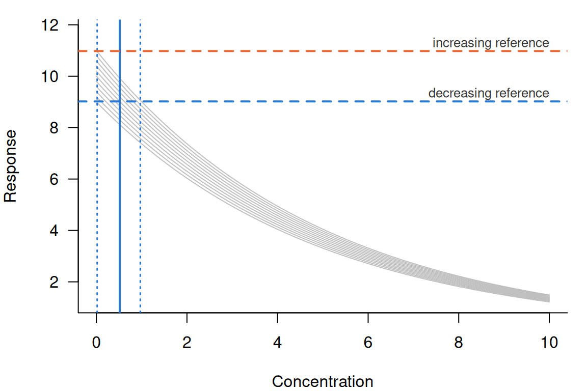
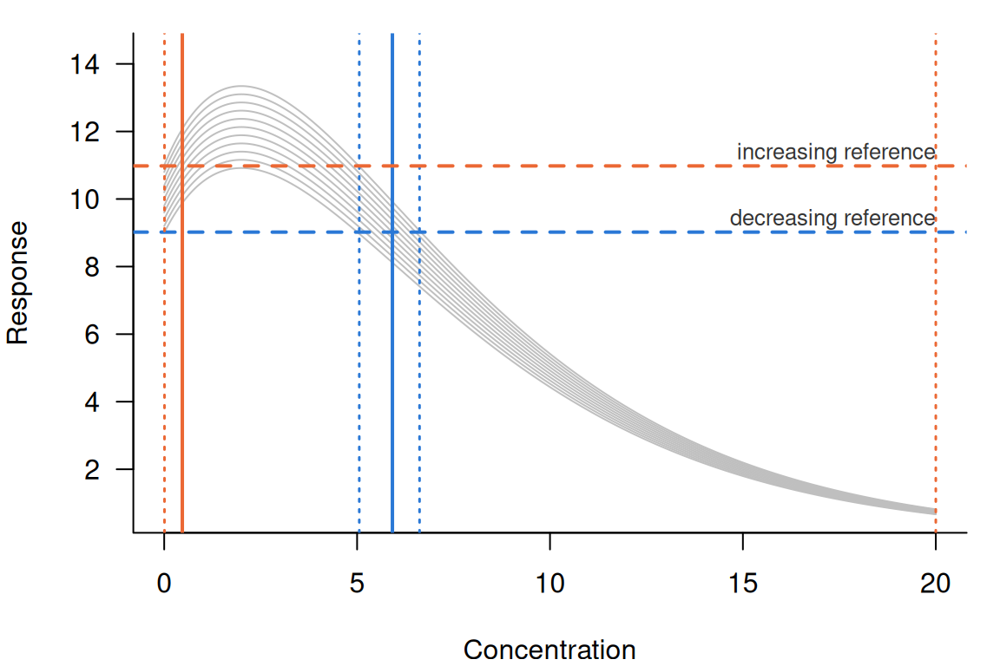
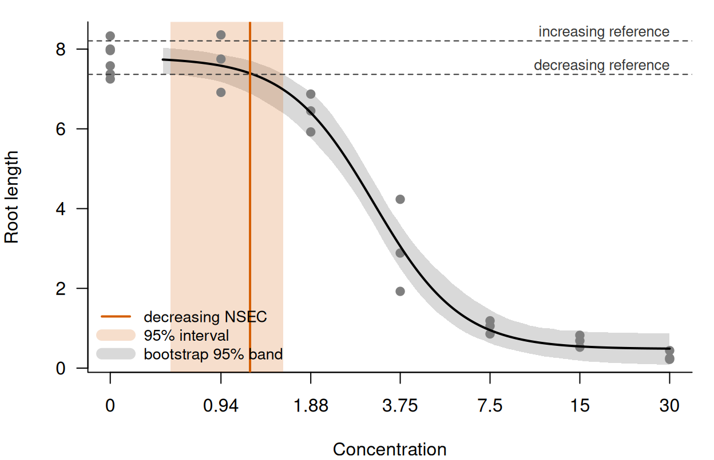

# The NSEC definition

``` r

library(toxval)
has_drc <- requireNamespace("drc", quietly = TRUE)
# the columns read in the text; each result also has `metric`, `sig_val`,
# `type`, `anchor` and `asymptote`
show_nsec <- function(x) {
  x[, c(
    "direction", "estimate", "conf.low", "conf.high",
    "control", "reference", "ecnsec", "ecnsec.low", "ecnsec.high"
  )]
}
```

## Background

A no-effect concentration (NEC) is suited only to a curve with a
threshold, below which the response does not change. For a curve without
one, Fisher and Fox (2023) described the no-significant-effect
concentration (NSEC), the lowest concentration at which the fitted
response differs from the control response by more than the uncertainty
in the control allows.
[`nsec()`](https://open-aims.github.io/toxval/reference/nsec.md)
computes it from realisations of the fitted curve (a posterior draw of a
Bayesian fit, or a parametric bootstrap replicate of a frequentist fit),
each evaluated over a grid of concentrations.
[`toxval_predict()`](https://open-aims.github.io/toxval/reference/toxval_predict.md)
builds that grid and those realisations, and stores them in a
`toxval_pred` object.

For each curve,
[`nsec()`](https://open-aims.github.io/toxval/reference/nsec.md) does
three things.

1.  It sets one reference response for each direction. The decreasing
    reference is the `sig_val` quantile of the control realisations
    (`sig_val` is 0.01 by default), and the increasing reference is the
    `1 - sig_val` quantile. A control realisation is the predicted
    response of a realisation at the control concentration (by default
    the lowest concentration in the data, where the grid starts).
2.  For each realisation, it finds the first concentration at which that
    realisation crosses the reference in each direction, using linear
    interpolation between grid points.
3.  It summarises the crossings by the quantiles in `prob_vals` (by
    default the median and the 2.5 and 97.5 per cent quantiles).

Both directions are sought on each call and returned as one row per
direction, identified by the `direction` column, and a direction in
which no realisation crosses is returned with `NA` estimates.

The reference is a quantile of the control realisations, so it is
defined only across realisations, and all realisations of a curve are
measured against the same reference (under `anchor = "component"`, all
realisations of one component; see [The anchor
argument](#the-anchor-argument)). The ECx reference, by contrast, is
computed for each realisation from its own control (see
[`vignette("ecx-definition", package = "toxval")`](https://open-aims.github.io/toxval/articles/ecx-definition.md)).

The examples below use sets of 101 realisations constructed with
[`new_toxval_pred()`](https://open-aims.github.io/toxval/reference/new_toxval_pred.md)
(not sampled from a fit), with evenly spaced controls, so that each
value returned by
[`nsec()`](https://open-aims.github.io/toxval/reference/nsec.md) can be
computed independently. The helper `build_pred()` evaluates one curve
shape at each control. It sets the control concentration (`x_control`)
to 0, the first grid value, and `family = "beta"` marks a response on
the proportion scale (see
[`?new_toxval_pred`](https://open-aims.github.io/toxval/reference/new_toxval_pred.md)
for the slots it fills).

The helper build_pred()

``` r

build_pred <- function(shape, controls, x_vec, family = "gaussian", ...) {
  curves <- t(vapply(
    controls,
    function(control) shape(control, x_vec),
    numeric(length(x_vec))
  ))
  new_toxval_pred(
    curves = list(curves),
    keys = data.frame(row.names = 1L),
    x_vec = x_vec,
    meta = list(
      source_class = "constructed",
      x_var = "x",
      group_var = NULL,
      multi_var = NULL,
      resolution = length(x_vec),
      x_range = range(x_vec),
      x_control = 0,
      family = family,
      realisation = "draws",
      n_realisation = length(controls),
      seed = NULL,
      ...
    )
  )
}
```

## A decreasing response

A response that falls with concentration (e.g. growth) is the case for
which the NSEC was described (Fisher and Fox 2023). In a constructed set
its NSEC can be found by hand, so each of the three steps above can be
checked.

The first set has controls from 9.00 to 11.00 in steps of 0.02, and each
realisation declines exponentially from its control
($`y = c\,e^{-x/5}`$) over a grid of 500 concentrations from 0 to 10.

``` r

controls <- seq(9, 11, by = 0.02)
decline <- function(control, x) control * exp(-x / 5)
dec_pred <- build_pred(decline, controls, seq(0, 10, length.out = 500))
dec <- nsec(dec_pred)
print(dec, width = Inf)
#> # A tibble: 2 × 14
#> # Model:    constructed
#> # Settings: resolution 500 | 101 posterior draws
#>   metric direction  estimate conf.low conf.high sig_val type     anchor control reference asymptote
#>   <chr>  <chr>         <dbl>    <dbl>     <dbl>   <dbl> <chr>    <chr>    <dbl>     <dbl>     <dbl>
#> 1 nsec   decreasing    0.516   0.0166     0.969    0.01 absolute model       10      9.02        NA
#> 2 nsec   increasing   NA      NA         NA        0.01 absolute model       10     11.0         NA
#>   ecnsec ecnsec.low ecnsec.high
#>    <dbl>      <dbl>       <dbl>
#> 1  0.098    0.00331       0.176
#> 2  0.098    0.00274       0.213
```

[`nsec()`](https://open-aims.github.io/toxval/reference/nsec.md)
computes the references, and summarises the crossings, with R’s default
quantile method (type 7), under which the quantile at probability $`p`$
of 101 values is the value at position $`1 + 100p`$ in sorted order,
interpolated where that position is not a whole number. A row with a
censored realisation is the exception, and is summarised as described
under [Realisations with no crossing](#realisations-with-no-crossing).
The decreasing reference is therefore 9.02 (the 0.01 quantile, the
second-smallest control), and the increasing reference is 10.98 (the
0.99 quantile, the hundredth). A realisation with control $`c`$ crosses
the decreasing reference at $`x = 5 \log(c / 9.02)`$, so the median
realisation, with a control of 10.00, has an NSEC of
$`5 \log(10.00 / 9.02) = 0.516`$, and
[`nsec()`](https://open-aims.github.io/toxval/reference/nsec.md) returns
0.516. The interval of 0.0166 to 0.969 agrees to within one grid step
(0.0200) with the 2.5 and 97.5 per cent quantiles of the 101 crossings
given by this formula, taking 0 for the realisation with control 9.00
(which starts below the decreasing reference, and is placed by the rule
given under [Realisations with no
crossing](#realisations-with-no-crossing)). The increasing row has `NA`
estimates because no realisation rises, although its `reference` and
`ecnsec` still describe the response level that was sought.



Figure 1: Every tenth realisation of the decreasing set, with both
references and the decreasing NSEC and its interval.

The realisations differ only in their control
([Figure 1](#fig-decreasing)), so the spread of the NSEC comes entirely
from the spread of the control. The lowest curve shown (control 9.00)
starts below the decreasing reference, whereas the highest (control
11.00) starts above the increasing reference, and no curve rises towards
it.

## The effect at the NSEC

An NSEC is a concentration, so it does not by itself give the size of
the effect that it detects. `ecnsec` gives that size, so that an NSEC
can be compared with an ECx. It is the effect that the NSEC reference
represents, expressed as a proportion of the span named by `type`. It is
the inverse of the ECx reference under that `type`: an ECx at proportion
$`p`$ sets its reference $`p`$ of the span away from the control, and
`ecnsec` gives the $`p`$ at which that reference would equal the NSEC
reference. Under the default, `type = "absolute"`, both spans of a
response that is not a proportion are the control, so for a realisation
with control $`c`$, decreasing reference $`R_{\text{dec}}`$ and
increasing reference $`R_{\text{inc}}`$

``` math
\text{ecnsec} = \frac{c - R_{\text{dec}}}{c} \ \text{(decreasing)}, \qquad
\text{ecnsec} = \frac{R_{\text{inc}} - c}{c} \ \text{(increasing)}.
```

`ecnsec` is computed for each realisation and summarised by the
quantiles used for the NSEC. For the decreasing set the median
decreasing `ecnsec` is $`1 - 9.02 / 10 = 0.0980`$ (i.e. the decreasing
reference is 9.8 per cent below the median control), and the median
increasing `ecnsec` is $`10.98 / 10 - 1 = 0.0980`$ (the increasing
reference is 9.8 per cent above it). For a proportion the increasing
span is instead the distance from the control to 1, as described under
[An increasing response](#an-increasing-response), and the span for each
`type` and direction is given in
[`vignette("ecx-definition", package = "toxval")`](https://open-aims.github.io/toxval/articles/ecx-definition.md).

We can test the inverse relation by calling
[`ecx()`](https://open-aims.github.io/toxval/reference/ecx.md) at the
median `ecnsec`.

``` r

ecx(dec_pred, proportion = dec$ecnsec[1])
#> # A tibble: 2 × 10
#> # Model:    constructed
#> # Settings: resolution 500 | 101 posterior draws
#>   metric direction  estimate conf.low conf.high proportion type     control reference asymptote
#>   <chr>  <chr>         <dbl>    <dbl>     <dbl>      <dbl> <chr>      <dbl>     <dbl>     <dbl>
#> 1 ecx    decreasing    0.516    0.516     0.516      0.098 absolute      10      9.02        NA
#> 2 ecx    increasing   NA       NA        NA          0.098 absolute      10     11.0         NA
```

The decreasing ECx at proportion 0.0980 is 0.516, the NSEC of the median
realisation. Its interval has zero width because each realisation here
is its control multiplied by $`e^{-x/5}`$, so each falls by a given
proportion of its own control at the same concentration,
$`-5 \log(1 - p)`$.

`type` changes `ecnsec`, but not the NSEC. For example, under
`type = "range"` the decreasing span is the control minus the lowest
response of the realisation over the grid (here $`c\,(1 - e^{-2})`$).

``` r

dec_range <- nsec(dec_pred, type = "range")
show_nsec(dec_range)
#> # A tibble: 2 × 9
#> # Model:    constructed
#> # Settings: resolution 500 | 101 posterior draws
#>   direction  estimate conf.low conf.high control reference ecnsec ecnsec.low ecnsec.high
#>   <chr>         <dbl>    <dbl>     <dbl>   <dbl>     <dbl>  <dbl>      <dbl>       <dbl>
#> 1 decreasing    0.516   0.0166     0.969      10      9.02  0.113    0.00383       0.204
#> 2 increasing   NA      NA         NA          10     11.0  NA       NA            NA
```

The NSEC and its interval are identical to those under `"absolute"`,
whereas the median decreasing `ecnsec` is 0.113
($`0.0980 / (1 - e^{-2})`$). The increasing `ecnsec` is `NA` because a
declining curve has no response above its control, so its increasing
span under `"range"` is zero. `type = "relative"` measures to the
asymptote of the fitted equation, which a constructed `toxval_pred`
supplies only through its `asymptote` slot.

[`nsec()`](https://open-aims.github.io/toxval/reference/nsec.md) refuses
`type = "direct"`.

``` r

nsec(dec_pred, type = "direct")
#> Error in `nsec()`:
#> ! `type` must not be 'direct' for an NSEC; the response value at the NSEC is reported as `reference`.
```

Under `"direct"` the ECx reference is a response value supplied by the
user, with no span, so the `ecnsec` would be the NSEC reference itself
(a single value for all realisations), which is already given in the
`reference` column. However,
[`ecx()`](https://open-aims.github.io/toxval/reference/ecx.md) keeps
`type = "direct"`, under which the supplied value sets the reference and
the ECx varies between realisations.

## An increasing response

The NSEC of a rising response is found as for a falling one, from the
increasing reference (the `1 - sig_val` quantile of the controls). The
example uses a proportion, for which `ecnsec` is measured against the
distance from the control to 1.

The second set is a proportion (e.g. mortality) that rises from its
control towards 1, $`y = 1 - (1 - c)\,e^{-x/5}`$, with controls from
0.050 to 0.150 in steps of 0.001 over the grid of the decreasing set.
`family = "beta"` records that the response is a proportion.

``` r

inc_controls <- seq(0.05, 0.15, by = 0.001)
rise <- function(control, x) 1 - (1 - control) * exp(-x / 5)
inc_pred <- build_pred(
  rise,
  inc_controls,
  seq(0, 10, length.out = 500),
  family = "beta"
)
inc <- nsec(inc_pred)
show_nsec(inc)
#> # A tibble: 2 × 9
#> # Model:    constructed
#> # Settings: resolution 500 | 101 posterior draws
#>   direction  estimate conf.low conf.high control reference ecnsec ecnsec.low ecnsec.high
#>   <chr>         <dbl>    <dbl>     <dbl>   <dbl>     <dbl>  <dbl>      <dbl>       <dbl>
#> 1 decreasing   NA     NA          NA         0.1    0.0510 0.490     0.0285        0.654
#> 2 increasing    0.280  0.00881     0.537     0.1    0.149  0.0544    0.00176       0.102
```

The increasing reference is the 0.99 quantile of the controls (0.149,
the hundredth value). A realisation with control $`c`$ crosses it at
$`x = 5 \log\{(1 - c) / (1 - 0.149)\}`$, which for the median control of
0.100 is 0.280, and
[`nsec()`](https://open-aims.github.io/toxval/reference/nsec.md) returns
0.280 (0.00881 to 0.537), in agreement with the formula to within one
grid step. The decreasing row is `NA`, since no realisation falls.

For a proportion, however, the increasing span under `"absolute"` is
$`1 - c`$ (the distance from the control to the upper bound of the
response), so

``` math
\text{ecnsec} = \frac{R_{\text{inc}} - c}{1 - c},
```

which is the extra risk at the NSEC. Its median is
$`(0.149 - 0.100) / (1 - 0.100) = 0.0544`$.

## A hormetic response

A hormetic response rises above its control at low concentrations and
then falls, so a realisation can cross the increasing reference and then
the decreasing one.
[`nsec()`](https://open-aims.github.io/toxval/reference/nsec.md) returns
an NSEC for each direction, and the example shows how each is read.

The third set uses the controls of the decreasing set with a hormetic
shape, $`y = c\,(1 + x/2)\,e^{-x/4}`$, over a grid of 500 concentrations
from 0 to 20. Each realisation rises to $`2e^{-1/2} = 1.21`$ times its
control at $`x = 2`$ and then declines. Because the controls are
unchanged, the references are those of the decreasing set.

``` r

hormesis <- function(control, x) control * (1 + x / 2) * exp(-x / 4)
horm_pred <- build_pred(hormesis, controls, seq(0, 20, length.out = 500))
horm <- nsec(horm_pred)
#> Warning: Some realisations have no crossing within the evaluated range, so a reported quantile is at the highest concentration, or have no reference and were excluded. Consider a wider `x_range`.
#> * increasing: 3.0% censored
show_nsec(horm)
#> # A tibble: 2 × 9
#> # Model:    constructed
#> # Settings: resolution 500 | 101 posterior draws
#>   direction  estimate conf.low conf.high control reference ecnsec ecnsec.low ecnsec.high
#>   <chr>         <dbl>    <dbl>     <dbl>   <dbl>     <dbl>  <dbl>      <dbl>       <dbl>
#> 1 decreasing    5.92   5.06         6.62      10      9.02  0.098    0.00331       0.176
#> 2 increasing    0.470  0.00741     20         10     11.0   0.098    0.00274       0.213
```

Both rows have estimates. The decreasing NSEC is 5.92 (5.06 to 6.62),
where the declining part of each curve falls through 9.02, and the
increasing NSEC is 0.470 (0.00741 to 20.0), where the rising part passes
10.98. Both agree to within one grid step (0.0401) with crossings found
by [`uniroot()`](https://rdrr.io/r/stats/uniroot.html). The increasing
row has censored realisations, which never reach the reference and are
ranked above every crossing (see [Realisations with no
crossing](#realisations-with-no-crossing)), so its crossings are
compared as order statistics. The `ecnsec` values are those of the
decreasing set, because under `absolute` the effect at the NSEC depends
only on the controls and the references, which are unchanged.



Figure 2: Every tenth realisation of the hormetic set, with both
references and both NSECs and their intervals.

Most curves cross twice ([Figure 2](#fig-hormetic)), with an increasing
crossing before the peak at $`x = 2`$ and a decreasing crossing after
it. The result also has two features that are absent from the monotone
sets.

First, the realisation with control 9.00 starts below the decreasing
reference, but it rises above the reference and then falls through it at
5.01. Because this is a crossing in the direction sought,
[`nsec()`](https://open-aims.github.io/toxval/reference/nsec.md) gives
it that concentration, although its response first rises away from the
effect.

Second, the 3 realisations with the lowest controls peak below the
increasing reference (the highest of them peaks at
$`2e^{-1/2} \times 9.04 = 10.966`$, against 10.98). They never cross
upward, so they are censored. Because they are 3.0 per cent of the
realisations, the upper limit of the increasing NSEC is reported as the
highest concentration (20.0), and the call warns. The warning suggests a
wider `x_range`. However, a wider range would not resolve the censoring,
because these realisations decline beyond $`x = 2`$. The upper limit
would instead be reported at the new highest concentration. It indicates
that more than 2.5 per cent of the realisations show no increase past
the reference anywhere in the tested range.

## Realisations with no crossing

Some realisations do not cross the reference within the grid, because
their control is already past it or because their response changes too
little over the concentrations evaluated. How such realisations are
treated changes the interval, and sometimes the estimate. A realisation
that never crosses the reference in the direction sought, within the
grid, has no NSEC of its own, and
[`nsec()`](https://open-aims.github.io/toxval/reference/nsec.md) treats
it in one of four ways.

- A realisation whose control is already at or beyond the reference, in
  the direction sought, is given `x_control` (the control concentration,
  by default the lowest concentration in the data the model was fitted
  to).
- The exception is such a realisation that shows no effect in the tested
  range, and it is censored (see the next point). Its response first
  changes away from the effect as concentration rises from the control
  (i.e. it rises, for a decreasing NSEC, or falls, for an increasing
  one). It then passes to the no-effect side of the reference (above it
  for a decreasing NSEC and below it for an increasing one), and does
  not return. Changes smaller than `1e-8` times the largest absolute
  response of the realisation are ignored in finding the first change,
  so a curve that is flat at the control is judged by the direction of
  its first larger change.
- A realisation that does not reach the reference within the grid is
  given `Inf`, which ranks it above all crossings. A quantile that falls
  among such realisations is reported as the highest concentration, and
  the call warns with the fraction of realisations that are censored.
- A realisation with no finite control (e.g. a bootstrap replicate
  outside the parameter space of the model) is excluded from the summary
  and counted in the warning.

Censoring follows from what a missing crossing means. A realisation that
has not reached the reference by the highest concentration would reach
it, if at all, at a higher one, so it belongs in the upper tail.
Dropping it would give a quantile of only the realisations that crossed,
which is lower than that quantile of all of them. A realisation that
starts past the reference and then passes to the no-effect side is past
it only because its own control is in the tail of the control
realisations. Within the tested range it never departs from the control
towards the effect, so it is censored in the same way.

Because a censored realisation has a rank but no value, a row that
contains one is summarised by observed order statistics
([`quantile()`](https://rdrr.io/r/stats/quantile.html) type 1) rather
than by type 7. Type 7 interpolates between adjacent sorted values, and
an interpolation between the last crossing and a censored realisation
has no finite value, so under type 7 a quantile only partly among the
censored realisations would be reported as the highest concentration.
Under type 1, the quantile at probability $`p`$ of $`n`$ values is the
value at position $`\lceil np \rceil`$ in sorted order. Types 1 and 7
agree where the type 7 position, $`1 + (n - 1)p`$, is a whole number
(e.g. for the median of 101 values). Elsewhere the switch changes the
quantile, including one well below the censored realisations, by at most
the gap between the adjacent sorted values that type 7 interpolates
between.

### Controls past the reference

By construction of the reference, about a fraction `sig_val` of the
realisations have a control at or beyond it. For example, the decreasing
set has one, whose control of 9.00 is below the reference of 9.02. Its
response falls (towards the effect), so it is placed at `x_control`.
With `sig_val = 0.05`, more than 2.5 per cent of the realisations are
placed there, so they set the lower limit of the interval.

``` r

dec_05 <- nsec(dec_pred, sig_val = 0.05)
show_nsec(dec_05)
#> # A tibble: 2 × 9
#> # Model:    constructed
#> # Settings: resolution 500 | 101 posterior draws
#>   direction  estimate conf.low conf.high control reference ecnsec ecnsec.low ecnsec.high
#>   <chr>         <dbl>    <dbl>     <dbl>   <dbl>     <dbl>  <dbl>      <dbl>       <dbl>
#> 1 decreasing    0.472        0     0.925      10       9.1 0.0900   -0.00553       0.169
#> 2 increasing   NA           NA    NA          10      10.9 0.0900   -0.00457       0.204
```

The decreasing reference is now 9.10 (the sixth control), and the 5
realisations with lower controls are below it from the start. They
decline, as do all realisations of this set, so they are placed at
`x_control`, and the lower limit is 0. Fisher and Fox (2023, p. 2026)
describe the same result: where the significance level is higher than
the lower probability of the interval (typically 0.025), the lower limit
of the NSEC is zero (e.g. at levels of 0.05, 0.10 and 0.20 in their
Table 3). Where they give zero,
[`nsec()`](https://open-aims.github.io/toxval/reference/nsec.md) gives
`x_control`, which is 0 for these realisations.

Those realisations would instead be censored if they showed no effect.
To show this, the next set keeps the controls and the declining curves
of the decreasing set, except that the 5 realisations with controls
below 9.10 rise slowly ($`y = c\,e^{x/100}`$).

``` r

rise_slowly <- function(control, x) control * exp(x / 100)
mixed_shape <- function(control, x) {
  if (control < controls[6]) rise_slowly(control, x) else decline(control, x)
}
mixed_pred <- build_pred(mixed_shape, controls, seq(0, 10, length.out = 500))
mixed <- nsec(mixed_pred, sig_val = 0.05, draws = TRUE)
#> Warning: Some realisations have no crossing within the evaluated range, so a reported quantile is at the highest concentration, or have no reference and were excluded. Consider a wider `x_range`.
#> * decreasing: 5.0% censored
show_nsec(mixed)
#> # A tibble: 2 × 9
#> # Model:    constructed
#> # Settings: resolution 500 | 101 posterior draws
#>   direction  estimate conf.low conf.high control reference ecnsec ecnsec.low ecnsec.high
#>   <chr>         <dbl>    <dbl>     <dbl>   <dbl>     <dbl>  <dbl>      <dbl>       <dbl>
#> 1 decreasing    0.521   0.0219        10      10       9.1 0.0900   -0.00553       0.169
#> 2 increasing   NA      NA             NA      10      10.9 0.0900   -0.00457       0.204
head(mixed$draws[[1]], 7)
#> # A tibble: 7 × 3
#>   .draw value.draw ecnsec.draw
#>   <int>      <dbl>       <dbl>
#> 1     1   Inf         -0.0111 
#> 2     2   Inf         -0.00887
#> 3     3   Inf         -0.00664
#> 4     4   Inf         -0.00442
#> 5     5   Inf         -0.00220
#> 6     6     0          0      
#> 7     7     0.0110     0.00219
```

The reference is still 9.10, since the controls are unchanged. Each of
the 5 rising realisations passes above it by $`x = 1.10`$ and stays
above it to the end of the grid. Because its response first changes away
from a decreasing effect and then remains on the no-effect side, it
shows no effect in the tested range, so
[`nsec()`](https://open-aims.github.io/toxval/reference/nsec.md) censors
it (`Inf` in the `draws` column). Ranked above all crossings, the
censored realisations raise the lower limit from 0 to 0.0219 and the
median from 0.472 to 0.521. They are 5.0 per cent of the realisations,
so the 97.5 per cent quantile falls among them and is reported as the
highest concentration (10.0), and the call warns. A wider range would
not remove the censoring, since the response of these realisations rises
further above the reference as concentration increases. Each value
agrees to within one grid step with the order statistics of the
crossings $`5 \log(c / 9.10)`$ of the declining realisations, with the
rising ones ranked above them.

### Crossings beyond the grid

A realisation that has not reached the reference by the highest
concentration is censored, so the upper limit of the interval can be no
higher than the end of the grid. The decreasing set was also evaluated
over a shorter grid, from 0 to 0.9, in which the realisations with the
highest controls decline too little to reach the reference, so they are
censored. For a fitted model the range is set with `x_range`, whereas
for a constructed `toxval_pred` it is the grid supplied, and
[`nsec()`](https://open-aims.github.io/toxval/reference/nsec.md) refuses
`x_range`.

``` r

short_pred <- build_pred(decline, controls, seq(0, 0.9, length.out = 500))
short <- nsec(short_pred, draws = TRUE)
#> Warning: Some realisations have no crossing within the evaluated range, so a reported quantile is at the highest concentration, or have no reference and were excluded. Consider a wider `x_range`.
#> * decreasing: 10.9% censored
show_nsec(short)
#> # A tibble: 2 × 9
#> # Model:    constructed
#> # Settings: resolution 500 | 101 posterior draws
#>   direction  estimate conf.low conf.high control reference ecnsec ecnsec.low ecnsec.high
#>   <chr>         <dbl>    <dbl>     <dbl>   <dbl>     <dbl>  <dbl>      <dbl>       <dbl>
#> 1 decreasing    0.516   0.0111       0.9      10      9.02  0.098    0.00331       0.176
#> 2 increasing   NA      NA           NA        10     11.0   0.098    0.00274       0.213
tail(short$draws[[1]], 3)
#> # A tibble: 3 × 3
#>   .draw value.draw ecnsec.draw
#>   <int>      <dbl>       <dbl>
#> 1    99        Inf       0.177
#> 2   100        Inf       0.179
#> 3   101        Inf       0.18
```

11 of the 101 realisations (those with controls from 10.80 to 11.00)
would reach the reference beyond 0.900. They are `Inf` in the `draws`
column and make up 10.9 per cent of the realisations. Because the 97.5
per cent quantile has 2.5 per cent of the realisations above it, it
falls among the censored ones and is reported as 0.900 (the highest
concentration), and the call warns. The median, 0.516, is that of the
full grid. The lower limit is 0.0111, against 0.0166 on the full grid,
although the realisations that set it crossed within both ranges. This
is because the row now has censored realisations, so its lower limit is
the third crossing, whereas the full grid takes the value halfway
between the third and the fourth.

The upper limit should then be read as “at least 0.900”, since the
tested range did not extend far enough to bound it. Where the censored
realisations are fewer than 2.5 per cent, the upper limit is below all
of them, and there is no warning.

``` r

few_pred <- build_pred(decline, controls, seq(0, 0.98, length.out = 500))
few <- nsec(few_pred, draws = TRUE)
show_nsec(few)
#> # A tibble: 2 × 9
#> # Model:    constructed
#> # Settings: resolution 500 | 101 posterior draws
#>   direction  estimate conf.low conf.high control reference ecnsec ecnsec.low ecnsec.high
#>   <chr>         <dbl>    <dbl>     <dbl>   <dbl>     <dbl>  <dbl>      <dbl>       <dbl>
#> 1 decreasing    0.516   0.0111     0.974      10      9.02  0.098    0.00331       0.176
#> 2 increasing   NA      NA         NA          10     11.0   0.098    0.00274       0.213
```

On a grid to 0.980, 2 realisations are censored. They are above the 97.5
per cent quantile, so the upper limit is a crossing (0.974, the 99th),
and there is no warning. The full grid gives 0.969, halfway between the
98th and the 99th crossings, because that row has no censored
realisation.

## The anchor argument

`anchor` names where the reference comes from when the realisations come
from a model average. A model average combines several fitted equations
by weight (Fisher et al. 2024), and each of its realisations is drawn
from one of those equations (its component). `anchor` is also returned
as a column of the result.

`anchor = "model"` takes the reference from all the control realisations
of the curve, pooled across components (as in the examples above), so
that all realisations are measured against one response level, which can
be drawn on a plot as in [Figure 1](#fig-decreasing).

`anchor = "component"` measures the realisations of each component
against the `sig_val` quantile of that component’s own control
realisations. This is the strict Bayesian model average, and the
reference that
[`bayesnec::nsec()`](https://open-aims.github.io/bayesnec/reference/nsec.html)
uses for a model set. It is therefore the default for a `bayesmanecfit`,
whereas `"model"` is the default otherwise. For a `bayesmanecfit`, each
component’s quantile is taken over all draws of its own fit, not only
the draws kept in the average. For a fit that is not a model average
there is one component, so `"model"` and `"component"` give identical
values.

``` r

dec_component <- nsec(dec_pred, anchor = "component")
dec_component[, c("direction", "estimate", "conf.low", "conf.high", "anchor")]
#> # A tibble: 2 × 5
#> # Model:    constructed
#> # Settings: resolution 500 | 101 posterior draws
#>   direction  estimate conf.low conf.high anchor   
#>   <chr>         <dbl>    <dbl>     <dbl> <chr>    
#> 1 decreasing    0.516   0.0166     0.969 component
#> 2 increasing   NA      NA         NA     component
```

A model average is recognised from `meta$draw_model`, which names the
component of each realisation. In the constructed set below, the
realisations of the decreasing set with controls up to the median are
assigned to an equation `a`, and the rest to an equation `b`.

``` r

draw_model <- ifelse(controls <= median(controls), "a", "b")
avg_pred <- build_pred(
  decline,
  controls,
  seq(0, 10, length.out = 500),
  model_weights = c(table(draw_model)) / length(draw_model),
  draw_model = draw_model
)
avg_component <- nsec(avg_pred, anchor = "component")
avg_component[, c("direction", "estimate", "conf.low", "conf.high", "anchor")]
#> # A tibble: 2 × 5
#> # Model:    constructed
#> # Settings: resolution 500 | 101 posterior draws
#>   direction  estimate conf.low conf.high anchor   
#>   <chr>         <dbl>    <dbl>     <dbl> <chr>    
#> 1 decreasing    0.248  0.00532     0.496 component
#> 2 increasing   NA     NA          NA     component
```

Under `"model"` all realisations are measured against 9.02, whereas
under `"component"` the 51 realisations of `a` (controls from 9.00 to
10.00) are measured against 9.01, and the 50 realisations of `b`
(controls from 10.02 to 11.00) against 10.03. Each of these references
is the 0.01 quantile of that equation’s own controls. Applying
[`nsec()`](https://open-aims.github.io/toxval/reference/nsec.md) to the
realisations of each equation separately, and summarising their
crossings together, gives the NSEC returned under
`anchor = "component"`.

``` r

component_nsec <- lapply(split(seq_along(controls), draw_model), function(rows) {
  one_equation <- build_pred(decline, controls[rows], seq(0, 10, length.out = 500))
  nsec(one_equation, draws = TRUE)$draws[[1]]$value.draw
})
model_nsec <- nsec(avg_pred, draws = TRUE)
rbind(
  model = unlist(model_nsec[1, c("estimate", "conf.low", "conf.high")]),
  component = quantile(unlist(component_nsec), probs, names = FALSE)
)
#>            estimate    conf.low conf.high
#> model     0.5157116 0.016605902 0.9694809
#> component 0.2480939 0.005322111 0.4961901
```

Under `"component"` the NSEC is 0.248 (0.00532 to 0.496), against 0.516
(0.0166 to 0.969) under `"model"`, so in this example the interval is
narrower. The NSEC of each realisation decreases when its equation’s own
reference is above the pooled one, and increases when it is below, so
the direction in which the width changes depends on which realisations
set the limits under `"model"`. Here the realisations of `b` set the
upper limit, because they are measured against a reference well below
their controls. Under `"component"` they are measured against 10.03, so
their NSECs decrease, and the upper limit decreases with them. Where an
equation whose reference is above the pooled one has the lowest NSECs
instead, its NSECs decrease further and the interval widens.

`anchor = "control"` (a reference taken from a model fitted to the
control observations alone) was proposed but is not implemented, and
[`nsec()`](https://open-aims.github.io/toxval/reference/nsec.md) refuses
it.

``` r

nsec(dec_pred, anchor = "control")
#> Error in `chk_anchor()`:
#> ! `anchor` must match 'component' or 'model', not 'control'.
```

## A fitted model

The examples above are constructed so that each answer is known exactly.
For a fitted model the calculation is unchanged, and only the source of
the realisations differs. Here we use
[`drc::drm()`](https://rdrr.io/pkg/drc/man/drm.html) to fit the
four-parameter log-logistic equation
[`LL.4()`](https://rdrr.io/pkg/drc/man/LL.4.html) to the root lengths of
ryegrass exposed to ferulic acid
([`drc::ryegrass`](https://rdrr.io/pkg/drc/man/ryegrass.html)).
[`toxval_predict()`](https://open-aims.github.io/toxval/reference/toxval_predict.md)
then draws parametric bootstrap replicates of the curve (1000 by
default, set by `n_boot`), and
[`nsec()`](https://open-aims.github.io/toxval/reference/nsec.md) is
called on the result.

``` r

fit <- drc::drm(rootl ~ conc, data = drc::ryegrass, fct = drc::LL.4())
rye_pred <- toxval_predict(fit, seed = 42)
rye <- nsec(rye_pred)
show_nsec(rye)
#> # A tibble: 2 × 9
#> # Model:    drc
#> # Settings: resolution 500 | 1000 bootstrap realisations
#>   direction  estimate conf.low conf.high control reference ecnsec ecnsec.low ecnsec.high
#>   <chr>         <dbl>    <dbl>     <dbl>   <dbl>     <dbl>  <dbl>      <dbl>       <dbl>
#> 1 decreasing     1.18    0.637      1.52    7.80      7.37 0.0553    0.00884      0.0953
#> 2 increasing    NA      NA         NA       7.80      8.21 0.0524    0.00786      0.104
```

The decreasing reference is 7.37, the 0.01 quantile of the 1000
bootstrap controls, whose median is 7.80. The NSEC is 1.18 (0.637 to
1.52), and the reference is 5.5 per cent below the control at the
median. `nsec(fit, seed = 42)` gives an identical result in one call. No
replicate crosses the increasing reference, so the increasing row is
`NA`.



Figure 3: The [`LL.4()`](https://rdrr.io/pkg/drc/man/LL.4.html) fit to
[`drc::ryegrass`](https://rdrr.io/pkg/drc/man/ryegrass.html): root
lengths (grey points), the curve at the parameter estimates (black line)
and the 95 per cent band of the bootstrap replicates (grey band), on a
log concentration axis with the controls drawn at the tick labelled 0.
Dashed lines are the two references; the vermillion line and band are
the decreasing NSEC and its 95 per cent interval, from `nsec(rye_pred)`
and identically from `nsec(fit, seed = 42)`. The increasing NSEC is `NA`
and is not drawn.

The NSEC is between the lowest two concentrations tested (0.94 and
1.88), and the lower limit of its interval is below 0.94
([Figure 3](#fig-ryegrass-nsec)). Because the NSEC is located on the
bootstrap curves, not at a tested concentration, it can fall between or
below the concentrations tested. The increasing reference is above the
band of replicates at all concentrations drawn.

## References

Fisher R, Fox DR (2023). Introducing the no-significant-effect
concentration. *Environmental Toxicology and Chemistry* 42(9):2019-2028.
<https://doi.org/10.1002/etc.5610>

Fisher R, Fox DR, Negri AP, van Dam J, Flores F, Koppel D (2024).
Methods for estimating no-effect toxicity concentrations in
ecotoxicology. *Integrated Environmental Assessment and Management*
20(1):279-293. <https://doi.org/10.1002/ieam.4809>

## Provenance

The realisations in all examples except the last are constructed, with
no random element. In the `drc` example the bootstrap replicates were
drawn with `seed = 42` (passed to
[`toxval_predict()`](https://open-aims.github.io/toxval/reference/toxval_predict.md)),
from a fit to
[`drc::ryegrass`](https://rdrr.io/pkg/drc/man/ryegrass.html) as
distributed with `drc`. Each grid has 500 points (the default
`resolution`), and each hand-computed NSEC is checked against
[`nsec()`](https://open-aims.github.io/toxval/reference/nsec.md) to
within one grid step.

    #>       R  toxval     drc
    #> "4.6.2" "2.0.0" "4.0.0"
